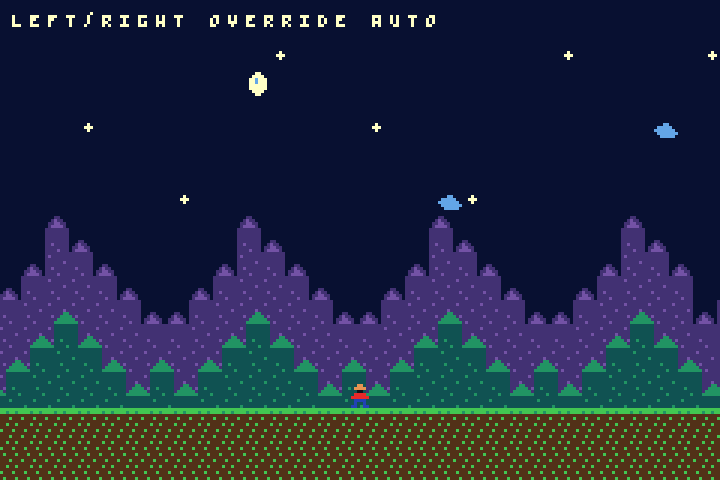

# Mtile

**Make Game Boy Advance games in Lua.**

Write your game, draw its sprites and maps, compose hardware sound, and build
an actual `.gba` cartridge—all from one desktop editor.

[Get started](#quick-start) · [Documentation](docs/README.md) · [Examples](examples/README.md) · [Contribute](CONTRIBUTING.md)

**New to game development?** [Make your first game with Coin Quest](docs/first-game.md):
a playable starter with sprites, sound, and four guided lessons.



*An actual ROM built from [background-layers](examples/background-layers).
[Still image](docs/media/background-layers.png) · [Capture details](docs/media/README.md)*

## Why Mtile?

- **Lua to native code.** A small, PICO-8-inspired Lua dialect compiles through
  Go and TinyGo. Your cartridge does not run a Lua interpreter.
- **A complete editing loop.** Sprite, map, audio, and code workspaces share
  one project, with build diagnostics and a playable mGBA preview.
- **Real GBA graphics and sound.** A 240×160 display, indexed sprites, layered
  maps, and the four Game Boy hardware sound channels available on the GBA.
- **Inspectable output.** Keep the generated Go, inspect memory and cycle
  budgets, and run the resulting ROM in an emulator or on GBA hardware.

```text
game.lua + assets → generated Go → TinyGo → game.gba
```

**Status: early development.** APIs and asset formats can change. Games target
about 30 updates per second; actual performance depends on the workload.
Mode 4 provides software rendering, while Mode 0 uses hardware tiles and
sprites for supported projects. `auto` selects Mode 0 only when its compatibility
and cost checks pass. See [renderer support](docs/render-modes.md) and
[measured limits](docs/performance.md). Physical-GBA audio validation is
[still pending](docs/audio/hardware-signoff.md).

## Quick start

The source workflow requires **Go 1.27.1+** and **TinyGo 0.42.0**. The editor also
needs **CMake**, a **C compiler**, and platform graphics/audio dependencies.
Follow [installation](docs/getting-started.md#requirements) for your system.

```sh
git clone --recurse-submodules https://github.com/drpaneas/mtile.git
cd mtile
go run ./cmd/mtile doctor
go run ./cmd/mtile new mygame
go run ./cmd/mtile build mygame
```

Your first ROM is `mygame/game.gba`. Open the project in the editor:

```sh
go run ./cmd/mtile edit mygame
```

Choose **Develop**, edit `game.lua`, and press **Build + Reload**. Click the
GBA preview to play: arrow keys move, Z/X are A/B, and Escape returns focus to
code. The first source-checkout preview builds the bundled emulator helper.

Prefer an existing project? Try `go run ./cmd/mtile edit examples/hello`.
For a guided game, use `go run ./cmd/mtile new -template coin-quest mygame`
instead of the blank-project command above; choose an unused directory name.
The [getting-started guide](docs/getting-started.md) also covers installed
bundles, command-line builds, and troubleshooting.

## A small game fits in a small file

Replace the generated `game.lua` with this complete example. Move the circle
with the left and right arrow keys:

```lua
x = 120

function _update()
  if btn(0) then x -= 2 end
  if btn(1) then x += 2 end
  x = mid(4, x, 235)
end

function _draw()
  cls(0)
  circfill(x, 80, 4, 7)
  print("hello, gba", 8, 8, 7)
end
```

Mtile uses 16:16 fixed-point numbers and statically bound calls. It supports
a deliberate subset of Lua; it is not a drop-in Lua 5.x or PICO-8 cartridge
runner. Read the [language reference](docs/reference.md#lua-dialect) before
porting a larger game.

## Explore the examples

| Start with | What you will learn |
| --- | --- |
| [Hello](examples/hello) | Input, sprites, and a mapped background |
| [Multiple files](examples/multi-file) | Organizing a game with `require()` |
| [Background layers](examples/background-layers) | Four map planes and parallax |
| [Coin block](examples/coin-block) | Animation and changing a map cell |
| [Hardware melody](examples/audio-gb-melody) | Four-channel sound and music |

The [example index](examples/README.md) separates learning projects from
benchmarks and research projects.

## Documentation and contributions

The [static guide website](website/README.md) brings the tutorials and API
reference together with category browsing and search. Build it locally or host
the generated files on any static host.

- [Getting started](docs/getting-started.md): installation, first ROM, and editor preview.
- [IDE guide](docs/ide.md): sprite, map, audio, and code controls.
- [Reference](docs/reference.md): commands, project structure, input, and Lua builtins.
- [Audio guide](docs/audio/README.md): hardware sounds and music.
- [Performance](docs/performance.md): frame budgets, memory limits, and benchmark evidence.
- [Contributing](CONTRIBUTING.md): repository map, checks, and focused ways to help.

Bug reports with a small reproducer, clearer examples, documentation fixes,
and measured runtime improvements are welcome. For help, see
[Support](SUPPORT.md). Please follow the [Code of Conduct](CODE_OF_CONDUCT.md).
If Mtile is useful to you, a star helps other game developers discover it.

## Credits and license

Mtile is [MIT licensed](LICENSE). Its API is inspired by
[PIGO8](https://drpaneas.com/pigo8/) and PICO-8. The default palette is
[DawnBringer's Aurora](https://lospec.com/palette-list/aurora).
[TinyGo](docs/third-party/tinygo.md) compiles the cartridge, and
[mGBA](docs/third-party/mgba.md) powers the preview. Bundled components retain
their own licenses; see [third-party notices](docs/third-party/README.md).

Mtile is an independent homebrew project, unaffiliated with Nintendo.
