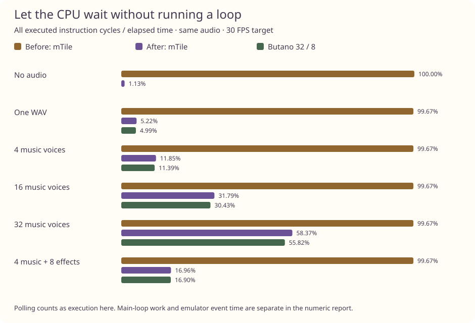
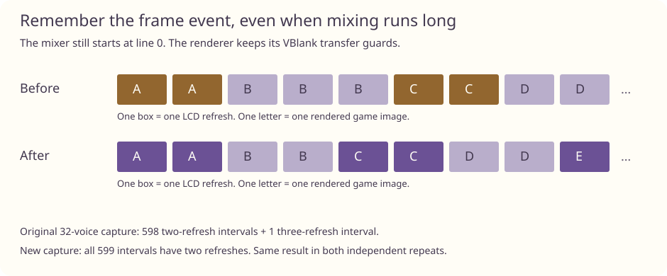
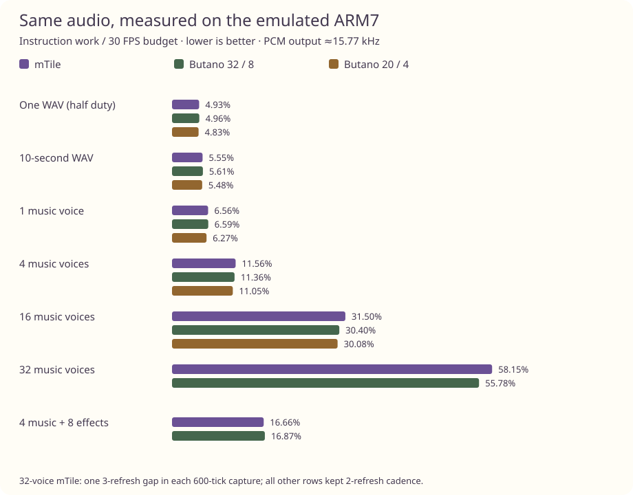
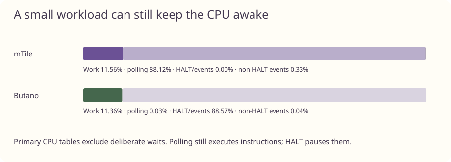
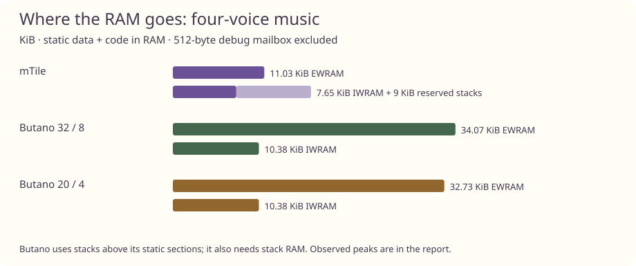

# What imported audio costs

**mTile now remembers LCD frame events and uses HALT while waiting.**
The measured 32-voice pacing fault is fixed, including the moving-sprite
PCM/PSG fixtures in both renderers. Playback still has zero Lua allocations
and collections in these audio-only programs.

## PCM Editor and batch-import recheck

The [current 25-configuration audit](../benchmarks/pcm-batch-audit-2026-11-02/README.md)
also measures files prepared by the new PCM batch wizard. Paired mTile and
Butano banks match byte for byte. Current non-wait instruction work is
28,506 versus 27,858 cycles/update for a short WAV, 65,746 versus 63,830 for
four music voices, and 327,087 versus 313,344 for 32 voices: about 2.3%,
3.0% and 4.4% more work respectively. All 25 configurations keep two-refresh
cadence in both 600-update captures, with zero Lua heap/GC in these fixtures.
Desktop preparation adds no runtime analyzer or growing playback buffer.
The audit also documents two corrected editor state/lifecycle bugs.

## Latest: stop polling, keep the frames steady

The old engine kept checking whether enough time had passed. The new engine
can sleep until a display event wakes it. It also remembers that a new
display frame began, even if mixing kept the CPU busy for that whole
visible interval. Your existing Lua music/effect calls need no rewrite.

| Workload | Old mTile instruction execution | New mTile | Butano, matched |
| --- | ---: | ---: | ---: |
| No audio | 100.00% | 1.13% | — |
| One short WAV | 99.67% | 5.22% | 4.99% |
| Music, 4 voices | 99.67% | 11.85% | 11.39% |
| Music, 16 voices | 99.67% | 31.79% | 30.43% |
| Music, 32 voices | 99.67% | 58.37% | 55.82% |
| Music, 4 voices + 8 effects | 99.67% | 16.96% | 16.90% |

These percentages include polling instructions, so they show the waiting
improvement directly. They are not battery measurements. The CPU's mixer
work remains: four voices require 65,672 non-wait instruction cycles per
update, versus 63,830 in matched Butano. New clock/wakeup bookkeeping adds
740 cycles relative to the old mTile fixture, about 0.13 percentage points
of a complete 30 FPS budget. It trades a small amount of bookkeeping for
removing almost all instruction execution during intentional waits.



Every measured 32-voice interval is now two LCD refreshes in both
independent 600-update captures. The moving-sprite tests also compare exact
Mode 0/4 pixels, exercise PSG alongside 32 PCM voices, and verify IRQ-state
preservation. The player still starts mixing at line 0; the renderer keeps
its safe VRAM-transfer windows. The clock adds 24 bytes of static IWRAM;
its fixed buffers, Lua heap behavior and stack reservation are unchanged.



The preview's pinned mGBA also needed its pending-interrupt HALT behavior
corrected. Both engines were remeasured with that same core. Read the
[19-configuration follow-up and verification](../benchmarks/audio-pacing-2026-11-02/README.md)
for the hardware contract, exact tradeoffs and remaining workload limits.

## Original measurements and the choices behind them

The sections below retain the **31 original ROM/configuration combinations**, taken on
2026-11-02 with the repository's pinned mGBA core. They describe simple
audio-only programs, not every song or a complete game's performance.
The [full report and reproducible harness](../benchmarks/imported-audio-performance-2026-11-02/README.md)
retain input hashes, instruction traces, memory sections and raw captures.

## First, picture a tiny sound kitchen

A WAV is a recording. A tracker song is a score with small recordings for
its instruments. To play several sounds at once, the CPU repeatedly combines
their next few samples into one output. Each playing sound is a **voice**.
Four instruments at once mean four voices, even if they belong to one song.

Think of a cook preparing small trays. The recipe book stays on the shelf;
the cook needs space for the current tray, not a table as long as the book.
Here the shelf is cartridge ROM, the working table is RAM, and the cook is
the CPU. A longer recording mainly makes the cartridge larger. More voices
make the cook do more work for every tray.

```text
CARTRIDGE ROM                  CPU + SMALL FIXED RAM           SOUND HARDWARE
song + instruments ──┐
                     ├───────→ combine the next samples ─────→ play the tray
WAV recording ───────┘                  ↑                          │
                                       └──── repeat ─────────────┘

Longer file → more ROM.     More simultaneous voices → more CPU.
```

Both engines used the **same converted soundbank, byte for byte**, the
Maxmod mixer at approximately 15,768 output samples per second, and game
updates every second LCD refresh: approximately 29.86 FPS, normally called
30 FPS. Audio needs servicing every LCD refresh, even when the game updates
at 30 FPS. Reducing game updates does not halve the audio work.

## CPU: how much of the game budget does the work use?

This table retains the original pre-fix work measurements. Current pacing
and instruction-execution figures are in the latest section above.

A 30 FPS update has **561,792 GBA clock cycles**. The table counts cycles
spent executing instructions for the application, engine and interrupts,
including memory wait states, with deliberate waiting removed. This measures
software work. Emulator event advancement, including DMA stalls, is recorded
separately in the raw results; it is not silently assigned to a CPU function.

| Audio-only workload | mTile | Butano defaults | Butano matched capacity |
| --- | ---: | ---: | ---: |
| No PCM player linked | 0.73% | 1.21% | — |
| PCM player linked, silent | 4.32% | 4.18% | 4.31% |
| One short WAV, playing about half the time | 4.93% | 4.83% | 4.96% |
| One 10-second WAV, almost continuous | 5.55% | 5.48% | 5.61% |
| Music, 1 sustained voice | 6.56% | 6.27% | 6.59% |
| Music, 4 sustained voices | 11.56% | 11.05% | 11.36% |
| Music, 16 sustained voices | 31.50% | 30.08% | 30.40% |
| Music, 32 sustained voices | 58.15% † | — | 55.78% |
| Music, 4 voices + bursts of 4 WAV effects | 14.11% | 13.79% | 14.11% |
| Music, 4 voices + bursts of 8 WAV effects | 16.66% | — | 16.87% |

† One interval took three LCD refreshes instead of two in each 600-update
capture. This is a timing failure despite average work being below 100%.



Butano's defaults reserve **20 total mixer slots and 4 effect slots**.
mTile reserves **32 total mixer slots and 8 effect slots**. The matched
Butano build uses 32 total slots and 8 effect slots. These are capacities,
not the number of voices actually playing. We inspect the mixer state to
verify the active voice count. The 32-voice stress case fills all slots;
it has no spare voices for effects.

For four music voices, mTile used **64,932 instruction cycles** per game
update versus **63,830** for the matched Butano build: about **1.7% more
software work**, or **0.20 percentage points** of the complete game budget.
The small differences in the WAV and eight-effect rows are too small and
too dependent on scheduling phase to establish a general winner. These
synthetic songs also avoid many expensive tracker effects.

The figures include each program's debug publication. mTile publishes
more telemetry than this minimal Butano fixture. They are not claims about
uninstrumented release-ROM performance. The full report also provides the
no-audio floor and event-inclusive measurements.

## What the original waiting loop did

After finishing the work, both programs wait for the correct display time.
In the original build, **mTile polled a timer and display counter**, while
Butano usually used the GBA's HALT mechanism during that wait. The new
event waits above replace this original polling behavior.



Consequently, the original mTile build executes instructions during almost the entire interval,
even though about 11.56% is non-wait software work in the four-voice example.
Butano spends most remaining time HALTed. The primary table measures how
much useful work must fit into the game budget; it does **not** mean that
mTile sleeps for the remaining 88%, or that the engines have equal energy
use. We did not measure battery life or electrical power.

The existing `stat(1)` and `stat(2)` counters omit audio work that interrupts
these waits. In the four-voice fixture the game work counter can report
only hundreds of cycles while the independent profiler sees tens of
thousands. Use actual update cadence and an interrupt-inclusive profiler
when judging imported audio. A Go cartridge can also inspect
`Context.AudioStats().PCM.MaxMixCycles` for the worst single mixer service.

## Memory: the file is not copied into a giant playback heap

The GBA has two separate work RAM banks. EWRAM is the larger, slower bank;
IWRAM is smaller and faster. Free space in one cannot automatically replace
space needed in the other. The player keeps samples in cartridge ROM and
uses fixed working buffers.

| Four-voice audio-only build | EWRAM static | IWRAM static | Explicit stack reservation | ROM |
| --- | ---: | ---: | ---: | ---: |
| mTile, normal Mode 0 | 11,292 B | 7,836 B | 9,216 B | 56,292 B |
| Butano, defaults | 33,512 B | 10,624 B | See below | 72,680 B |
| Butano, matched capacity | 34,888 B | 10,624 B | See below | 72,768 B |

The common **512-byte debug mailbox** is additional. Butano also needs
stacks above its static sections: its zero in the machine-readable
"explicit stack reservation" column means there is no corresponding ELF
section, not that C++ needs no stack. In this fixture we observed about
4,040 B of mTile user-stack depth and 196 B of IRQ-stack depth. Butano used
312 B, 36 B and 16 B on its user, IRQ and supervisor stacks. These are
observed running peaks after warmup, not worst-case guarantees for a game.



Compared with its own no-audio build, linking mTile's PCM path added
**3,784 B EWRAM and 7,416 B IWRAM** in this fixture. That IWRAM figure
includes executable mixer/player code placed in fast RAM, as well as data.
The matched Butano build added 4,196 B EWRAM and 6,676 B IWRAM relative
to the shared null-backend floor. Whole-engine defaults explain much of
the difference between the total EWRAM columns; they are not all audio data.

The main fixed PCM buffers in mTile are:

| Storage | Size | Location |
| --- | ---: | --- |
| 32 module + active + mixer records | 2,688 B | EWRAM |
| Output/DMA buffer | 1,056 B | EWRAM |
| Mixing accumulator | 1,056 B | IWRAM |

There is also small fixed player state and bounded effect bookkeeping.
These figures describe the main buffers, not every byte of linked code.

Replacing the short WAV with a **10-second, 16-bit, 22,050 Hz WAV** grew
the shared converted bank from **11,820 B to 224,320 B**. mTile's EWRAM
stayed **11,292 B** and its IWRAM data/code plus reserved stacks stayed
**17,088 B**. Butano's RAM also stayed unchanged. The larger WAV therefore
cost cartridge storage, not a RAM allocation proportional to its duration.

## What about allocations and garbage collection?

All normal mTile audio-only cases had **zero Lua heap capacity, zero live
or allocated heap bytes, zero collections, and no heap errors**. The
compiler can prove that these programs need no Lua objects and removes
the Lua heap. The TinyGo build uses `-gc=none`; mTile's optional Lua
collector is a separate mechanism. Maxmod is initialized with fixed
arrays rather than its allocating convenience initializer.

We also ran a benchmark-only control that deliberately retains the Lua
heap while playing the same four-voice song:

| Same song | EWRAM static | Allocated/live Lua bytes | Collections |
| --- | ---: | ---: | ---: |
| Normal build | 11,292 B | 0 / 0 | 0 |
| Heap deliberately retained | 154,356 B | 0 / 0 | 0 |

The **143,064 B extra EWRAM** includes two 57,344-byte copying spaces and
larger runtime context storage. Reserved memory and allocation activity
are different things: a heap can occupy RAM without collecting anything.
Keeping it changed software work by less than 0.1% here. This is not
evidence that a game which creates Lua tables will have no GC cost.
Butano reported zero dynamic EWRAM allocation at all captured publications;
its audio buffers are static too.

## The real stress limitation: meeting the right deadline

This is the original diagnosis. The remembered-frame fix above resolves
the observed pacing fault; the single-service mixer duration remains a
real workload constraint.

An average below 100% does not guarantee smooth timing. Imagine two
deliveries: one may take most of the afternoon, but a smaller one still
has to arrive before the shop closes at noon.

```text
One LCD refresh: 280,896 cycles
line 0                               line 160                 next line 0
├──────── visible scan: 197,120 ────────┼────── VBlank ────────────┤
│ mTile begins mixing here            │                        │
│ └──── worst 32-voice service: 204,026 cycles ──┘               │
│                                      ↑                      │
│                        the display is already in VBlank       │
```

In the 32-voice case, mTile's `mmFrame` service exceeded 197,120 cycles
five times during the 300-update profiling window. If the main loop is
waiting to observe visible drawing begin, the line-0 interrupt can occupy
the whole visible interval. `WaitVDraw` then still sees VBlank when the
interrupt returns and can wait for another refresh. The average per-game
update can remain comfortably under 561,792 cycles.

A diagnostic runtime copy moved only that interrupt to line 16. It kept
the same buffers, zero GC and almost the same instruction work, but both
600-update captures then kept exact two-refresh cadence. Its worst mixer
call was still 204,034 cycles. This supports a **scheduling interaction**,
not garbage collection or insufficient RAM, as the cause of the observed
gap. The control is retained in the harness; it is **not a production
fix**. Moving audio can overlap graphics transfers, so a general change
needs renderer parity and full-game timing validation.

Butano's worst `mmFrame` call was 192,376 cycles in this stress run; it
services mixing as part of its VBlank work. These exact peaks depend on
this song and toolchain. Sixteen voices passing does not guarantee every
sixteen-channel song is safe.

## How to write the game

Start persistent music once when entering a scene. Play an effect when
its event happens. Repeating a play command restarts a sound and adds
command work; it does not make continuing playback more efficient.

```lua
-- Repeated restart: the recording may never reach its later notes.
function _update()
  pcm_music(0)
  sample(0)
end
```

```lua
-- Start the song once; trigger the effect on a new button press.
function _init()
  pcm_music(0)
end

function _update()
  if btnp(5) then sample(0) end
end
```

Choose a short recording for a jump or pickup, and a tracker song when
reusing small instruments suits the music. Control simultaneous voices
in the source song, not just the number of Lua calls. Leave margin for
the busiest room, largest sound burst and any gameplay allocation.

For an agent building your game, a useful instruction is: “Start imported
music on scene entry; trigger WAV effects on events; test the busiest song
and effect burst together; report actual 30 FPS cadence, separate ROM from
both RAM banks, and include background interrupts in CPU measurements.”

Open [the audio-only example](../../examples/audio-only/README.md) to hear
four sustained voices without gameplay, or use the
[interactive imported-audio example](../../examples/imported-audio/README.md)
to try WAV, tracker music and PSG together. The Mode 4 control in the
full report has the same mixer work but extra bitmap clear work: changing
renderers must not be mistaken for an audio optimization.
