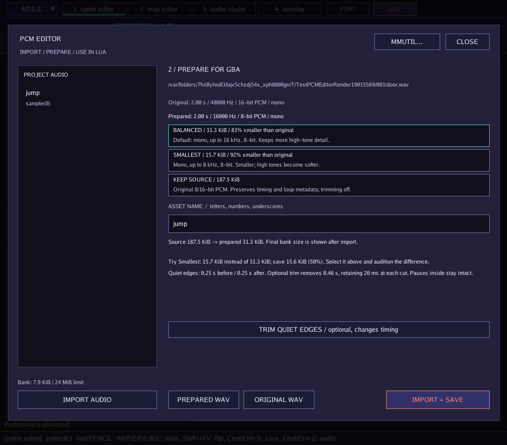
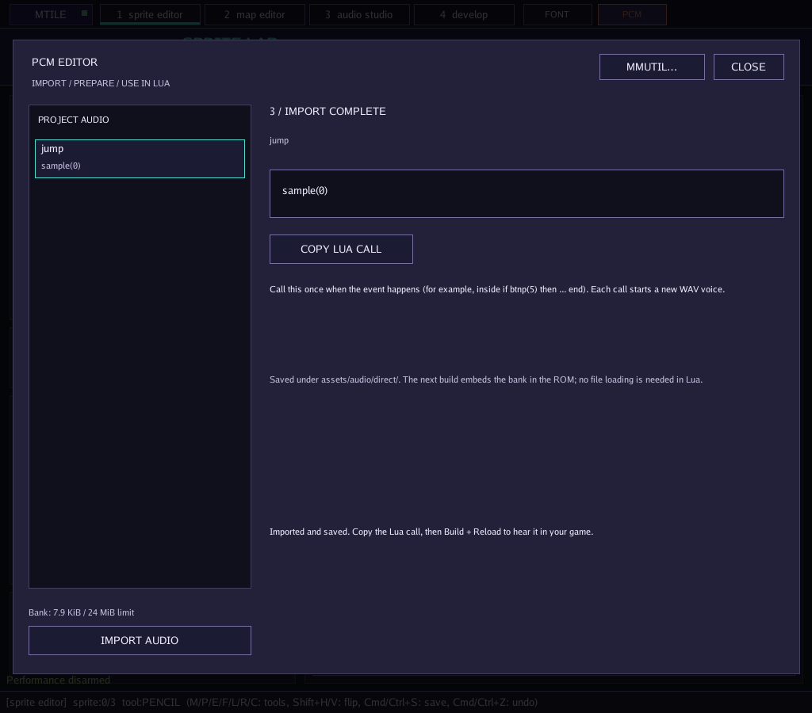
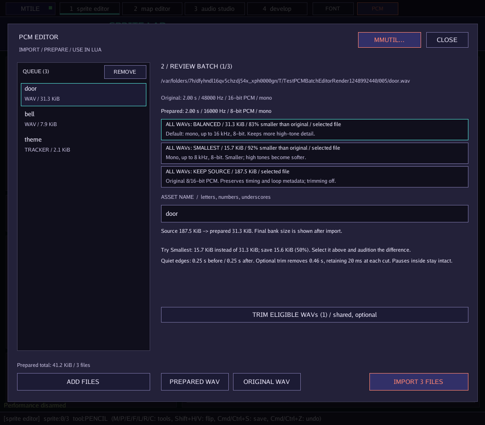
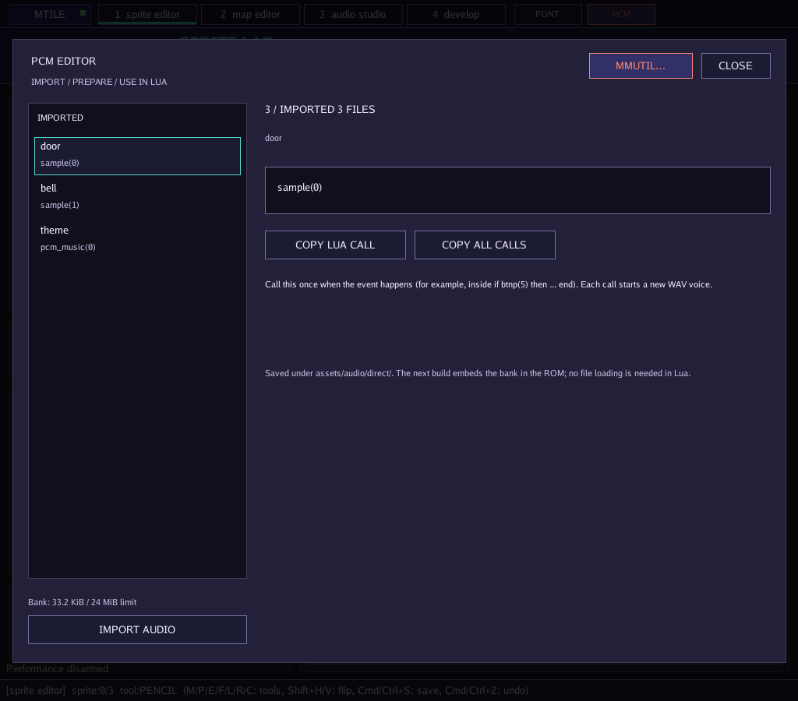
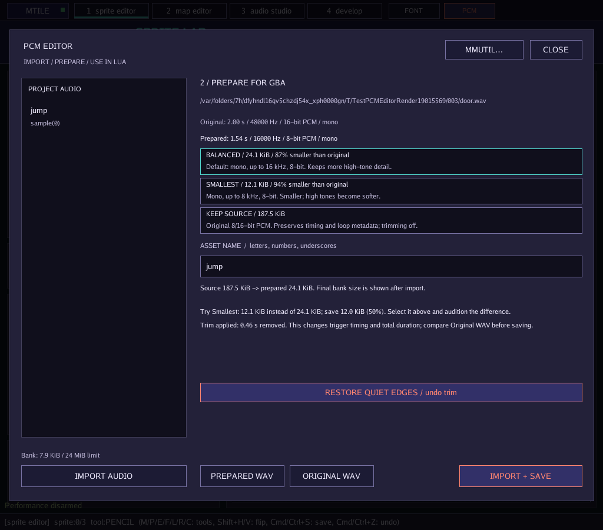

# Import music and recorded sounds

You can use the same **Direct Sound input formats as Butano**:

| What you have | Files | Lua call |
| --- | --- | --- |
| A recorded sound, voice or short effect | Uncompressed PCM `.wav` | `sample(id)` |
| A tracker song, with notes and sampled instruments | `.mod`, `.xm`, `.s3m`, `.it` | `pcm_music(id)` |
| A song made in mTile's four-channel Music Lab | Existing PSG JSON assets | `music(id)` |

A WAV is a recording: it stores the waveform over time. A tracker song is
closer to a score plus its instruments. It can repeat a small instrument many
times, which usually takes much less cartridge space than a full recording.
Butano uses Maxmod for these Direct Sound assets; mTile now uses the same
BlocksDS Maxmod player and the `mmutil` converter. See the
[Butano import guide](https://gvaliente.github.io/butano/import.html).

## Bring files into a project

You can do this without typing an import command: open `mtile edit mygame`
and choose **PCM** in the top bar. The **PCM Editor** has a three-step import
wizard, native **Browse**, WAV audition, a project library, **Copy Lua call**,
and **Delete asset**. See [the editor workflow](#pcm-editor-workflow).

Install **mmutil**, the Maxmod converter supplied by the Butano/devkitPro or
Wonderful/BlocksDS toolchain. It must be on your `PATH`. Alternatively set
`MMUTIL` or pass `-mmutil /path/to/mmutil`. The upstream converter and build
instructions are at [BlocksDS mmutil](https://github.com/blocksds/mmutil).
This tool is needed when importing or updating source audio; building an
already imported project needs only mTile and TinyGo.

```sh
mtile import-audio -project mygame theme.xm jump.wav
```

The command prints the IDs to use:

```text
pcm_music(0)  theme
sample(0)     jump
```

Use simple filenames such as `theme`, `jump` or `boss_theme`: a letter followed
by letters, numbers or underscores. File extensions are case-insensitive.
For WAV, export uncompressed 8-bit or 16-bit PCM; float, 24-bit and ADPCM
encodings are rejected by mmutil. Mono is a good choice for short effects.
Importing another file adds it to the existing bank; reimporting the same name
updates it and preserves its public ID. Song and effect IDs are independent.

The importer stores copies of source files and a compiled bank under
`assets/audio/direct/`. Commit that complete directory. A content-addressed
bank is published before its manifest, so a failed conversion leaves the
previous bank playable. Old bank/source files are not automatically deleted.
Keep the generated manifest intact; reimport the sources to change it.

## PCM Editor workflow



```text
Browse for a file -> Prepare for GBA -> Import + Save -> Copy Lua call
                         |                  |
                    audition WAV      assets/audio/direct/
```

1. Open the project with `mtile edit mygame`, then click **PCM** in the top
   bar and **Import audio**. **Browse** uses the desktop file picker and
   accepts multiple files. You can also paste one full path per line and
   choose **Next: Prepare**.
2. For a WAV, choose a quality preset. The wizard shows the original and
   prepared duration, sample rate, channels, bit depth and file size. Use
   **Original WAV** and **Prepared WAV** to compare up to fifteen seconds
   of each version. Review the space-saving advice and optional edge trim.
   Enter a short asset name, such as `jump` or `door_open`.
3. Choose **Import + Save**. The editor converts the source with `mmutil`,
   saves the bank and its manifest, and shows the exact call, for example
   `sample(0)` or `pcm_music(0)`. **Copy Lua call** copies it to the clipboard.
   Build + Reload to hear the final cartridge mix.



### Import many files together

Select several WAV and/or tracker files in **Browse** using your desktop's
multiple-selection controls. The left column becomes an **import queue**.
Click each row to inspect its source/prepared format, size, advice and
Original/Prepared WAV audition. Edit that row's asset name if needed.



The preset controls marked **ALL WAVs** apply to every queued WAV. Shared
**Trim eligible WAVs** only trims recordings with the conservative quiet
edges described below; it skips all-quiet, loop-marked and ineligible WAVs.
Tracker notes and instruments remain intact. Keep Source turns shared trim
off. Select a WAV row to change these common settings in a mixed queue.
Each fresh file selection starts with trim off; changing a preset or adding
files to the current queue preserves that queue's explicit trim choice.
**Add files** appends more sources; **Remove** excludes the selected queued
file without touching an existing project asset.

Files with preparation errors stay visible as **Needs attention**. Choose
another shared preset or remove the failed row. The wizard blocks import
while a failed row remains; it does not silently import a subset. Duplicate
source paths are deduplicated, and initially colliding basenames receive
suffixes such as `_2`. Duplicate names introduced by editing must be fixed
before import. A WAV and a tracker song may share a name because their
public ID spaces are independent.

**Import N files** runs `mmutil` **once** for the complete selection and
publishes one bank and manifest. If the batch replaces existing names,
**Replace + Import** asks for confirmation and preserves their IDs. A failed
conversion leaves the previously published bank playable. Completed rows
show their exact Lua calls. **Copy Lua call** copies the selected call;
**Copy all calls** copies a commented reference list, so pasting that list
does not accidentally start every sound. Put tracker calls in `_init()`
and WAV calls at their game events as shown below.



Batch preparation processes sources sequentially and stages the results in
a temporary directory. The queue holds metadata; it loads one prepared
waveform at a time for review rather than retaining all of them in editor
RAM. Closing the wizard removes its completed temporary workspace. Original
files are untouched. The displayed **Prepared** total adds staged WAV and
tracker source sizes; it is not a final-bank ROM-size prediction.

A selection can contain at most 512 files. The existing limits still apply:
256 public slots per kind (including reserved deleted IDs), 24 MiB per input
and 24 MiB for the final bank. The importer includes existing active assets
when rebuilding the bank, so review its actual size after import.

Conversion happens during **import or an explicit audio-library change**.
Ordinary builds embed the already prepared bank; they do not repeat WAV
preparation, trim or `mmutil` conversion, and do not require `mmutil`.

No separate audio application or ffmpeg is needed to prepare a supported
WAV. The editor accepts integer PCM 8/16/24/32-bit and IEEE float 32/64-bit
WAV, mono or stereo, from 1–192 kHz. The direct CLI importer still requires
the 8/16-bit integer PCM formats accepted by `mmutil`; the wizard prepares
the broader inputs *before* calling that same importer. Compressed WAV,
WAVE_FORMAT_EXTENSIBLE, MP3, OGG and FLAC are not decoded by this wizard;
export those as ordinary PCM WAV first. Each input is limited to 24 MiB.

| Preset | Preparation | Decision |
| --- | --- | --- |
| **GBA balanced** (default) | Mono, at most 16 kHz, 8-bit PCM with dither | Retains more detail within the player's approximately 16 kHz output range. |
| **Smallest** | Mono, at most 8 kHz, 8-bit PCM with dither | About half the recording data of 16 kHz; removes more high-frequency detail. Audition voices and effects before choosing it. |
| **Keep source** | Original 8/16-bit integer PCM WAV | Retains source rate, channels and metadata. May occupy more cartridge space; Maxmod still converts it to its GBA playback format. |

The first two presets average stereo to mono, apply a windowed-sinc low-pass
filter before downsampling, and quantize with deterministic triangular
dither. They do not boost volume or speed it up. Trimming is off unless you
explicitly enable **Trim quiet edges**, described below. They
do not upsample an already lower-rate source. Mono conversion removes stereo
placement; unusually out-of-phase stereo channels can cancel, so audition
such recordings. Preparation rebuilds the WAV's audio data and drops source
metadata, including authored sample-loop markers; use Keep source if those
markers are intentional. The original external file is never modified.
The project stores the **prepared** WAV, so keep your external master if you
want to make a different quality choice later.

For example, one second of 44.1 kHz stereo 16-bit PCM contains 176,400 bytes
of recording data. Balanced preparation produces 16,000 bytes; Smallest
produces 8,000 bytes, plus WAV headers before import. The final bank has
Maxmod's own headers, padding and instrument data; read the actual **Bank**
size in the library rather than treating the WAV size as final ROM usage.
These options primarily save **cartridge space**. They do not reduce the
fixed mixer RAM reservation or guarantee less CPU work per active voice.

### Space-saving advice and optional quiet-edge trimming

Each quality option shows its predicted prepared WAV size and percentage
saved relative to the external source file. The selected option's actual
prepared size is shown separately. When another preset would save at least
**1 KiB and 10%**, the wizard gives a concrete recommendation, for example:

> Try Smallest: 15.7 KiB instead of 31.3 KiB; save 15.6 KiB (50%). Select it
> above and audition the difference.

Balanced suggests Smallest when it would save space; Keep Source suggests
Balanced first. These numbers use the preparation code's frame rounding,
WAV header and padding rules. They describe WAV files, not final ROM-bank
sizes or a promise that both recordings will sound equally good.

The wizard also flags a **prepared** recording lasting at least **30 seconds**
or occupying at least **256 KiB**. These are review thresholds, not import
errors: a long narration or song may be intentional. The editor cannot know
your game's timing or the sound's role. It suggests a shorter effect or
tracker music and lets you keep the recording. The 24 MiB input/bank limits
and the final cartridge build checks still apply.

For WAV, quiet-edge analysis runs on the original decoded samples, **before
mono mixing and 8-bit dither**. It checks every channel independently. An
edge is a candidate only when its peak stays at or below **0.001 full scale
(approximately -60 dBFS)** for at least **100 ms**. The wizard shows quiet
time at the beginning/end and the duration an optional trim would remove.
It retains **20 ms of padding** next to each cut. Interior pauses and brief
edge gaps remain intact; opposing stereo channels are not mistaken for silence.



Choose **Trim quiet edges** to prepare that shorter recording. The button
then becomes **Restore quiet edges**, which prepares it again from the
external master. Compare Original WAV and Prepared WAV before saving:
removing a leading delay changes when a sound starts after `sample(id)`,
and removing a tail changes its total duration. Quiet tails may be intentional.
There is no automatic cut or claim that a low-level passage is musically
unnecessary. Keep Source disables trimming and restores the original timing.
Entirely quiet recordings receive a warning and cannot be trimmed to an
empty sound. WAVs with authored `smpl` loop markers also cannot be trimmed;
use Keep Source to preserve those markers. Tracker modules are not scanned
for silent patterns or rewritten by this analysis.

All analysis and preparation happen on the desktop. No analyzer, silence
scanner or additional allocation is introduced into the GBA game loop.

Tracker files (`.mod`, `.xm`, `.s3m`, `.it`) follow the same wizard but retain
their notes, instruments and channel layout. WAV presets do not rewrite
tracker instruments. A WAV recording remains a `sample(id)` even if it
contains a complete song; it does not become looping tracker music.
Tracker audition uses the built cartridge through Build + Reload.

`mmutil` is still required to create or update a bank. If it is not on PATH,
choose **MMUTIL…** at the top of the PCM Editor and locate its executable;
that selection lasts for the editor session. `MMUTIL` also works as an
environment variable. An unavailable converter or failed conversion leaves
the previously published bank playable. Conversion warnings are shown in
the wizard. Native Browse uses macOS's file picker, Windows's file dialog,
or `zenity`/`kdialog` on Linux; the path field is the fallback.

### Replace or delete an imported asset

Importing the same name and kind asks for confirmation, replaces its audio,
and keeps its Lua ID. Choose an existing item in **Project audio** to copy
its Lua call, audition a WAV, or choose **Delete asset**. Deletion asks for
confirmation, rebuilds the bank without the item, then removes that item's
project source and the previous active generated bank. Other files in the
directory and external master recordings are left alone. Deleting the last
item leaves a valid empty bank and the reserved ID slots.

Deleting `sample(0)` never changes the meaning of `sample(1)`. The deleted
slot remains reserved in the manifest; it is not silently reused for a new
name. Reimporting the same name restores its old slot. Up to 256 public
slots per kind are available, including reserved deleted slots. Literal Lua
calls to a deleted ID fail at their source position during build; dynamic
calls to it do nothing. Update any game code which still references the
removed asset. Import and delete are immediate disk changes, independent
of the sprite/PSG undo stack.

The Direct Sound companion manifest now supports version 2 for reserved
deleted slots. Existing version 1 banks still load unchanged; their first
deletion upgrades only this companion manifest to version 2. This is
independent of the PSG library's v2 schema. Older mTile versions cannot read
the new deleted-slot representation; retain a Git revision of the previous
directory if you need to build with an older release.

## Play the result

```lua
function _init()
  pcm_music(0)       -- loop the imported tracker song
end

function _update()
  if btnp(5) then sample(0) end
end

function _draw()
  cls(1)
end
```

Build normally with `mtile build mygame`, or open it with `mtile edit mygame`
and **Build + Reload**. The cartridge preview plays the ROM's actual audio.
Music Lab continues to edit PSG music; imported module patterns and WAVs are
source assets, not editable PSG lanes.

| Operation | Meaning |
| --- | --- |
| `pcm_music(id)` | Start a tracker song from its beginning; loop by default. |
| `pcm_music(id, false)` | Play it once. Tracker-authored jumps/loops still follow Maxmod semantics. |
| `pcm_music(-1)` | Stop the imported song. |
| `sample(id, volume, priority)` | Play a WAV; volume is 0–1 (default 1), priority 0–255 (default 160). |
| `sample(-1)` | Stop all imported WAV effects. |

There are eight tracked WAV effect voices. When full, a new effect may replace
the lowest-priority active effect; lower-priority requests are discarded.
Songs and effects also share Maxmod's bounded 32-channel software mixer.
Dynamic invalid IDs and out-of-range values do nothing; known invalid literal
IDs fail with a source-positioned build diagnostic.

`music`, `sfx`, `gba_note` and `gba_stop` retain their existing PSG meanings.
You can use them alongside imported audio. Stopping an imported song or WAV
does not stop the PSG song, and stopping PSG does not stop the imported song.
The companion bank has its own versioned manifest; the existing PSG v2 schema
is preserved. This does not restore the superseded audio-v1 format.

## What it costs

For measured CPU cycles, both RAM banks, ROM, heap/GC controls and the
Butano comparison, read [What imported audio costs](imported-performance.md).
It includes audio-only examples, the 32-voice pacing fix and timing limits.

Maxmod reads instruments from ROM and mixes stereo output at approximately
15,768 Hz (its standard "16 kHz" rate), then DMA1/2 feed FIFO A/B. Mixing
needs CPU time and fixed RAM; PSG alone remains the inexpensive option.
The PCM sample clock uses Timer 1; PSG retains Timer 0; the existing frame
profiler retains Timers 2/3. Shared sound-register ownership preserves both.

The player is serviced at the LCD's 59.73 Hz while game updates remain at
approximately 30 FPS. A short VBlank handler resets DMA; mixing runs at scanline
0. A long service can extend into VBlank. Remembered LCD events and HALT
preserve the main loop's pacing across such interrupts; see the
[32-voice follow-up](../benchmarks/audio-pacing-2026-11-02/README.md).
Missing the audio service deadline can
also produce glitches in an overloaded game. Profile the
complete game with its busiest song and simultaneous effects.

The existing `stat(1)`/`stat(2)` work counters exclude deliberate pacing waits,
so they are not a total-CPU meter for background audio mixed during those
waits. Check actual update cadence and missed frames as well. Go cartridges
can read `Context.AudioStats().PCM.MaxMixCycles` for the maximum measured
single-refresh mixing cost; it uses the existing frame counter without
claiming another hardware timer.

The compiled bank is limited to 24 MiB, leaving room within the GBA's 32 MiB
cartridge limit for code and other assets. Full recordings consume much more
ROM than short instruments. There is no MP3/OGG decoder, runtime filesystem,
module-to-PSG conversion or claim of physical-hardware listening sign-off.
Unused imported assets do not link the Maxmod player into the cartridge.
