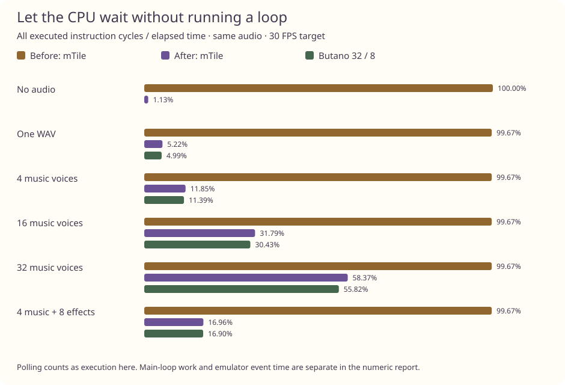
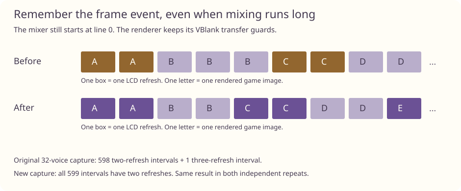

# LCD-event pacing and HALT: 32-voice follow-up

Measured 2026-11-02, after the imported-audio snapshot commit `75107da`.
The [original report](../imported-audio-performance-2026-11-02/README.md)
is preserved. This report contains **19 new ROM/configuration combinations**:
ten mTile workloads and nine matched-capacity Butano workloads.

## Result

The old mTile loop waited by repeatedly reading a timer or scanline number.
It could miss the entire visible interval while a 32-voice mixer IRQ ran.
The new loop remembers LCD frame events and uses BIOS HALT between events.
The PCM mixer still starts at line 0. Both renderers retain their existing
presentation-window safety rules; no game-specific rewrite is needed.



| Four music voices | Before | After | Butano, matched |
| --- | ---: | ---: | ---: |
| All instruction cycles / elapsed time | 99.67% | 11.85% | 11.39% |
| Non-wait instruction work / update | 64,932 | 65,672 | 63,830 |
| Non-wait work / 30 FPS budget | 11.56% | 11.69% | 11.36% |
| HALT/event advancement / elapsed time | 0% | 88.12% | 88.57% |

The first row includes deliberate polling. It is different from the
non-wait work metric used in the original CPU table. The new clock and
wakeup bookkeeping add **740 work cycles per update** in this fixture,
about 0.13 percentage points of the 561,792-cycle budget. That small cost
allows the CPU to stop executing the waiting loop. This is not a battery
or electrical-power measurement, and it does not make the mixer itself
faster. New mTile work is still about 2.9% above matched Butano here.

At 32 music voices, every one of the **599 measured inter-update gaps**
is two refreshes in each independent capture. The original captures each
had one three-refresh gap. The new worst non-wait update is **383,933
cycles**, versus **547,752** before; removing the extra refresh also removes
the extra mixer service from that delayed update. The average mixer
workload remains substantial: current mTile uses **327,013 work cycles**
per update, versus **313,344** for matched Butano.



All current normal workloads have two-refresh cadence, zero Lua heap,
zero collections and zero capture overflow. PCM channel capacities and
output sample rate are unchanged. Four-voice mTile EWRAM remains **11,292
bytes**; static IWRAM increases from **7,836 to 7,860 bytes**. Its separate
9,216-byte stack reservation is unchanged. ROM grows from 56,292 to
58,148 bytes in that fixture. Larger audio remains in cartridge ROM.

## Why the new waits work

The display always advances, even while the CPU is inside a mixer IRQ.
An instantaneous scanline read cannot tell whether an entire visible
interval has already passed. A frame event counter can.

```text
line 0 event → remember “next frame began” → run the mixer
                                              │
main loop resumes ← check remembered event ────┘
       │
       └─ wait for the target presentation frame using HALT
```

`hw` owns one VBlank and one line-0 VCOUNT dispatcher. The optional PCM
controller installs fixed callbacks in them. The VCOUNT dispatcher advances
a volatile frame counter before mixing. `BeginFramePace` records the next
target frame and resets the existing work timer atomically. `WaitFramePace`
waits for that frame event rather than waiting for a duration measured from
the delayed return of an audio IRQ.

The game loop's end-of-frame wait consumes the next frame event even if
mixing occupies all its visible scanlines. The lower-level `hw.WaitVDraw`
continues to require a physically visible scanline; Mode 0's transfer guard
uses it when a complete new VBlank window is required. Pixel parity is
verified with a moving sprite under audio load.

The predicate check and BIOS Halt run with IME masked. HALT wakes whenever
an enabled request is pending, including a request which appeared before
the sleep instruction; restoring IME then runs the handler. This closes
the check/interrupt/sleep race. Native callers which entered with IRQs
masked keep the polling fallback, preserving their interrupt state.
See [GBATEK's BIOS Halt contract](https://mgba-emu.github.io/gbatek/#bios-halt-functions).
The implementation uses no additional timer, no per-frame allocation and
no new Lua API.

## The preview core also needed a correction

The pinned mGBA 0.10.3 implementation unconditionally entered HALT. It
did not handle an already pending `IE & IF` request. The isolated
`mtile-halt-test` reproduces this with `IME=0`, then tests twenty
combinations of pending/disabled requests, IME and CPSR masking. The
unmodified core fails; the corrected build passes all cases.

mTile's helper CMake build adds an exact, checked transformation to a
generated copy of `gba.c`. The Git submodule remains unchanged. The
compatibility source is MPL-2.0-covered, and release notices include the
transformation. See [the component notice](../../third-party/mgba.md).
An optional `MTILE_MGBA_HALT_COMPAT=OFF` build reproduces the original bug.

**Both new mTile and Butano measurements use the same corrected core.**
Butano's matched instruction-work measurements remain identical to its
historical rows for these fixtures. Source, generated-core and binary hashes
are retained so the emulator change is visible in the evidence. The old
polling mTile baseline does not invoke HALT in these measured paths.

## Reproduce and verify

```sh
cmake -S cmd/mtile-player -B build/player -DCMAKE_BUILD_TYPE=Release
cmake --build build/player --target mtile-player mtile-halt-test
ctest --test-dir build/player --output-on-failure

python3 scripts/butano-bench/pcm/run.py \
  --mmutil /path/to/mmutil \
  --butano /path/to/butano \
  --work /private/tmp/mtile-audio-pacing-bench-20261102 \
  --out docs/benchmarks/audio-pacing-2026-11-02 \
  --variants mtile,butano-matched

python3 scripts/butano-bench/pcm/pacing_report.py \
  docs/benchmarks/audio-pacing-2026-11-02
```

Use fresh work/output directories for a new experiment. Import conversion,
soundbanks, toolchains and CPU accounting follow the original report:
same bank bytes, standard 16 kHz Maxmod mode, 32 total mixer slots and
8 effect slots, 60 warmup updates, 300 complete profiled intervals and
two independent 600-update captures. The profiler includes background IRQs
and accounts hardware event advancement separately from instruction work.

The opt-in native regression gate is:

```sh
MTILE_FRAME_PACING_INTEGRATION=1 MTILE_IMPORTED_AUDIO_INTEGRATION=1 \
MTILE_PLAYER="$PWD/build/player/mtile-player" \
go test ./internal/emulator \
  -run '^Test(FramePacingROMConformance|FramePacingPreservesMaskedIRQs|ImportedAudioROMConformance)$' \
  -count=1 -v
```

It verifies silence, 32 PCM voices, and 32 PCM voices plus PSG with a moving
sprite in both renderers. It checks 599 consecutive two-refresh intervals,
changing pixels, exact Mode 0/4 pixel hashes, active PCM/PSG and zero heap/GC.
A standalone Go cartridge verifies masked-IRQ fallback and subsequent
event waits. Existing WAV start/stop and PSG coexistence checks also pass.
The moving-sprite test fails against the old runtime in both renderers,
reproducing the original extra refresh, then passes with the fix. CI now
runs the core contract and these native conformance tests.

These results do not certify every song or game. In particular, the PSG
stress test proves output presence and game cadence, not every 256 Hz PSG
commit deadline. A long non-preemptible mixer service can still delay
other interrupt work. Physical-hardware listening and worst-case game
budgets remain separate validation tasks.

## Retained evidence

- [Numeric comparison](matrix.md), [combined results](results.json),
  [environment/core hashes](environment.json), [source hashes](source-sha256.json).
- Per-configuration instruction traces, cycle buckets and both captures
  are compressed next to their `result.json` and `profile.json`.
- [Verification record](verification.json) includes the native gates,
  core regression, and required repository tests.
