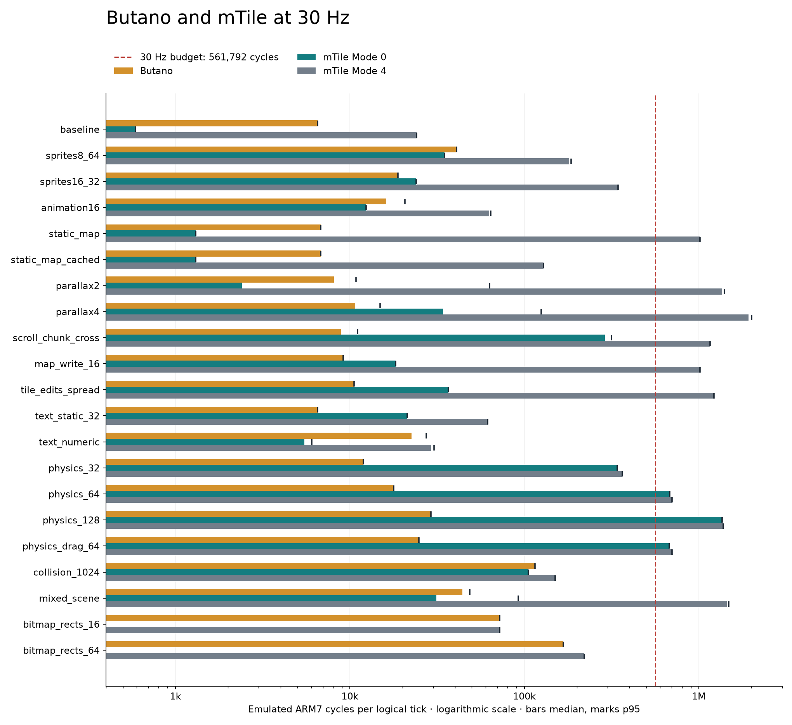
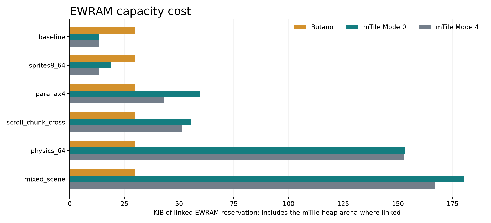

# Butano and mTile performance at 30 Hz

Measured on 2026-10-29. This comparison covers 38 deterministic graphics and game-logic workloads on the same pinned mGBA core. Each ROM has 60 warm-up ticks followed by two independent runs of 600 measured ticks. All **134,400 measured tick images and state checksums** match an independent integer reference. Every pair of repeated medians is identical. These are emulator measurements; physical GBA confirmation remains outstanding.

mTile Mode 0 is faster in several small tile, sprite, collision-read and numeric-HUD scenes. Butano has much more CPU headroom for the tested entity simulation, four-background parallax, dirty-tile uploads and rapid map streaming. A renderer choice alone cannot bring the 64-entity mTile simulation inside its 30 Hz budget.

## Conditions and measurement boundaries

- mTile revision: `bb849262279142eee99e970828880de57b0c94da`. No engine source or public Lua API changes.
- Butano revision: `04374b034c76b82bfdc3aa6c38d652e5e7778a68`; devkitARM 65 / GCC 14.2.0; stock `-O2` Thumb build; assertions and logging disabled. Unused PCM and DMG backends are disabled for non-audio workloads.
- mTile uses TinyGo 0.42.0 / LLVM 22.1.4, stock ARM `-opt=2 -gc=none`, all normal compiler optimizations enabled, plus the existing debug mailbox. Butano also writes its mailbox outside the measured interval.
- Both engines target one logical update per two LCD refreshes. The GBA rate makes this approximately **29.864 Hz**, with a **561,792-cycle** budget. No 60 Hz game mode is compared.
- Main-suite cycle totals include input/update/drawing, renderer preparation, deferred VRAM/OAM commits and useful VBlank interrupt work; intentional waiting is excluded. Butano receives timing hooks only around its VBlank waits and interrupt body. The exact patch is included. Audio is treated separately below.
- The stopwatch zero-work control, including two artificial wait/interrupt boundaries, measures **489 cycles**. No overhead is subtracted from published results. Differences smaller than this control are treated as practical ties, including the 16-rectangle bitmap result.
- The first complete scan for a new mailbox publication is captured for the same logical tick in both engines. The independent reference verifies every image and state in both repetitions. Capturing the last scan can include the next Butano image; the final dataset does not use that method.
- Shared assets use the same 8bpp pixel indices and a 256-entry RGB15 palette repeating 16 colors. This also allows the 4bpp Butano text font to coexist with 8bpp sprite palettes. Font pixels, 6-pixel advance and 10-pixel cell height match exactly.
- Physics uses the same signed Q16.16 state and rounding. C++ uses native typed arrays in its normal IWRAM placement. These Lua fixtures declare global arrays, so mTile uses generic tagged tables; its compact numeric-array optimization currently requires chunk-scope `local` bindings. This compares the shipped programming models, including their memory layout and access costs. See the [subsequent profiling and improvements](../../performance-improvements-2026-10-29.md).
- No input is required: all games receive the same zero-key replay and deterministic tick sequence. Initial boot is excluded by warm-up; first-use work encountered later in the route remains part of measured tick cost.

## Main results

Each cell is **median / p95 / maximum cycles per tick**. Lower is better. Unsupported Mode 0 bitmap primitives have no Mode 0 result. The complete machine-readable table is in [results.csv](results.csv).

| Workload | Butano | mTile Mode 0 | mTile Mode 4 |
| --- | ---: | ---: | ---: |
| `animation16` | 16,129 / 20,625 / 20,625 | 12,397 / 12,397 / 12,397 | 62,945 / 64,193 / 64,193 |
| `baseline` | 6,522 / 6,522 / 6,522 | 589 / 589 / 589 | 24,063 / 24,063 / 24,063 |
| `bitmap_rects_16` | 71,984 / 72,092 / 72,119 | — | 72,048 / 72,048 / 72,048 |
| `bitmap_rects_64` | 166,930 / 167,038 / 167,065 | — | 220,361 / 220,361 / 220,361 |
| `collision_1024` | 115,169 / 115,196 / 115,196 | 105,469 / 105,469 / 105,469 | 150,423 / 150,423 / 150,423 |
| `collision_256` | 33,761 / 33,761 / 33,761 | 27,133 / 27,133 / 27,133 | 55,959 / 55,959 / 55,959 |
| `collision_64` | 13,409 / 13,409 / 13,409 | 7,549 / 7,549 / 7,549 | 32,343 / 32,343 / 32,343 |
| `map_write_1` | 9,085 / 9,085 / 9,085 | 10,122 / 10,122 / 10,122 | 1,013,029 / 1,013,029 / 1,013,029 |
| `map_write_16` | 9,149 / 9,149 / 9,149 | 18,278 / 18,278 / 18,278 | 1,016,126 / 1,016,126 / 1,016,126 |
| `map_write_4` | 9,091 / 9,091 / 9,091 | 11,714 / 11,714 / 11,714 | 1,013,643 / 1,013,643 / 1,013,643 |
| `mixed_scene` | 44,081 / 48,529 / 81,146 | 31,265 / 92,279 / 93,074 | 1,447,330 / 1,484,905 / 1,486,048 |
| `palette_1` | 10,382 / 10,382 / 10,382 | 9,914 / 9,914 / 9,914 | 1,012,936 / 1,012,936 / 1,012,936 |
| `palette_16` | 14,997 / 14,997 / 14,997 | 11,383 / 11,383 / 11,383 | 1,014,361 / 1,014,361 / 1,014,361 |
| `parallax2` | 8,081 / 10,851 / 44,771 | 2,401 / 63,003 / 63,003 | 1,361,738 / 1,399,168 / 1,399,240 |
| `parallax4` | 10,744 / 14,899 / 82,739 | 34,161 / 125,052 / 125,052 | 1,929,438 / 2,004,285 / 2,004,432 |
| `physics_128` | 28,985 / 29,069 / 29,097 | 1,359,757 / 1,359,757 / 1,359,757 | 1,382,151 / 1,382,367 / 1,382,439 |
| `physics_32` | 11,896 / 11,910 / 11,926 | 340,525 / 340,525 / 340,525 | 363,687 / 363,723 / 363,759 |
| `physics_64` | 17,758 / 17,800 / 17,814 | 680,269 / 680,269 / 680,269 | 703,175 / 703,283 / 703,319 |
| `physics_drag_64` | 24,832 / 24,883 / 24,919 | 676,432 / 676,480 / 676,528 | 701,298 / 701,316 / 701,334 |
| `scroll_chunk_cross` | 8,855 / 11,061 / 25,827 | 289,299 / 315,429 / 345,109 | 1,158,754 / 1,160,842 / 1,208,678 |
| `scroll_small` | 7,474 / 8,859 / 25,819 | 1,364 / 31,785 / 31,785 | 1,086,823 / 1,086,895 / 1,086,931 |
| `scroll_streamed` | 7,474 / 8,832 / 25,819 | 1,416 / 278,500 / 278,500 | 1,125,631 / 1,125,703 / 1,125,739 |
| `sprites16_16` | 12,979 / 12,979 / 12,979 | 13,913 / 13,913 / 13,913 | 184,415 / 184,415 / 184,415 |
| `sprites16_32` | 18,861 / 18,861 / 18,861 | 23,969 / 23,969 / 23,969 | 344,919 / 344,919 / 344,919 |
| `sprites32_16` | 12,979 / 12,979 / 12,979 | 13,977 / 13,977 / 13,977 | 647,711 / 647,711 / 647,711 |
| `sprites32_8` | 9,889 / 9,889 / 9,889 | 8,981 / 8,981 / 8,981 | 335,767 / 335,767 / 335,767 |
| `sprites8_16` | 15,041 / 15,041 / 15,041 | 11,522 / 11,522 / 11,522 | 62,895 / 64,143 / 64,143 |
| `sprites8_32` | 23,611 / 23,611 / 23,611 | 19,326 / 19,326 / 19,326 | 101,903 / 104,399 / 104,399 |
| `sprites8_64` | 40,763 / 40,763 / 40,779 | 34,800 / 34,800 / 34,800 | 180,364 / 185,356 / 185,356 |
| `sprites8_96` | 57,903 / 57,903 / 57,903 | 48,376 / 48,376 / 48,376 | 253,537 / 261,025 / 261,025 |
| `static_map` | 6,789 / 6,789 / 6,789 | 1,307 / 1,307 / 1,307 | 1,012,811 / 1,012,811 / 1,012,811 |
| `static_map_cached` | 6,789 / 6,789 / 6,789 | 1,307 / 1,307 / 1,307 | 128,920 / 128,920 / 128,920 |
| `text_numeric` | 22,492 / 27,325 / 28,622 | 5,471 / 6,050 / 6,050 | 29,186 / 30,402 / 30,458 |
| `text_static_16` | 6,522 / 6,522 / 6,522 | 12,620 / 12,620 / 12,620 | 43,054 / 43,054 / 43,054 |
| `text_static_32` | 6,522 / 6,522 / 6,522 | 21,300 / 21,300 / 21,300 | 61,662 / 61,662 / 61,662 |
| `text_static_8` | 6,522 / 6,522 / 6,522 | 8,280 / 8,280 / 8,280 | 33,750 / 33,750 / 33,750 |
| `tile_edits_clustered` | 7,209 / 7,209 / 7,209 | 9,571 / 9,571 / 9,571 | 1,219,155 / 1,219,155 / 1,219,155 |
| `tile_edits_spread` | 10,581 / 10,581 / 10,581 | 36,630 / 36,630 / 36,630 | 1,219,369 / 1,219,369 / 1,219,369 |

## Sustained cadence and deadlines

Butano maintains an exact two-refresh cadence in **38/38** cases. mTile Mode 0 does so in **33/36** compatible cases. Mode 4 does so in **20/38** cases. The following rates come from observed refresh intervals, rather than a host FPS counter.

The raw engine `MissedFrames` counters have different meanings. The common deadline columns below use measured cycle cost and refresh spacing instead. AUTO selects Mode 0 for the 36 compatible workloads and Mode 4 for the two bitmap workloads; AUTO does not guarantee that arbitrary update logic fits the budget.

| Workload | Butano Hz | Mode 0 Hz | Mode 4 Hz | Mode 0 over-budget ticks | Mode 4 over-budget ticks |
| --- | ---: | ---: | ---: | ---: | ---: |
| `animation16` | 29.864 | 29.864 | 29.864 | 0 | 0 |
| `baseline` | 29.864 | 29.864 | 29.864 | 0 | 0 |
| `bitmap_rects_16` | 29.864 | — | 29.864 | — | 0 |
| `bitmap_rects_64` | 29.864 | — | 29.864 | — | 0 |
| `collision_1024` | 29.864 | 29.864 | 29.864 | 0 | 0 |
| `collision_256` | 29.864 | 29.864 | 29.864 | 0 | 0 |
| `collision_64` | 29.864 | 29.864 | 29.864 | 0 | 0 |
| `map_write_1` | 29.864 | 29.864 | 14.932 | 0 | 600 |
| `map_write_16` | 29.864 | 29.864 | 14.932 | 0 | 600 |
| `map_write_4` | 29.864 | 29.864 | 14.932 | 0 | 600 |
| `mixed_scene` | 29.864 | 29.864 | 10.167 | 0 | 600 |
| `palette_1` | 29.864 | 29.864 | 14.932 | 0 | 600 |
| `palette_16` | 29.864 | 29.864 | 14.932 | 0 | 600 |
| `parallax2` | 29.864 | 29.864 | 11.946 | 0 | 600 |
| `parallax4` | 29.864 | 29.864 | 8.174 | 0 | 600 |
| `physics_128` | 29.864 | 11.946 | 11.946 | 600 | 600 |
| `physics_32` | 29.864 | 29.864 | 29.864 | 0 | 0 |
| `physics_64` | 29.864 | 19.909 | 19.909 | 600 | 600 |
| `physics_drag_64` | 29.864 | 19.909 | 19.909 | 600 | 600 |
| `scroll_chunk_cross` | 29.864 | 29.864 | 12.252 | 0 | 600 |
| `scroll_small` | 29.864 | 29.864 | 14.932 | 0 | 600 |
| `scroll_streamed` | 29.864 | 29.864 | 12.553 | 0 | 600 |
| `sprites16_16` | 29.864 | 29.864 | 29.864 | 0 | 0 |
| `sprites16_32` | 29.864 | 29.864 | 29.864 | 0 | 0 |
| `sprites32_16` | 29.864 | 29.864 | 19.909 | 0 | 600 |
| `sprites32_8` | 29.864 | 29.864 | 29.864 | 0 | 0 |
| `sprites8_16` | 29.864 | 29.864 | 29.864 | 0 | 0 |
| `sprites8_32` | 29.864 | 29.864 | 29.864 | 0 | 0 |
| `sprites8_64` | 29.864 | 29.864 | 29.864 | 0 | 0 |
| `sprites8_96` | 29.864 | 29.864 | 29.864 | 0 | 0 |
| `static_map` | 29.864 | 29.864 | 14.932 | 0 | 600 |
| `static_map_cached` | 29.864 | 29.864 | 29.864 | 0 | 0 |
| `text_numeric` | 29.864 | 29.864 | 29.864 | 0 | 0 |
| `text_static_16` | 29.864 | 29.864 | 29.864 | 0 | 0 |
| `text_static_32` | 29.864 | 29.864 | 29.864 | 0 | 0 |
| `text_static_8` | 29.864 | 29.864 | 29.864 | 0 | 0 |
| `tile_edits_clustered` | 29.864 | 29.864 | 11.946 | 0 | 600 |
| `tile_edits_spread` | 29.864 | 29.864 | 11.946 | 0 | 600 |

## Interpretation of the workloads

- **Sprites:** 16, 32, 64 and 96 moving 8×8 objects, plus 16×16 and 32×32 shapes. Objects share resident artwork, remain within hardware scanline limits, and preserve overlap order. Butano uses one sort layer and `put_above`, rather than allocating one sort layer per object.
- **Animation:** 16 objects select the same four resident frames. Both retain the frames in VRAM; Butano uses cached `sprite_tiles_ptr` handles. Lua uses explicit finite frame assignments accepted by the public Mode 0 proof. This does not characterize large pose-bank streaming.
- **Maps:** `static_map` is a 32×32 map with many transparent holes, outside the small Mode 4 raster-cache shape. `static_map_cached` is an opaque 30×20 logical map, padded to the hardware-required 32×32 storage on Butano. Its Mode 4 cost is much lower; a dense uncached map must not stand in for every Mode 4 game.
- **Scrolling:** the slow cases move one pixel per tick per layer. `scroll_chunk_cross` moves 9 pixels horizontally and 3 vertically through a 256×128-cell ROM-backed map. It crosses tile and 32×32-cell chunk boundaries, including wraps of the deterministic route.
- **Mutations:** map writes change 1, 4 or 16 cells. Artwork edits change 16 pixels in either one tile or 16 separate tiles. Butano uses public `reload_cells_ref` and `overwrite_tile`; mTile uses `mset` and `sset`. The full visible mutation is included in commit time.
- **Text:** static text is retained in Butano and redrawn through the mTile API. The numeric HUD changes every tick; Butano uses its native text generator and mTile its numeric-print path. Manual digit-sprite replacement could improve Butano further and is not measured here.
- **Simulation:** 32, 64 and 128 entities update positions, velocity, gravity, boundary clamps and checksums. The drag variant additionally multiplies both velocity components by an exact Q16.16 factor. Rendering is a plain backdrop, isolating update cost.
- **Collisions:** 64, 256 and 1,024 map reads feed an observable checksum. Butano reads its native imported map array; mTile uses public `mget`. These results include normal ROM/EWRAM placement costs.
- **Mixed scene:** two independently scrolling layers, 32 sprites, 64 collision probes and a changing score. Mode 0 has a lower median than Butano here, but a substantially higher p95.
- **Bitmap:** both use indexed Mode 4 and draw the same inclusive filled rectangles, clear and page flip. At 16 rectangles the result is a practical tie; 64 rectangles favor Butano.

## Memory and startup

EWRAM columns are linked capacity reservations, including the mTile heap arena where present and the Butano fixed resource pools. They are not peak live heap measurements. IWRAM figures require care: mTile includes its 8 KiB user plus 1 KiB IRQ stack reservation; Butano reports static IWRAM separately from a stack reading taken at publication. The latter is not a stack high-water mark. No GC collections occur during these measured runs.

| Workload | Butano EWRAM B | Mode 0 EWRAM B | Mode 4 EWRAM B | Butano ROM B | Mode 0 ROM B | Mode 4 ROM B |
| --- | ---: | ---: | ---: | ---: | ---: | ---: |
| `animation16` | 30,692 | 19,080 | 13,552 | 56,700 | 39,880 | 40,932 |
| `baseline` | 30,692 | 13,772 | 13,548 | 50,336 | 33,492 | 33,700 |
| `bitmap_rects_16` | 30,692 | — | 13,548 | 59,176 | — | 35,716 |
| `bitmap_rects_64` | 30,692 | — | 13,548 | 59,200 | — | 35,960 |
| `collision_1024` | 30,692 | 13,772 | 13,552 | 50,456 | 34,248 | 34,512 |
| `collision_256` | 30,692 | 13,772 | 13,552 | 50,456 | 34,248 | 34,512 |
| `collision_64` | 30,692 | 13,772 | 13,552 | 50,456 | 34,248 | 34,512 |
| `map_write_1` | 30,692 | 17,860 | 13,548 | 61,240 | 41,040 | 46,548 |
| `map_write_16` | 30,692 | 17,860 | 13,548 | 61,256 | 43,148 | 51,164 |
| `map_write_4` | 30,692 | 17,860 | 13,548 | 61,256 | 41,488 | 47,488 |
| `mixed_scene` | 30,692 | 184,800 | 170,952 | 94,672 | 69,484 | 77,220 |
| `palette_1` | 30,692 | 17,860 | 13,548 | 61,624 | 40,492 | 46,352 |
| `palette_16` | 30,692 | 17,860 | 13,548 | 61,648 | 43,036 | 48,680 |
| `parallax2` | 30,692 | 36,324 | 27,884 | 75,480 | 56,656 | 60,996 |
| `parallax4` | 30,692 | 60,968 | 44,268 | 92,008 | 73,604 | 77,484 |
| `physics_128` | 30,692 | 156,892 | 156,664 | 50,696 | 85,784 | 85,764 |
| `physics_32` | 30,692 | 156,892 | 156,664 | 50,680 | 58,912 | 58,892 |
| `physics_64` | 30,692 | 156,892 | 156,664 | 50,688 | 67,864 | 67,844 |
| `physics_drag_64` | 30,692 | 156,892 | 156,664 | 50,824 | 67,948 | 67,804 |
| `scroll_chunk_cross` | 30,692 | 56,836 | 52,524 | 124,512 | 106,496 | 112,276 |
| `scroll_small` | 30,692 | 24,004 | 19,692 | 67,152 | 46,412 | 52,452 |
| `scroll_streamed` | 30,692 | 56,836 | 52,524 | 124,504 | 104,924 | 112,124 |
| `sprites16_16` | 30,692 | 21,156 | 13,548 | 56,316 | 42,028 | 41,172 |
| `sprites16_32` | 30,692 | 21,156 | 13,548 | 56,316 | 42,156 | 44,772 |
| `sprites32_16` | 30,692 | 21,156 | 13,548 | 57,084 | 42,420 | 41,148 |
| `sprites32_8` | 30,692 | 21,156 | 13,548 | 57,060 | 42,188 | 39,296 |
| `sprites8_16` | 30,692 | 19,080 | 13,548 | 56,164 | 39,592 | 40,536 |
| `sprites8_32` | 30,692 | 19,080 | 13,548 | 56,156 | 39,784 | 43,896 |
| `sprites8_64` | 30,692 | 19,080 | 13,548 | 56,156 | 40,216 | 50,916 |
| `sprites8_96` | 30,692 | 19,080 | 13,548 | 56,156 | 40,640 | 53,552 |
| `static_map` | 30,692 | 17,860 | 13,548 | 60,960 | 40,224 | 46,196 |
| `static_map_cached` | 30,692 | 17,012 | 59,292 | 60,960 | 39,384 | 49,584 |
| `text_numeric` | 30,692 | 162,248 | 156,612 | 70,588 | 44,012 | 44,436 |
| `text_static_16` | 30,692 | 19,192 | 13,560 | 69,392 | 41,348 | 39,212 |
| `text_static_32` | 30,692 | 19,192 | 13,560 | 69,408 | 41,172 | 39,088 |
| `text_static_8` | 30,692 | 19,192 | 13,560 | 69,384 | 41,260 | 39,124 |
| `tile_edits_clustered` | 30,692 | 18,860 | 13,484 | 61,296 | 42,276 | 47,460 |
| `tile_edits_spread` | 30,692 | 18,860 | 13,484 | 61,328 | 42,264 | 47,520 |

Physical VRAM/OAM snapshots at tick 660 are included in [graphics-memory.json](graphics-memory.json). Referenced BG/OBJ bytes are a **lower bound on current hardware references**, not an allocator high-water mark: unused resident animation frames, the font atlas, system-menu art and stale tile contents can occupy additional space. Nonzero VRAM bytes are also reported as a separate diagnostic, never as allocated bytes. Mode 4 reserves two 40 KiB pages in both engines.
For example, four-background parallax references 10,240 BG bytes on Butano and 18,432 on mTile Mode 0. The mixed scene uses 34 active hardware OAM entries in both. Butano can use 2 KiB hardware maps, while mTile Mode 0 uses 4 KiB maps for its current scrolling contract.
Startup is recorded separately as `firstPublicationVideoFrame` in the raw data and CSV. It is a refresh-quantized observation of the first completed debug publication, including normal engine boot waits. It is not a precise tile-upload stopwatch and is excluded from steady-state statistics.

## PSG characterization

Two additional four-channel PSG programs retrigger notes every eight logical ticks or every tick. Both maintain the two-refresh cadence. They are **excluded from cross-engine audio speedup rankings**: mTile commits at 256 Hz, advgm at VBlank, and the snapshots do not establish equal trigger/sample phase. Even the sampled register sequences differ at event boundaries. Graphics tick-cost counters also omit some mTile timer service work occurring during deliberate waits, so comparing those counters as complete audio CPU totals would be misleading.

| Program | Mode 0 register mismatches / 600 | Mode 4 register mismatches / 600 | mTile PSG service CPU estimate |
| --- | ---: | ---: | ---: |
| `psg_events_every_8_ticks` | 75 | 75 | 0.527% |
| `psg_events_every_1_ticks` | 600 | 600 | 1.792% |

The mTile audio percentage uses differences in cumulative measured-service count × integer-rounded mean cycles, divided by observed emulated time. It excludes interrupt entry/exit overhead. The full register traces and service counters are retained. A timestamped register-write and PCM conformance capture is needed before publishing an equal-audio performance ratio.

## Reproduction and evidence

The [benchmark scripts](../../../scripts/butano-bench/README.md) generate assets and both programs, build all renderers, record the replay and run the independent oracle. [evidence.tar.gz](evidence.tar.gz) contains both raw repetitions, source/layout evidence, final images, memory snapshots and the separate audio/calibration captures. [results.json](results.json) contains the complete consolidated results. ROM SHA-256 values and the player SHA-256 identify the measured binaries.
Validation: `go test ./internal/transpiler ./internal/build ./cmd/mtile`, `cd runtime && go test ./...`, benchmark driver compilation, and the independent 134,400-tick oracle all passed. The results establish emulator performance for these exact public-API workloads. They do not establish physical-hardware timing or the maximum performance obtainable from hand-tuned C++, assembly, custom renderers or alternative data layouts.
