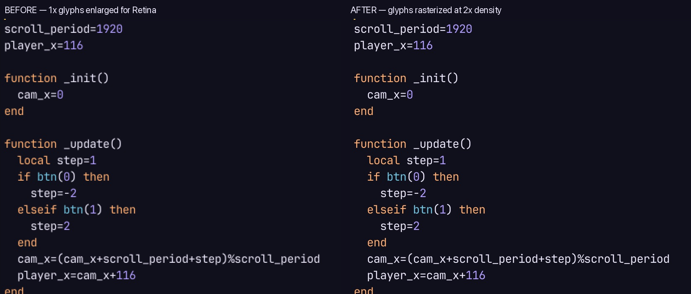

# Editor HiDPI verification

2026-10-27, Apple M2 Pro, darwin/arm64, built-in Retina display at 2x.
Baseline: `c78b24be6267ff4fdd58aca402ed37fb479d11c5`.

The editor now keeps layout and hit testing in logical window coordinates,
requests a physical-resolution framebuffer through `editorWindow.LayoutF`,
and rasterizes every UI font at the display density. Font advances and
baselines preserve the logical metrics, so source, caret, selections, syntax
spans, and popups share the same coordinate grid. Monitor or window changes
invalidate the retained frame. Glyph caches are reused at the current density
and replaced when density changes.

## Visual evidence



These are unscaled physical-pixel crops from native macOS window screenshots
of the baseline and fixed executables. Both used the same disposable copy of
`examples/background-layers`, the same source, Comfort typography (14 px code,
20 px logical line height), and a 1920x1200 logical content area. Both complete
window screenshots measured 3840x2464, including window chrome. The crop
rectangle was `(590, 410, 1420, 1080)` in both screenshots. Only the comparison
labels and arrangement were added; the code crops were not resampled.

Individual crops: [before](before.png), [after](after.png).
Full screenshots are retained in `/private/tmp/mtile-hidpi-before/native-window.png`
and `/private/tmp/mtile-hidpi-after/native-window.png` for this session.

The native GPU test also calls the real adapter on the real 2x monitor:
1200x800 logical becomes 2400x1600 physical. Within the first 200 logical
pixels of the source viewport, 3,539 logical-pixel blocks contain different
physical subpixels. This would be impossible if the result were only a
nearest-neighbor enlargement of the original 1x glyphs.

Additional native GPU captures: [quick open](quick-open-2x.png),
[autocomplete](completion-2x.png), [selection and scrolling](selection-scroll-2x.png).
The autocomplete test checks its border at the expected physical anchor.

## Verification coverage and limits

| Check | Result |
| --- | --- |
| 1200x800 at 1x, 1.25x, 1.5x, 2x | Correct framebuffer dimensions; real monitor/adapter verified at 2x |
| Font raster density, advances, baselines | All typography presets checked; physical glyph bounds grow, logical positioning stays stable |
| Character-boundary clicks, selection drag, scrolling | Automated conversion and editor interaction tests pass at every tested scale |
| Resize and monitor transitions | Automated size/density sequences invalidate on change and retain idle frames when unchanged |
| Sprite and emulator previews | Actual presentation helpers preserve exact palette colors at all tested scales; no blends or gaps |
| 1x image regressions | Sprite, map, and code captures are byte-identical to the baseline |
| Idle rendering | Retained framebuffer stays untouched; draw path allocates zero times |
| Native window inspection | Sharper glyphs at the same apparent size; quick-open keyboard action and placement verified |

Only one monitor was available. Physical moves between displays and native
fractional-density displays were not exercised; density transitions are
automated simulations. macOS mouse automation did not move the caret in the
GLFW window, so native mouse clicks, drags, wheel scrolling, and mouse resizing
remain unconfirmed. Their coordinate conversion and editor behavior are
covered by automated tests; the failed UI attempts are not counted as passes.

The normal editor/codeeditor tests, editor/codeeditor race tests, the required
transpiler/build/CLI tests, and `runtime`'s full test suite passed. Native GPU
tests passed. The final normal editor gate was run outside the sandbox because
a sandboxed retry aborted in the existing RtMidi backend while creating a
CoreMIDI client (`-10833`).

## Performance

Three repetitions, 60 measured frames each, after 20 warm-up frames. Each
typing frame inserts one character, updates the editor, draws, and reads back
the GPU target. Readback is a synchronization fence and includes transfer
cost; these are host measurements for this project, not a general latency
guarantee.

| Work | 1x median | 2x median |
| --- | ---: | ---: |
| Typing, editor update, redraw, GPU readback | 2.52 ms | 5.58 ms |
| Idle draw call | 131 ns | 322 ns |

The 2x typing result is below a 16.67 ms frame interval on this host, despite
four times as many framebuffer pixels. The idle path performs no rasterization
at either density. Use the custom `work-ns/op` metric: ordinary benchmark
`ns/op` includes the native test loop's frame scheduling. Allocation columns
also include that harness; a separate in-frame assertion proves zero idle draw
allocations.

The equivalent 1x redraw control ran the exact baseline sources through a
read-only Go overlay, with the same 60-frame/three-repetition configuration:

| View | Baseline median | Fixed median |
| --- | ---: | ---: |
| Sprites | 3.93 ms | 3.72 ms |
| Map | 14.21 ms | 14.50 ms |
| Code | 4.70 ms | 3.81 ms |

These small samples show comparable 1x rendering costs; they are not a
statistical claim of improvement. Raw results:
[baseline](baseline-benchmarks.txt), [fixed and density comparison](benchmarks.txt),
[native render tests](render-tests.txt), [uncached repository gates](checks.txt).

## Reproduce

Native render tests and benchmarks require a working desktop graphics session
and access to the platform's native audio/MIDI services.

```sh
go test ./cmd/editor ./internal/codeeditor
go test -race ./cmd/editor ./internal/codeeditor
go test ./internal/transpiler ./internal/build ./cmd/mtile
env MTILE_HIDPI_REPORT=/tmp/mtile-hidpi go test -tags mtile_editor_bench ./cmd/editor -run '^TestEditorHiDPI' -count=1 -v
go test -tags mtile_editor_bench ./cmd/editor -run '^$' -bench '^(BenchmarkEditorHiDPI|BenchmarkEditorRender)$' -benchtime=60x -count=3
cd runtime
go test ./...
```

The production window keeps its existing 900-logical-pixel minimum height.
The requested 1200x800 resolution example is exercised through the real
adapter and GPU targets without changing that UI sizing policy.
