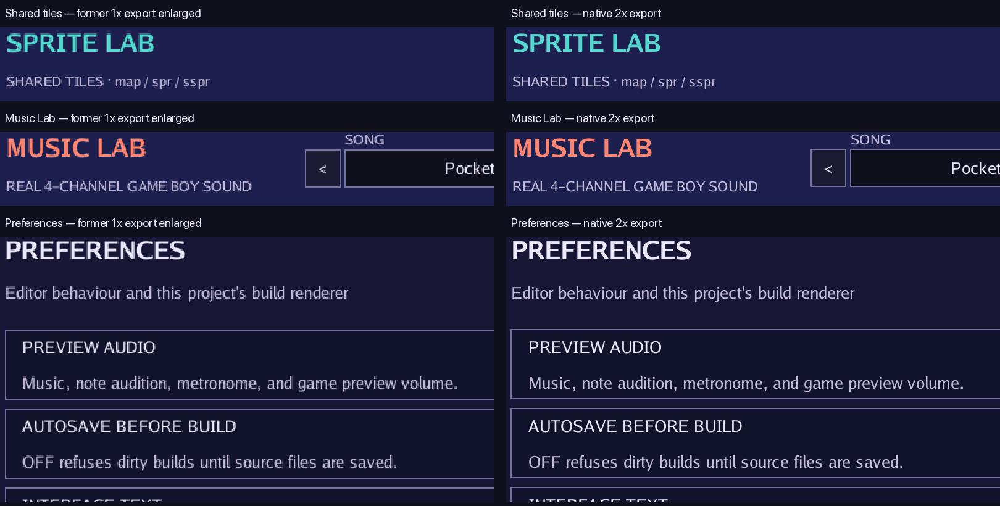

# HiDPI coverage across mTile

2026-10-28. The application-wide renderer from `cbb6d92` already handles
every editor workspace. Source inspection found no separate production font
or drawing path bypassing it: all text roles use `displayFont`, all UI drawing
helpers apply the display scale, and all mouse consumers use the common logical
coordinate conversion. The mGBA helper is headless and has no separate window.

The remaining low-resolution path was documentation export. It called
`Game.Draw` at 1600x1000, bypassing the physical-resolution window adapter.
Exports now use `editorWindow.Draw` at 2x: the same logical layout produces
3200x2000 PNGs. The manifest records both dimensions and the density. All ten
distributed editor captures were regenerated from disposable example copies.

## Visual proof



The former 1x captures were generated from the same current source and
fixtures using a read-only Go overlay containing the original export test.
The left-hand crops are enlarged 2x with nearest-neighbor sampling to show the
former presentation; right-hand crops come directly from the new 2x captures.
Only the comparison labels and arrangement are added. The distributed PNGs
are direct GPU readbacks without post-processing.

## Verified surfaces

The native GPU export test checks physical dimensions and additional detail
inside each workspace, excluding the common navigation. All captures pass:

- Shared tiles and tile links.
- Poses and the registered-pose strip.
- Animations, frame ordering, and preview.
- Color Variants dialog and recolored preview.
- Map rooms and tile-link map views.
- Music Lab controls, piano roll, inspector, and arrangement.
- Develop, project files, source, diagnostics, and preview placeholder.
- Preferences and its text-size controls.

The font-metric tests now cover all seven roles, including small Develop text
and Develop titles, in all three typography presets at 1x, 1.25x, 1.5x, and 2x.
Their raster bounds, advances, and baselines pass the existing checks.

The guide's general pixel-art image filter also affected editor screenshots.
A scoped CSS rule gives editor captures `image-rendering: auto`; game images
retain `pixelated`. Browser inspection confirmed all eight editor images in
the editor guide load at 3200x2000 with `auto`, and the game capture on the
examples page retains `pixelated`.

## Checks

- `go test ./internal/transpiler ./internal/build ./cmd/mtile ./cmd/editor`: pass.
- `cd runtime && go test ./...`: pass.
- Expanded display tests and their race-detector run: pass.
- All ten native 2x documentation captures: pass; [raw output](workspace-captures.txt).
- Website build and all nine site tests: pass (118 pages, 76 API entries).
- CSS browser inspection and batched visual inspection: pass.

The previous native-mouse automation and single-monitor limitations remain as
documented in [the original verification](README.md). This pass proves drawing
coverage across the app and the exported images; it does not add new native
mouse or physical cross-monitor validation.

## Reproduce

```sh
go test ./cmd/editor -run '^TestEditor(Display|InvalidDisplay)' -count=1
MTILE_DOC_SCREENSHOTS="$PWD/docs/media/editor" go test -tags mtile_editor_bench ./cmd/editor -run '^TestDocumentationScreenshots$' -count=1 -v -timeout=90s
python3 -m unittest discover -s website -p 'test_*.py'
```

Use an environment with `website/requirements.txt` installed for the site tests.
The capture command requires a native desktop graphics/audio session.
