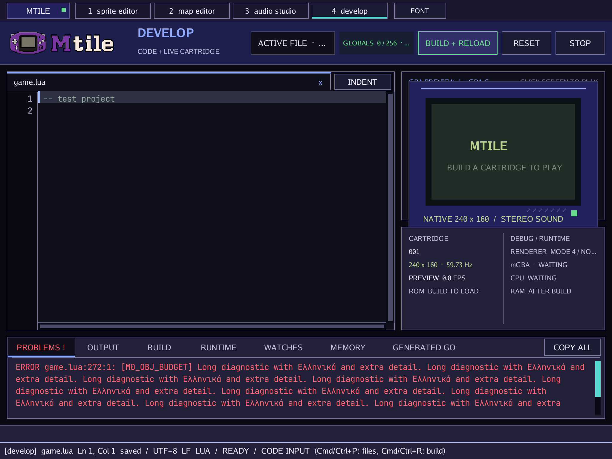

# Lumen build and diagnostic panel regression (2026-10-29)

The previous authored Lumen scene required **1,176 OBJ scanline cycles**, while
mTile reserves 64 of the hardware's 1,226 cycles for the shared pause overlay,
leaving **1,162** for the game. Lumen uses authored pose lettering, not `print()`;
changing its project font cannot fix this resource overrun.

Three ambient motes instead of five bring the proof to **1,160/1,162 cycles**
and **103/127 game OAM entries**. The runtime limits remain enforced; a regression
test restores the five-mote source through an unsaved overlay and requires its
`M0_OBJ_BUDGET` rejection. Gameplay logic and authored assets are preserved.

The updated real-ROM harness follows the system pause contract: Lua state/time
freeze while Start opens the menu; Start resumes and A restarts after dawn.
System-menu presentation costs are reported separately, without removing the
raw misses or weakening gameplay deadline assertions.

Actual TinyGo/mGBA [report](report.json). Timing/deadline assertions apply to
Mode 0; Mode 4 is the slower pixel/state reference, not the shipping renderer:

- Forced Mode 0 and Mode 4: **7,114 paired frames / 273,177,600 pixels, zero differences**.
- All 12 rooms, 18 embers, 6 lanterns, checkpoint recovery, both dawn orders,
  clock rollover and restart verified through normal button input.
- **6,876 flight updates**, maximum **278,659 cycles** of the 561,792-cycle budget;
  zero gameplay misses, no Lua heap, 152,832 bytes of free EWRAM in the debug ROM.
- One startup miss and **two system-pause UI presentation misses** are retained
  explicitly. They are excluded from flight statistics because Lua is frozen.

The diagnostics panel now wraps without ellipses, scrolls through every row,
and provides mouse selection, Cmd/Ctrl+A/C, and COPY ALL. Clipboard text retains
original Unicode and line breaks, without inserting visual wrap breaks. GPU
regressions cover 1024×768 and 1920×1200 at 1×, 1.5× and 2× density; model tests
cover long tokens, Unicode, resize, cross-row selection, scrolling, independent
panels, refreshed errors and clipboard failures.



```sh
go test ./internal/build -run TestLumenMode0FitsWithSystemPauseOverlay -count=1
go run ./examples/lumen/tests/verify.go -player build/player/mtile-player -out /tmp/lumen-verification
go test ./cmd/editor -run TestDevelopDiagnostic -count=1
MTILE_HIDPI_REPORT=/tmp/diagnostic-captures go test -tags mtile_editor_bench ./cmd/editor -run TestDevelopLongDiagnosticWraps -count=1
```

[Verification log](verification.txt). The full raw playthrough, ROMs, frames and
samples are retained locally in `/tmp/mtile-lumen-verified` and are reproduced by
the command above. These are emulator cycle measurements, not physical hardware timings.

The recorded verbose log retains the old “Start after dawn” assertion caption;
the verified restart button was A. The harness caption has also been corrected.
