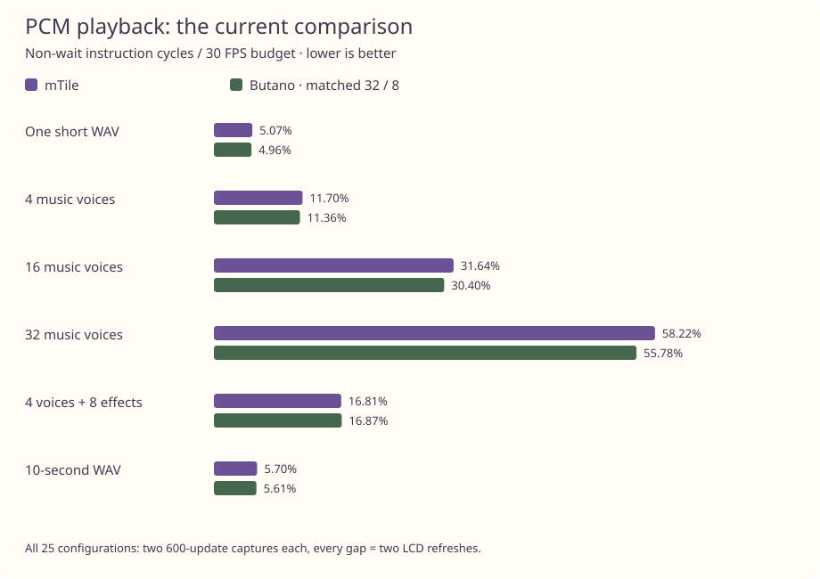

# PCM Editor audit and playback recheck

Current mTile remains close to matched Butano in these audio-only programs:
about **1–4.4% more non-wait instruction work** in most playing workloads.
The eight-effect fixture uses 0.38% less. This establishes similar performance
for these fixtures, not universal equality or a general mTile win. Two PCM
Editor bugs were reproduced and fixed during this audit.

## Current CPU results

At the GBA's two-refresh cadence an update has **561,792 cycles** available
(approximately 29.86 updates/second, conventionally called 30 FPS). The
figures count application, engine and interrupt instruction cycles, including
memory wait states, excluding intentional waits. Active emulator events,
including DMA stalls, are retained separately in the profiles.

| Audio-only workload | mTile cycles/update | Butano cycles/update | Relative mTile work | mTile / Butano budget |
| --- | ---: | ---: | ---: | ---: |
| One short WAV | 28,506 | 27,858 | +2.33% | 5.07% / 4.96% |
| One sustained music voice | 37,658 | 37,010 | +1.75% | 6.70% / 6.59% |
| Four music voices | 65,746 | 63,830 | +3.00% | 11.70% / 11.36% |
| Sixteen music voices | 177,752 | 170,765 | +4.09% | 31.64% / 30.40% |
| Thirty-two music voices | 327,087 | 313,344 | +4.39% | 58.22% / 55.78% |
| Four voices + four effects | 80,090 | 79,250 | +1.06% | 14.26% / 14.11% |
| Four voices + eight effects | 94,410 | 94,768 | −0.38% | 16.81% / 16.87% |
| One 10-second WAV | 32,030 | 31,531 | +1.58% | 5.70% / 5.61% |

The relative gap is a percentage of **Butano's work**, not of the entire
game budget. For 32 voices the absolute gap is 2.45 percentage points of
the update budget. Both kept the required cadence in both captures.



All nine matched Butano mean instruction counts reproduce the previous
[LCD-event pacing measurements](../audio-pacing-2026-11-02/README.md) exactly.
Current mTile audio rows differ by only 11–74 cycles/update; the no-audio
floor is unchanged. The current build includes the editor library's
deleted-ID checks. It retains HALT waiting: intentional waiting executes
about 0.158% of the update budget. This is not an electrical-power test.

## Does the actual batch wizard change playback cost?

Six additional configurations use the real `PrepareBatch` → `Batch.Import`
path, with **Balanced** and optional trim enabled. Butano imports those exact
prepared project sources with the same `mmutil`. Every paired final bank
matches byte for byte. These are playback measurements after desktop
preparation, not a comparison of desktop import speed.

| Prepared workload | mTile work cycles | Butano work cycles | Relative mTile work |
| --- | ---: | ---: | ---: |
| Short WAV | 28,506 | 27,858 | +2.33% |
| Four voices + eight effects | 94,410 | 94,768 | −0.38% |
| 10-second WAV, converted to 16 kHz | 31,723 | 31,224 | +1.60% |

Balanced reduces the long-WAV ROM by **60,500 bytes in each engine**. mTile
goes from 272,680 to 212,180 bytes; Butano from 285,676 to 225,176 bytes.
RAM stays unchanged. The short fixture is already 16 kHz/8-bit. These
benchmark sources have no eligible long quiet edges, so enabling trim does
not demonstrate a trimming saving. The native integration test separately
checks that a real 0.5-second source is trimmed to 0.29 seconds, imported
and played in both renderers.

Preparation, advice and silence analysis run on the desktop during import.
Normal builds embed the saved bank without invoking `mmutil` again; the
native integration test builds with an unavailable converter to check this.
No analyzer runs in the GBA audio loop.

## Memory, cadence and garbage collection

- All **25 configurations** have two independent **600-update captures**.
  Every observed gap is two LCD refreshes. No reported PCM overflow or
  clipped 16-bit output sample occurs.
- Every mTile fixture reports **zero Lua heap capacity, allocations, live
  bytes, collections and heap errors**. A game using dynamic Lua tables
  can still need a heap; this finding applies to these audio-only programs.
- Active mTile audio builds use **11,292 B static EWRAM**, **7,860–7,896 B
  static IWRAM**, plus a **9,216 B IWRAM stack reservation**. A longer
  recording does not grow these fixed working areas.
- Matched Butano reports **34,888 B static EWRAM** and **10,624 B static
  IWRAM**, plus stacks. Zero explicit stack-section size in the matrix
  does not mean zero stack use. These are complete fixture totals with
  different framework/storage choices, not isolated mixer buffer sizes.
- Both also reserve a 512-byte debug mailbox, excluded above. Profiles
  retain observed stack ranges by CPU mode, excluding startup. They are
  not worst-case stack bounds for an arbitrary game.

## Bugs found and fixed

1. **New batches inherited an earlier trim opt-in.** After trimming one
   queue, closing/reopening and choosing another multi-file selection could
   silently trim it too. Fresh selections now start with trim off; preset
   changes and adding files preserve the current queue's explicit choice.
   `TestPCMBatchNewSelectionDoesNotInheritAnEarlierTrimOptIn` fails before
   the fix and passes afterwards.
2. **Window shutdown could delete staging files while a worker used them.**
   Modal closing was already blocked during work, but native shutdown was
   another path. Shutdown now transfers workspace ownership to a detached
   result consumer. It drains progress and removes stages after the worker
   finishes, including a new stage not yet accepted by the UI. Tests cover
   both ownership cases. Application exit is not delayed until an external
   converter finishes; this does not promise cleanup after a process crash.

Before-fix failures and final logs are retained under `tests/`. The full
editor suite passed with the real converter and `-race`, as did the audio
importer/manifest/file-picker suites. Required transpiler, build, CLI and
runtime gates passed. Native integration passed for prepared/trimmed WAV,
tracker playback, deleted IDs and an entirely deleted library in both
renderers. No public Lua API semantics changed in this audit.
All 14 website tests also passed after adding this report to the guide.

## Comparison boundaries and reproduction

Both builds use **32 total mixer channels, eight effect slots**, standard
16 kHz Maxmod output (approximately 15,768 Hz), identical paired banks, and
the same corrected pinned mGBA core. The profiler checks actual active
voices: the 32-voice case really plays 32 voices. Butano's two channel
settings sum to mixer capacity; this run uses `24 + 8`, not its smaller
defaults. Butano's official [asset import documentation](https://gvaliente.github.io/butano/import.html)
describes its WAV effects and tracker pipeline.

Butano is pinned to `04374b034c76b82bfdc3aa6c38d652e5e7778a68`. mTile is the
current dirty workspace based on `b6dce25`; source hashes supplement that
base. Environments retain TinyGo/GCC, converter and player hashes.

Each profile has 60 warmup and 300 measured updates. Every cycle reconciles
as instruction cycles + active events + HALT events = elapsed cycles.
Telemetry publication remains included, with different bookkeeping in the
engines. The normalized volume request matches; integer gain conversion and
playback phase differ, so identical banks do not imply sample-for-sample
output or exact loudness parity. These generated songs use few tracker
effects. Results at one output frequency on an emulator do not establish
physical-hardware, every-format/every-song, full-game or battery parity.

From the repository root, use separate fresh work/output directories:

```sh
python3 scripts/butano-bench/pcm/run.py \
  --mmutil /path/to/mmutil --butano /path/to/butano-checkout \
  --work /tmp/pcm-raw-work --out /tmp/pcm-raw-results \
  --variants mtile,butano-matched --rebuild

python3 scripts/butano-bench/pcm/run.py \
  --mmutil /path/to/mmutil --butano /path/to/butano-checkout \
  --work /tmp/pcm-prepared-work --out /tmp/pcm-prepared-results \
  --variants mtile,butano-matched --only wav,mixed8 \
  --prepare-quality balanced --trim --rebuild

python3 docs/benchmarks/pcm-batch-audit-2026-11-02/verify.py
```

`--only` matches substrings, so `wav` also includes `longwav`. Use a
converter emitting the MAS 0x18 format required by this pinned comparison.

- [Numeric matrix](matrix.md), [source hashes](source-sha256.json).
- Original imports: [results](raw/results.json), [environment](raw/environment.json).
- Wizard-prepared imports: [results](prepared/results.json), [environment](prepared/environment.json).
- Configuration folders retain ROM/ELF/bank hashes, profiles, compressed
  per-update/per-PC traces, inline frames and both raw capture summaries.
  Host driver/profiler binary hashes are retained per group. The raw run
  preceded the optional batch-driver extension; its default import path is
  unchanged by that extension.
