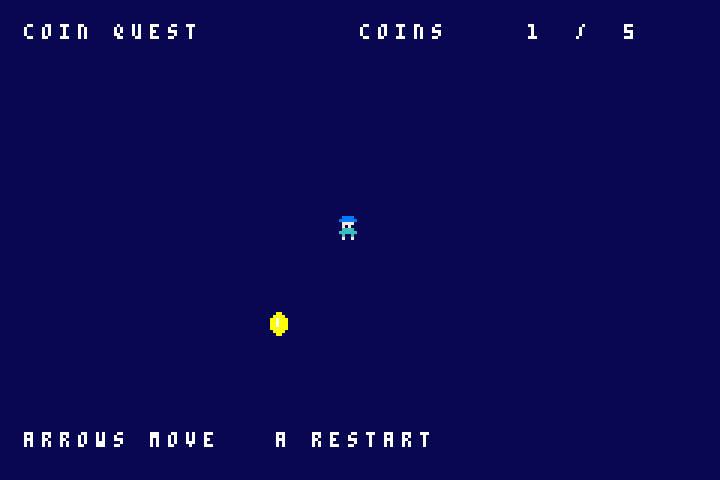

# Your first game in mTile

[Getting started](getting-started.md) · [Documentation index](README.md)

**Coin Quest** is a small, complete game: move an explorer, collect five coins,
hear each pickup, and restart. It includes original editable sprites and a
two-note hardware sound effect. Plan for about 15 minutes of learning once
your tools are installed; first-time builds can take longer.

Your first goal is small: **play it, change its speed, and play again.** The
lessons below are optional checkpoints you can return to one at a time. You
do not need to learn the whole API or choose a renderer to begin.



*An actual mGBA capture. [Reproduction details](media/README.md#coin-quest).*

## Check your setup

Follow the [installation requirements](getting-started.md#requirements), then
run these commands from your source checkout:

```sh
go run ./cmd/mtile doctor
go run ./cmd/mtile new -template coin-quest mygame
go run ./cmd/mtile build mygame
go run ./cmd/mtile edit mygame
```

Using an installed desktop bundle? Replace `go run ./cmd/mtile` with `mtile`.
Keep flags before the project directory. Creation refuses to overwrite an
existing directory; choose another name if `mygame` already exists.

`doctor` checks the ROM tools and suggests fixes if anything is missing. The
build and editor commands then check that you can compile and play a game.
See the [command reference](reference.md#commands) for the full checks.

## Play the complete game

Choose **Develop** → **Build + Reload** and click the GBA preview. Move with
the arrow keys, collect five coins, then press **Z** (GBA A) to restart.
Press Escape to return keyboard focus to the editor.

**Checkpoint:** you can move, collect five coins, and restart. You have a
working game to return to.

## Your first change

In **Develop**, open `game.lua`. Find `speed = 2` near the top and change it to
`speed = 3`. Save, select **Build + Reload**, and click the preview again.

**Checkpoint:** the explorer moves faster. You have completed the same
edit → build → play loop you will use for every new feature. Change it back
to `2` if you prefer the original pace.

**You can stop here.** To share your modified game, select **Export .gba** and
choose `mygame/game.gba`. Keep the project folder so you can edit it later.

For another small change, recolor sprite **1**, the explorer, in **Sprites**.
Save and rebuild to see the new artwork. The generated `mygame/README.md`
has the complete walkthrough, also available
[here](../internal/build/templates/coin-quest/README.md); it travels with the
project and works offline.

## Learn one piece at a time

When you want to understand the code, start with `01-movement.lua`. Each lesson
adds one idea; use the next one after its checkpoint makes sense.

| Checkpoint | What you learn | What to check |
| --- | --- | --- |
| `lessons/01-movement.lua` | Input, sprite coordinates, screen boundaries | The explorer stops at each edge of the play area |
| `lessons/02-coins.lua` | Collision and score | Each pickup awards one coin |
| `lessons/03-sound.lua` | Playing a hardware sound clip | Each pickup produces a rising chime |
| `lessons/04-complete.lua` | Win condition and restart | Five coins win; A resets the game |

Every checkpoint is a complete program. Save your own version separately,
then copy a lesson's contents into `game.lua`, save, and rebuild to try it.
Opening a lesson does not select it as the game entry point. To return to the
finished game, copy `lessons/04-complete.lua` into `game.lua`.

## Choose one next step

Choose [one small game](small-games.md) for the feature you want next: a pose
and looping clip, an action that starts and finishes, a scrolling coast, or a
transition between two rooms. Each has ready artwork and separate runnable
lessons. You do not need to work through all four.

Pick the feature you want next and keep a working copy before experimenting.
