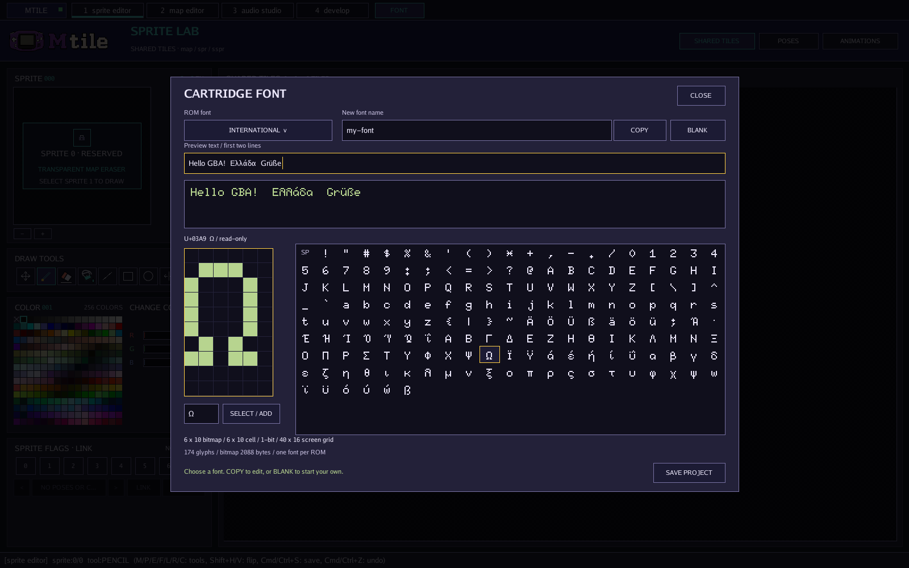
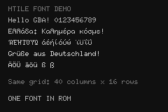

# Cartridge fonts

mTile renders text using a tiny monochrome bitmap font. The approved **B** design uses
**Misc Fixed 6×10**, with complete Greek accents and descenders. Every project
font uses a fixed **6×10 cell**: 40 columns and 16 rows on the 240×160 screen.
The editor's interface fonts are separate from the cartridge font.

## Choose a font and preview it

Open **FONT** in the editor's top navigation. Choose from the **ROM font**
dropdown and type or paste into **Preview text**. The preview uses the actual
cartridge bitmaps, enlarged with integer pixels; it shows the first two lines.
Unsupported characters appear as `?` and are counted beneath the preview.

| Preset | Character coverage and appearance |
| --- | --- |
| `pico8` | Original 4×5 PICO-8 wide ASCII artwork, padded to the current 6×10 cell |
| `arcade` | Misc Fixed 6×10 ASCII |
| `greek` | Misc Fixed Latin plus modern Greek capitals, lowercase, final sigma, tonos and dialytika |
| `german` | Misc Fixed Latin plus ÄÖÜ, äöü, ß and ẞ |
| `international` | Both Greek and German repertoires in one font; default |

Choose **SAVE PROJECT**, then build again. Only the selection is compiled into
the cartridge. Changing fonts is a build-time operation; there is no Lua font
switch and no alternative-font library loaded into the ROM.



The selection lives in `project.json`, for example:

```json
{
  "activePalette": "aurora",
  "renderer": "auto",
  "font": "international"
}
```

Omitting `font` now selects `international`. An explicit `pico8` selection
keeps its original small artwork, with the current 10-pixel line advance. Built-in presets do not
need files in your project. Custom fonts are stored in
`assets/fonts/<name>.json`. Share that file along with the project.

## Make your own

1. Enter a lowercase **New font name**, such as `my-font`.
2. Choose **COPY** to duplicate the selected font, or **BLANK** to start with
   empty ASCII, Greek and German glyphs. A visible `?` is retained as fallback.
3. Click a character in the glyph browser. Blank cells show a host-font label
   so you can identify them; `SP` denotes space. Scroll for more characters.
4. Paint inside the highlighted **6×10** area. A stroke adds or erases pixels.
   The canvas cannot grow; cell dimensions and advance cannot be changed.
5. To select a character directly, type/paste it into the small character box
   beneath the canvas and choose **SELECT / ADD**, or press Enter. A new
   printable, precomposed character is added if it is absent.
6. Preview your text and choose **SAVE PROJECT**. Cmd/Ctrl+S also saves;
   Cmd/Ctrl+Z and Cmd/Ctrl+Shift+Z undo/redo font selection, creation and strokes.
   Tab moves between the three text fields; Escape closes the dropdown/dialog.

Built-in fonts are read-only. Copies are independent, so editing a copy never
changes its source. BLANK intentionally leaves letters empty: draw the glyphs
needed by your game, and the ASCII letters used by the shared pause overlay.
The overlay uses the same selected font to avoid shipping a second font bank.

## Compatibility contract

| Property | Required value |
| --- | --- |
| Glyph bitmap | Exactly 6 columns × 10 rows |
| Cell/advance | Exactly 6×10 pixels, fixed width |
| Pixel depth | 1 bit: ink or transparent |
| Spacing | Contained in the bitmap; leave room around strokes when designing glyphs |
| Screen grid | 40 columns × 16 rows on the native 240×160 screen |
| Required repertoire | Every ASCII codepoint 32–126, exactly once |
| Extension capacity | At most 128 additional Unicode glyphs (223 total) |
| Space | Always blank |
| Missing character | Visible `?`, one 6×10 cell per unsupported codepoint |

The editor, save/load path, compiler and runtime enforce the structural
contract. Editing JSON cannot enable larger glyphs, wider advances, extra
bitmap rows, negative pixels, duplicate glyphs or invalid codepoints.

The version-2 JSON document has `version`, `name`, `cellWidth`, `cellHeight`,
`width`, `height` and `glyphs`. Dimensions must be `6, 10, 6, 10` respectively.
Each glyph stores a numeric Unicode `codepoint` and exactly six integer
`columns`, each 0–1023. Bit 0 is the top pixel, bit 9 the bottom. For example,
`{"codepoint": 937, "columns": [188,194,2,194,188,0]}` describes Ω.
All required ASCII entries must also be present. Filename and document name
must match; built-in names cannot be overwritten. Names use lowercase ASCII
letters, digits and internal hyphens, up to 32 bytes.

### Existing projects and version-1 fonts

This is an intentional vertical layout change: newlines, implicit `print()`
lines and wraps advance **10 instead of 8 pixels**, including `pico8`. Horizontal
advance, tabs and return x coordinates remain six pixels per character.
The final complete cell begins at **(234,150)**. Move labels anchored at y=151–159
upward if all ten bitmap rows must be visible. Arbitrary coordinates continue
to clip safely; the runtime does not move text back onto the screen.
Review hard-coded row spacing and backgrounds in existing games. The Moon Door
and Tidewalk samples have their bottom labels moved to y=150.

Strict version-1 files (4×5 bitmap / 6×8 cell) remain readable and buildable.
Compilation pads their original pixels with zeros to the current 6×10 runtime
format. Merely opening, building or saving a project preserves the document's
version, pixels and unknown font/glyph metadata. Explicitly copying, adding a
glyph or painting a legacy font upgrades that independent document to version 2.
Invalid mixed-version dimensions are rejected; changing `version` alone cannot
bypass geometry validation. Roll back to the earlier tool to recover the old
8-pixel advance; keep original version-1 files for that workflow. Version-2
files need the new tool.

## Text APIs and renderers

`print()` decodes UTF-8 printable text in Mode 4. Each codepoint advances six
pixels, including unknown characters; malformed UTF-8 bytes render `?` safely.
Return values and explicit cursor positions remain pixel coordinates. Newline,
wrap and implicit cursor line advance use ten pixels. Tabs remain four six-pixel
cells. Clipping, camera, background control and palette rules are shared.
The repeat control repeats a complete UTF-8 character. Other control parameters
remain bytes. Lua string length (`#`), `sub`, `ord` and `chr` remain byte based;
font support does not change Lua's string model.

Use **precomposed Unicode (NFC)**. Greek `ά` and German `ä` are supported;
separate combining accents are not merged by the runtime and produce fallback
glyphs. This is a bounded bitmap text system: polytonic Greek, shaping, variable
width, kerning, anti-aliasing and automatic Unicode normalization are not
implemented. Custom precomposed glyphs can be added within the extension limit.
The ten-row box includes accents and descenders without shifting and cropping
the base letter. It has no proportional widths or kerning.

Mode 0 supports the existing proven static ASCII/decimal print subset with
exactly the selected font's pixels. Its atlas deduplicates `(glyph,color)`
pairs. The compiler uses one 8×8 OBJ tile when rows 8–9 are blank, or two
consecutive tiles in one **8×16 OBJ** when either row contains ink. This is
lossless packing: all fonts retain their full 6×10 cell and artwork.
The existing 32-tile bank holds up to **32 compact pairs or 16 tall pairs**;
a mixture consumes one or two tiles per pair. Each visible occurrence still
costs one OAM entry. The scanline proof counts its actual 8 or 16 hardware rows,
including overlap between adjacent ten-pixel text lines.
Exceeding 32 physical tiles causes `M0_OBJ_BUDGET`: forced Mode 0 fails and
AUTO falls back to Mode 4. Numeric output reserves its 12-character decimal
charset, with the selected font's exact glyph heights. Greek and German diacritics require
Mode 4: AUTO falls back with a source-positioned `M0_PRINT_SHAPE` diagnostic;
forced Mode 0 rejects them. Selecting a Greek/German font and printing only
ASCII can still use Mode 0. See [renderer compatibility](render-modes.md).

## GBA memory and design choices

Bitmaps stay packed at 1bpp in read-only cartridge memory. ASCII lookup is
direct; additional codepoints use a bounded binary search. Rendering does not
allocate. Neither the editor's font library nor a TrueType rasterizer ships in
the cartridge, and font bitmaps are not copied into EWRAM. On ARM, font data
uses 1,152 bytes for ASCII plus its descriptor and 16 bytes per extra glyph:
**2,416 bytes** for the 174-glyph international preset, at most 3,200 bytes for
223 glyphs. The old international bank used 1,024 bytes. A ROM pointer lookup
avoids copying the six-column array on every character.

Mode 0 expands only the glyph/color pairs used by its static print calls into
its existing ROM/OBJ atlas, then uploads once while blanked. This is a renderer
cache of the same font, not another selectable font. ROM/VRAM expansion is
bounded by the existing 32 physical text tiles; no per-frame font upload is needed.

The implementation follows [Tonc's bitmap-text guidance](https://gbadev.net/tonc/text.html)
and its [UTF-8 text-engine discussion](https://gbadev.net/tonc/tte.html): bitpack
monochrome art, keep predictable metrics, and avoid retaining every glyph in
VRAM. [Pokémon Emerald's font source](https://github.com/pret/pokeemerald/blob/master/src/fonts.c)
and its small Latin font assets informed the compact menu style. Its variable
widths cannot be imported directly without violating mTile's fixed grid.
The B bitmap subset comes from the public-domain [Misc Fixed 6×10 BDF](https://raw.githubusercontent.com/olikraus/u8g2/master/tools/font/bdf/6x10.bdf);
[attribution and checksum](../fonts/misc-fixed/LICENSE) are checked in. Capital
ẞ is original mTile artwork. No commercial-game font assets are bundled. The inherited PICO-8 artwork remains
under its [existing CC0 license](../fonts/pico-8-wide.otf/license.txt).

## Try it and verify

```sh
go run ./cmd/mtile edit examples/font-demo
go run ./cmd/mtile build examples/font-demo
```



The [demo walkthrough](../examples/font-demo/README.md) covers selection and
scratch editing. [B benchmark evidence](../research/font-typography/production-b.md) includes
real Mode 0/4 parity captures and cycle measurements. Tests cover malformed
fonts, bounds and capacity, editable pixels, persistence, undo, UTF-8 static
and heap strings, fallback, control codes, renderer diagnostics and one-font
ROM linking. Every ASCII glyph in every preset is compared pixel for pixel
between the software renderer and the compiled Mode 0 atlas.
