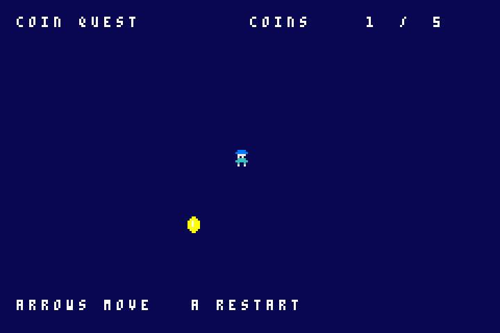

# Making room for the next enemy

<figure class="gc-opening">
  
  <figcaption>A whole little world on screen. Positions, scores, and other changing values in memory.</figcaption>
</figure>

A monster disappears. Another one spawns. Your game keeps moving, but where
does the old monster's data go?

The **Game Boy Advance**, or **GBA**, is Nintendo's small handheld game console.
It has much less memory than a modern computer. Even a little game has to make
room for what comes next.

mTile helps by automatically recovering space from Lua objects your game can
no longer reach. The part that does this is called the **Garbage Collector**,
or **GC**. To understand its job, let's follow one enemy through memory.

## A small workbench

Think of **RAM**, the game's working memory, as a small workbench. It holds
things that change while you play: positions, health, scores, and lists of
enemies. **ROM**, the cartridge's stored data, holds the compiled program,
artwork, and other fixed information.

<figure class="gc-storage" aria-label="ROM stores the game; RAM holds its changing state.">
  <div><strong>On the cartridge</strong><span class="gc-storage-label">ROM</span><p>Code · artwork · fixed data</p></div>
  <span class="gc-flow-arrow" aria-hidden="true"></span>
  <div><strong>While you play</strong><span class="gc-storage-label">RAM</span><p>Position · health · enemy lists</p></div>
  <figcaption>The game stays on the cartridge. Its changing state needs working space.</figcaption>
</figure>

A Lua **table** groups values together. An enemy's table might hold its
position and health. Making a new table reserves some memory. We call that
an **allocation**. Creating a new dynamic string, such as joining a label
and a score into one piece of text, can allocate too.

If we keep making new objects without recovering old space, the workbench
eventually fills up.

## Gone from the screen, still in memory

A **reference** is a way for your code to find an object again. A variable
can hold one. So can an entry in a list.

Suppose `enemy` and the first entry in `enemies` both refer to the same slime.
Setting `enemy = nil` makes that variable let go. The list still holds on.

<figure class="gc-references">
  <div class="gc-reference-row"><code>enemy = nil</code><div class="gc-reference-path"><code>enemies[1]</code><span class="gc-flow-arrow" aria-hidden="true"></span><span class="gc-object">Slime <small>still reachable</small></span></div></div>
  <div class="gc-reference-row"><code>deli(enemies, 1)</code><div class="gc-reference-path"><span class="gc-empty-list">empty list</span><span class="gc-broken-link" aria-hidden="true"></span><span class="gc-object gc-object-gone">Slime <small>now unreachable</small></span></div></div>
  <figcaption>One slime, two references. After the variable lets go, removing the only list entry leaves no reference to it.</figcaption>
</figure>

Once nothing the game can reach refers to the slime, its table becomes
**unreachable**. The GC can recover its space at the next collection.
`nil` does not free the memory immediately.

This is why hiding a sprite is not enough to release its table. If an enemy
list still holds the object, the GC keeps it.

## Keep the useful things. Make room for the next ones.

mTile uses a **copying collector**. Imagine two work trays, A and B.
The game creates objects in one tray. The other is reserved for collection.

When collection starts, the GC follows references from the game's globals,
active local variables, and temporary values. It also follows references
inside tables. It copies the objects it reaches into the other tray.
Unreachable objects stay behind.

<figure class="gc-copying" aria-label="Three stages of copying collection between two equal memory regions.">
  <div class="gc-pass">
    <p><strong>Before collection</strong> <span>A is in use. B is reserved.</span></p>
    <div class="gc-bank"><div class="gc-bank-label"><strong>A</strong> 56 KiB · in use</div><div class="gc-slots"><span class="gc-slot">Hero<small>live</small></span><span class="gc-slot">Slime<small>live</small></span><span class="gc-slot gc-slot-gone">Smoke<small>unreachable</small></span><span class="gc-slot gc-slot-gone">Spark<small>unreachable</small></span></div></div>
    <div class="gc-bank"><div class="gc-bank-label"><strong>B</strong> 56 KiB · reserved</div><div class="gc-slots"><span class="gc-slot gc-slot-free">free</span><span class="gc-slot gc-slot-free">free</span><span class="gc-slot gc-slot-free">free</span><span class="gc-slot gc-slot-free">free</span></div></div>
  </div>
  <div class="gc-pass gc-pass-copy">
    <p><strong>Copy what is reachable</strong> <span>Hero and Slime move to B.</span></p>
    <div class="gc-bank"><div class="gc-bank-label"><strong>A</strong> source</div><div class="gc-slots"><span class="gc-slot">Hero<small>live</small></span><span class="gc-slot">Slime<small>live</small></span><span class="gc-slot gc-slot-gone">Smoke<small>unreachable</small></span><span class="gc-slot gc-slot-gone">Spark<small>unreachable</small></span></div></div>
    <div class="gc-bank gc-bank-destination"><div class="gc-bank-label"><strong>B</strong> destination</div><div class="gc-slots"><span class="gc-slot">Hero<small>copied</small></span><span class="gc-slot">Slime<small>copied</small></span><span class="gc-slot gc-slot-free">free</span><span class="gc-slot gc-slot-free">free</span></div></div>
  </div>
  <div class="gc-pass">
    <p><strong>Carry on in B</strong> <span>New objects have room beside the live ones.</span></p>
    <div class="gc-bank"><div class="gc-bank-label"><strong>A</strong> reserved for next collection</div><div class="gc-slots"><span class="gc-slot gc-slot-free">free</span><span class="gc-slot gc-slot-free">free</span><span class="gc-slot gc-slot-free">free</span><span class="gc-slot gc-slot-free">free</span></div></div>
    <div class="gc-bank"><div class="gc-bank-label"><strong>B</strong> now in use</div><div class="gc-slots"><span class="gc-slot">Hero<small>live</small></span><span class="gc-slot">Slime<small>live</small></span><span class="gc-slot gc-slot-free">free</span><span class="gc-slot gc-slot-free">free</span></div></div>
  </div>
  <figcaption>A simplified view of memory, not equal-sized real objects. The old region becomes reusable; collection does not need to erase every old byte.</figcaption>
</figure>

The game carries on in B with the same live objects. At the next collection,
the trays swap jobs. This reserved object-storage area is called the **heap**.
You do not need to write a separate memory-release command for each table
or dynamic string.

## Cleaning up has a cost

<aside class="gc-pullquote"><p>The GC recovers space.<br>It cannot make the workbench bigger.</p></aside>

Each tray is **56 KiB**. A KiB is 1,024 bytes, a unit of memory.
The two trays reserve **112 KiB** in total, plus space for the GC's records.
Live object data must fit in one tray. This is separate from graphics memory
and the engine's other fixed buffers.

Following references and copying objects takes processing time. The game's
code waits while collection runs. A long collection can delay the next
**frame**, the next picture the game presents.

<figure class="gc-timing">
  <div class="gc-tick"><span>Update</span><span>Draw</span><span class="gc-collection-time">GC</span><span>Next frame</span></div>
  <figcaption>Collection is part of the game's work. These are stages, not measured durations; an allocation can also trigger GC during update or draw.</figcaption>
</figure>

mTile checks after update and draw whether more than three quarters of the
active tray has been used. If so, it collects. An allocation can trigger
collection earlier if there is not enough space or the object-handle slots
are full. These slots are the GC's fixed set of object records.

If live data still fills more than three quarters after collection, the
current collector can run again every game tick. Leave breathing room.
If the live objects and a new allocation cannot fit at all, the game runs
**out of memory**. Collecting cannot discard something your code still holds.

## Reuse an enemy instead of making another

You can move an existing enemy by changing its fields:

```lua
enemy.x = enemy.x + 1
```

<figure class="gc-reuse" aria-label="The same enemy table at three different times, with x changing from 10 to 40 to 70.">
  <span><strong>Same enemy</strong><code>x = 10</code></span><span class="gc-flow-arrow" aria-hidden="true"></span><span><strong>Same enemy</strong><code>x = 40</code></span><span class="gc-flow-arrow" aria-hidden="true"></span><span><strong>Same enemy</strong><code>x = 70</code></span>
  <figcaption>Three moments, one table. Changing an existing numeric value does not create a new table.</figcaption>
</figure>

For bullets or smoke particles, you can keep finished objects in a **pool**:
a collection of objects ready to use again. A pool keeps its objects in memory,
but reduces new allocations. It is useful when the same kinds of objects
appear repeatedly. Avoid building fresh tables or joined strings every
update when an existing object or a separate label and number will do.

Some games can go further. The **compiler**, which turns your code into a
cartridge program, checks whether the whole program needs dynamic allocations.
When it proves none are needed, it removes the GC, both trays, and almost all
of their bookkeeping. This is called **heapless**.

Reusing objects alone does not make a game heapless. A table created only in
`_init()` may still need the heap, unless the compiler can replace it with
ordinary values. The proof covers the whole program, including startup.

## What you control

You decide when objects are created, what keeps a reference to them, and what
can be reused. mTile automatically recovers unreachable Lua object storage.
There is currently no Lua `collectgarbage()` command to force a collection,
pause the GC, or tune its settings.

In the editor's inspector, **HEAP** includes used space that may still contain
unreachable objects. **LIVE** is the byte count kept by the most recent
collection. **GC** is the collection count. These help you see what your game
is keeping and how often it needs to clean up.

With C++ or ARM assembly, you can choose tighter data layouts and more exact
object lifetimes. Butano also provides ownership-based resource management,
so C++ does not mean manually freeing every object. mTile trades some memory
and processing time for tracing and recovering unreachable objects. There
is no single slowdown percentage that applies to every game.

For measured GC pauses and memory limits, see [Frame budgets](performance.md).
For Butano's resource ownership, see its
[official FAQ](https://gvaliente.github.io/butano/faq.html).
