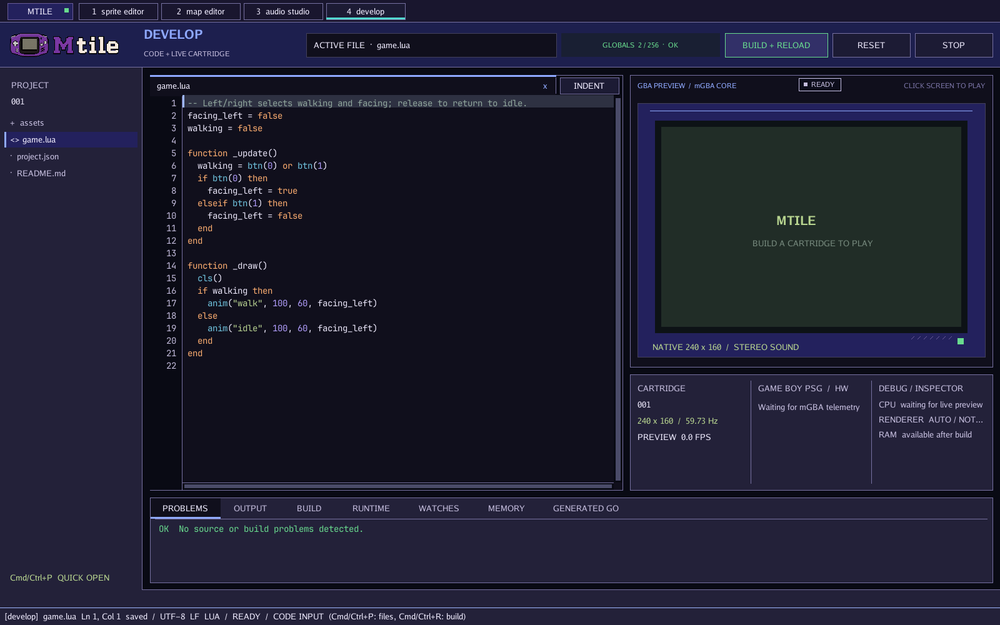

# Getting started

[Documentation index](README.md) · [Command reference](reference.md#commands)

[Download Mtile from GitHub Releases](https://github.com/drpaneas/mtile/releases/latest) to play **Coin Quest**, change the Lua, and export a Game Boy Advance cartridge. The desktop download includes Go, TinyGo and the mGBA preview player. Once you extract it, all three activities work offline.

## Using a desktop bundle

Under **Assets** on the [latest release](https://github.com/drpaneas/mtile/releases/latest), choose the archive for your computer.

| Your computer | Download | Open after extracting |
| --- | --- | --- |
| Windows x64 | `mtile-windows-amd64.zip` | `Mtile.exe` |
| Mac with Apple Silicon, macOS 14 or later | `mtile-darwin-arm64.zip` | `Mtile.app` |
| Intel Mac, macOS 15 or later | `mtile-darwin-amd64.zip` | `Mtile.app` |
| Linux x86-64 | `mtile-linux-amd64.tar.gz` | `Mtile` |
| Linux ARM64 | `mtile-linux-arm64.tar.gz` | `Mtile` |

Extract the **whole archive**. On Windows, right-click the ZIP and choose
**Extract All**. Double-click the launcher in the table above. If you move
Mtile, move the entire extracted folder or the whole Mac app. Linux requires
a graphical desktop with X11, OpenGL and audio support. Check the release
notes for signing details if your operating system prompts on first launch.

## Play and edit

Coin Quest opens in **Develop** with the game ready for input. Move with the
arrow keys, collect five coins and press Z to restart. Mtile creates your
editable copy in **mTile Projects/Coin Quest** in your home folder. Opening
Mtile again loads your saved work.

1. Press Escape to give the code editor keyboard focus.
2. In `game.lua`, change `speed = 2` to `speed = 3`, save, and select **Build + Reload** (Ctrl/Cmd+R).
3. Click the GBA preview and move again. The explorer now moves faster.
4. Select **Export .gba** to save the modified cartridge. The editor shows where it wrote the file. Play it in another emulator or on compatible GBA flash-cartridge hardware.



Z and X are the GBA A and B buttons. For larger text, open Preferences with
Ctrl/Cmd+`,` and choose COMFORT or LARGE. The [IDE guide](ide.md) covers the
other controls. Your project's `lessons/` folder contains four playable
lessons. Follow [Your first game](first-game.md#your-first-change) to explore them.

## Use mtile in a terminal

The command examples in this guide use the `mtile` program in the desktop
download. To make it available in the current terminal, follow the steps for
your system. These steps are optional when using the editor.

**macOS.** In Terminal, go to the folder containing `Mtile.app` and add its tools to the command search path.

```sh
export PATH="$PWD/Mtile.app/Contents/MacOS:$PATH"
```

**Linux.** Open a terminal inside the extracted folder containing the
`Mtile` launcher and its `bin` directory. Add the bundled tools to your path.

```sh
export PATH="$PWD/bin:$PATH"
```

**Windows.** Open PowerShell inside the extracted folder containing
`Mtile.exe` and `bin`. Add the bundled tools to your path.

```powershell
$env:Path = "$(Join-Path $PWD 'bin');$env:Path"
```

Run `mtile doctor` to check the bundled compilers. You can now change to
any project folder and use `mtile` in this terminal. To keep the command
available in new terminals, add the full path of the same directory to your
user's `PATH`.

## Build your first ROM

From a writable folder where you keep games, create another copy of Coin
Quest, build it and open it in the editor.

```sh
mtile new -template coin-quest mygame
mtile build mygame
mtile edit mygame
```

`new` creates the Lua, sprites and other assets in `mygame`. Choose an unused
name so you keep any existing project. `build` writes `mygame/game.gba` and
reports the renderer and memory use. Keep command flags before the project
directory. For an empty project, run `mtile new blankgame`.

You can also build the project the desktop launcher created. Open a terminal
in **mTile Projects/Coin Quest** and run `mtile build .` to write `game.gba`
there.

## When you are ready to change the artwork

Try recoloring the explorer in **Sprites**, save, and rebuild. For more
projects with ready-made artwork, [choose a small game](small-games.md).
[Moth Study](../examples/moth-study/README.md) teaches poses and clips.
[Tidewalk](../examples/tidewalk/README.md) covers maps, cameras and parallax.

## Build the desktop tools

This is the alternative installation path for people who want to compile
Mtile itself. Once built, the tools use the same `mtile` commands shown above.

### Requirements

Install Git, [Go 1.27.1 or newer](https://go.dev/doc/install), and
[TinyGo 0.42.0](https://github.com/tinygo-org/tinygo/releases/tag/v0.42.0).
Put the compilers on `PATH`. The desktop preview also needs
[CMake](https://cmake.org/download/), a C compiler and the platform's
graphics and audio development support. On macOS, the Xcode Command Line
Tools supply the C compiler. On Windows, use a CMake-compatible native
toolchain. Debian and Ubuntu source builds use the following desktop packages.

```sh
sudo apt install build-essential cmake pkg-config libc6-dev libgl1-mesa-dev \
  libglu1-mesa-dev libxcursor-dev libxi-dev libxinerama-dev libxrandr-dev \
  libxxf86vm-dev libasound2-dev
```

Check the compilers, clone the source with the pinned mGBA submodule, and
build the command-line tool and editor.

```sh
go version
tinygo version
git clone --recurse-submodules https://github.com/drpaneas/mtile.git
cd mtile
go build -o ./build/ ./cmd/mtile ./cmd/editor
```

Keep the resulting `mtile` and `editor` binaries together. On macOS and
Linux, the first source-checkout preview builds and caches the mGBA helper.
On Windows, build the helper next to `mtile.exe` and `editor.exe` from the
repository root in PowerShell.

```powershell
cmake -S cmd/mtile-player -B build/player -DCMAKE_BUILD_TYPE=Release "-DCMAKE_RUNTIME_OUTPUT_DIRECTORY=$PWD/build" "-DCMAKE_RUNTIME_OUTPUT_DIRECTORY_RELEASE=$PWD/build"
cmake --build build/player --config Release --target mtile-player
```

From the repository root, run `export PATH="$PWD/build:$PATH"` in a macOS or
Linux shell, or `$env:Path = "$(Join-Path $PWD 'build');$env:Path"` in
PowerShell. Run `mtile doctor`, then follow [Build your first ROM](#build-your-first-rom).

## Common setup problems

| Symptom | What to check |
| --- | --- |
| Terminal cannot find `mtile` | Add the directory containing the CLI to this terminal's [command search path](#use-mtile-in-a-terminal). |
| The desktop download reports a missing tool | Extract the complete archive again. Keep the launcher, player and toolchains in their original locations. |
| Game ignores the keyboard | Click the embedded GBA display to focus it. Press Escape to return focus to the code. |
| Source build cannot find TinyGo | Run `tinygo version`. Use `-tinygo /path/to/tinygo` before the project argument or set `MTILE_TINYGO`. |
| Source editor cannot build its helper | Run `git submodule update --init --recursive` in the checkout and check the [build requirements](#requirements). You can set `MTILE_PLAYER` to an existing helper. |
| Forced Mode 0 build fails | Read the source-positioned diagnostic. Use `-renderer auto` or `-renderer mode4` for unsupported drawing calls. |
| Game exceeds its frame budget | Inspect `stat(1)` and the [performance guide](performance.md). |

When [asking for help](../SUPPORT.md), include your operating system, Mtile
release or source revision, and the full error message.
