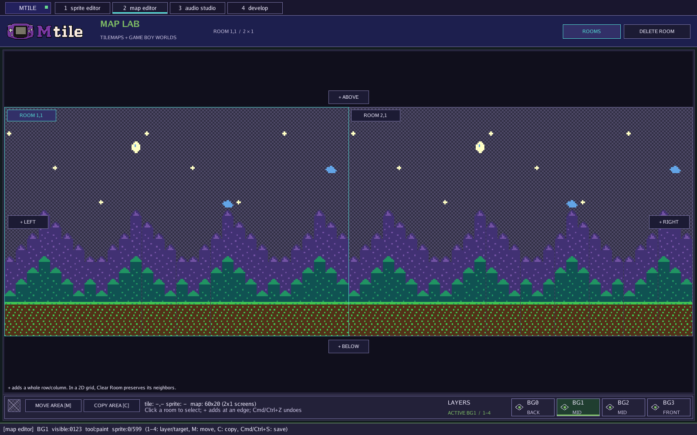
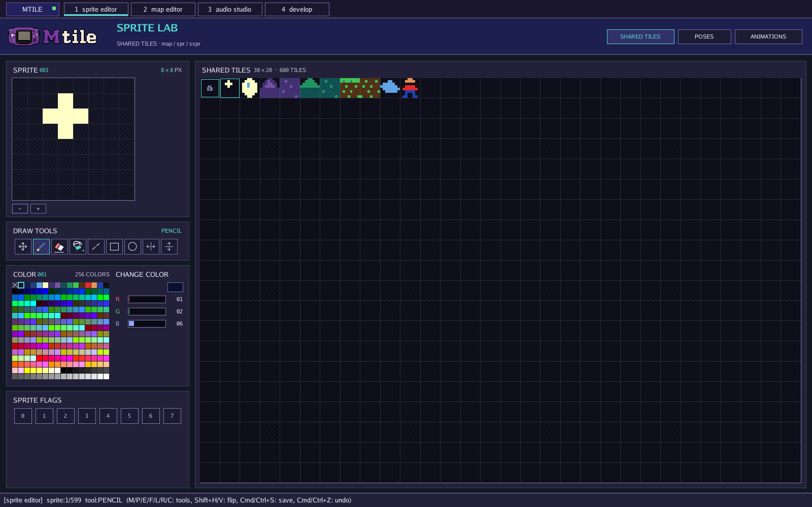
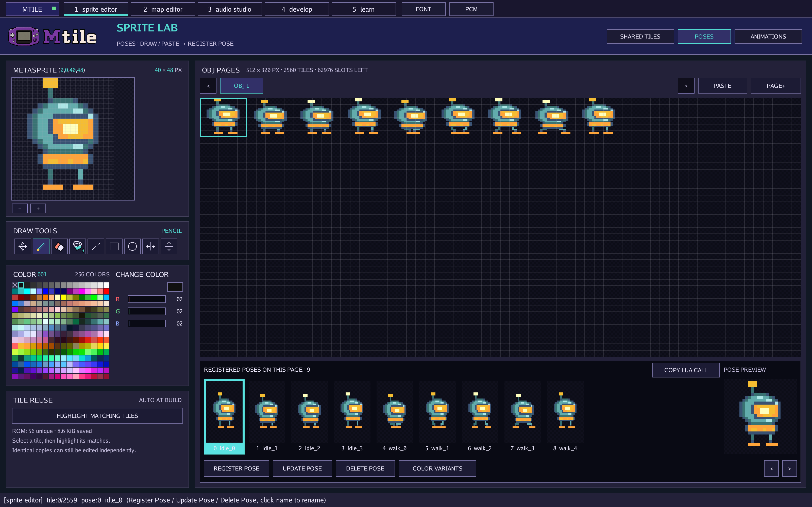
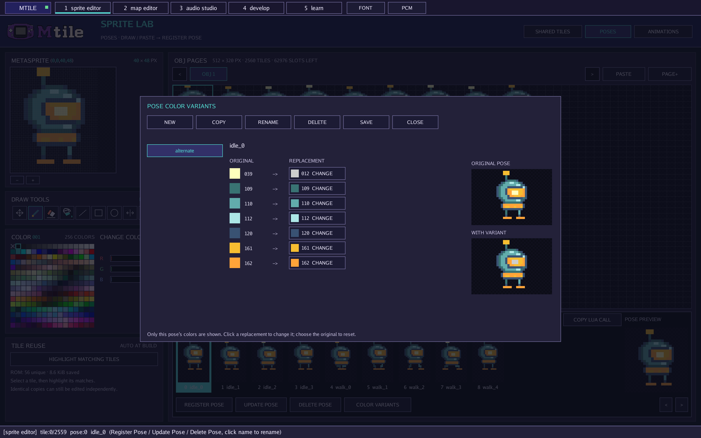
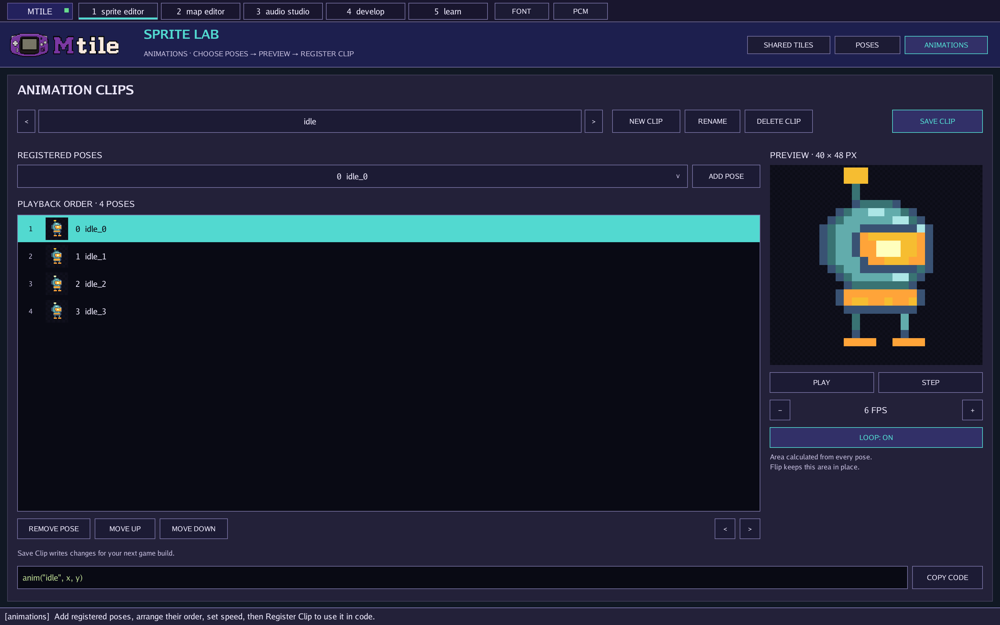
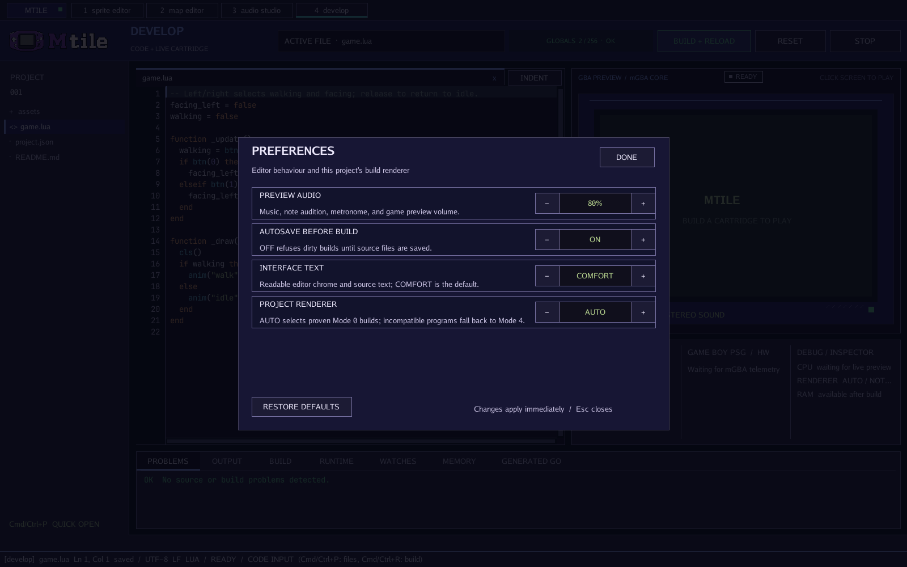
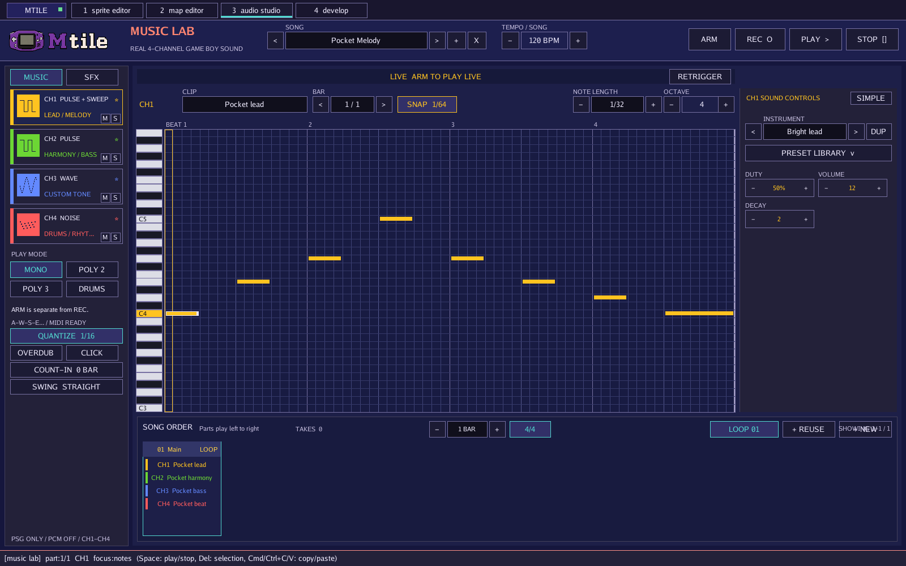
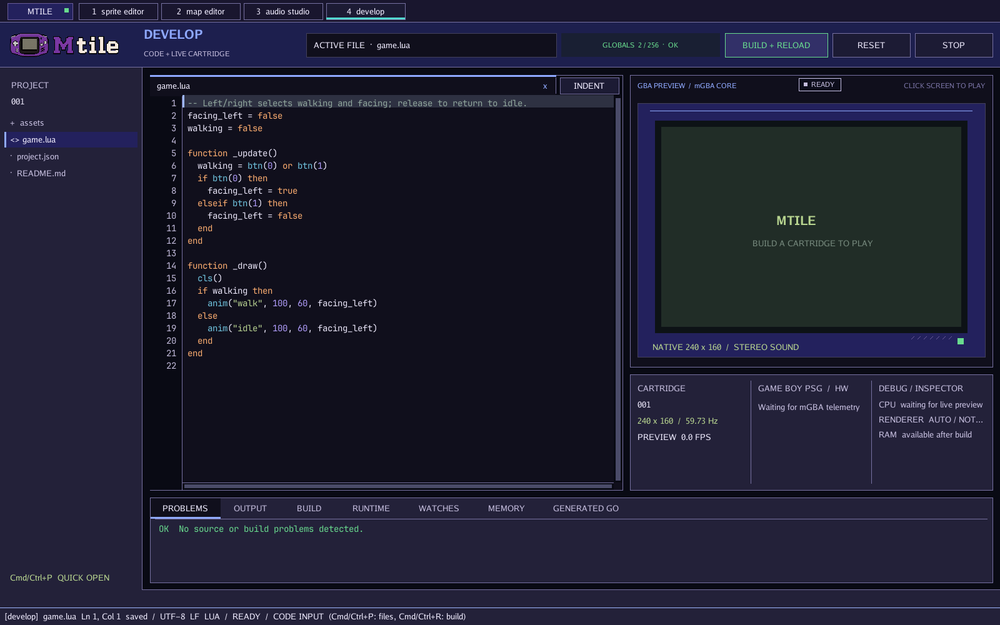

# Mtile IDE

Mtile keeps the complete game-making loop in one resizable Ebitengine
window. Its four workspaces share the same project model:

1. **Sprite Editor** paints shared tiles and poses, and assembles named animations. Shared
   tile 0 is the map eraser; animation tile 0 is paintable.
2. **Map Editor** places sprite cells on the GBA map.
3. **Audio Studio** authors the four Game Boy hardware channels available in
   the GBA: CH1 pulse+sweep, CH2 pulse, CH3 programmable wave, and CH4 noise.
4. **Develop** combines a multi-file Lua editor, build diagnostics, generated
   Go, and the live interactive cartridge in one workstation.

Use the tabs or Tab outside a text field to change workspace. Keys `1`–`4`
also switch workspaces, except in Map Lab where they select BG0–BG3. When the
cartridge preview owns keyboard focus, press Escape before using editor shortcuts.

## Find your workflow

Learning a feature for the first time? [Choose one small game](small-games.md)
with ready artwork and a visible checkpoint, then use the controls below
when you need them.

- [Paint tiles](#sprite-controls), [register poses](#register-a-pose), or [move artwork](#copy-or-move-artwork).
- [Recolor one pose without copying pixels](#color-variants).
- [Build and preview an animation](#register-and-preview-a-clip).
- [Paint maps and select background layers](#map-painting-and-layers), or [add/delete rooms](#map-rooms).
- [Compose music and gameplay effects](#audio-studio).
- [Edit, build, and play](#develop-controls), or [inspect memory](#memory-inspector).
- [Adjust text size, preview volume, and renderer](#preferences-and-readability).

The screenshots below are actual editor renders at 1600×1000 with COMFORT text.
They use checked-in examples, not interface mockups. The [capture notes](media/README.md#editor-screenshots)
identify each project and explain how to regenerate them.

## Saving your work

Ctrl/Cmd+S saves project assets in the graphics/audio workspaces and the active
source document in Develop. The bottom status line reports success or a failure.
Artwork, map cells, poses, variants, and clips support Ctrl/Cmd+Z; source files
have their own undo history. Registering or editing assets is separate from
rebuilding the cartridge: use **Build + Reload** after saving to test the result.

Keep project files under version control or make backups before large asset
migrations. Undo is session history, not a replacement for a disk backup.
Avoid editing the same asset JSON externally while an editor instance has it
open: a later editor save can replace external changes.

## Map painting and layers

Choose a tile or rectangular tile stamp in **Sprite Editor → Shared Tiles**,
then open **Map Editor**. Left-drag paints the selected stamp; right-drag erases
using transparent tile 0. Poses and animation frames are not map cells.

The BG0–BG3 buttons below the map select the plane you edit. BG0 is backmost;
BG3 is frontmost. Each eye control hides that plane only in the editor composite;
it does not change the game's Lua drawing calls. Painting affects the active
plane, not every visible plane. A legacy one-plane project expands to the
four-plane format on its first material edit to BG1–BG3.

Pan with the arrow keys/WASD or middle-button drag. Scroll over the canvas to
zoom around the pointer. **ROOMS** fits the full map so its room controls are
reachable. One room is 30×20 tiles, or 240×160 pixels; the header reports the
room grid and, while selected, the room coordinates.

### Move or copy a map region

1. Choose **MOVE AREA [M]** or **COPY AREA [C]** and drag a rectangle on the active layer.
2. Drag the selected region to its destination. Move removes the source on
   successful placement; Copy keeps it.
3. To transfer to another plane, click its BG button or press `1`–`4` while
   the region is selected. Transparent source cells merge into that target.
4. Release or press Enter to commit. If another target plane has occupied cells,
   hold Shift to explicitly confirm replacing them. Out-of-bounds placement
   is rejected.
5. Ctrl/Cmd+Z undoes the completed transfer. Escape cancels placement first,
   then clears the selection; pressing it with no selection returns to painting.
   Clicking the active area-tool button also returns to painting.

See [map storage and migration](map-assets.md) and [Lua drawing order](graphics-model.md#map-contract)
when connecting authored layers to your game.

## Map rooms

Try [Lantern Rooms](../examples/lantern-rooms/README.md) for a complete
two-room program that selects a room and places the keeper at its entrance.
The controls below edit the artwork; the lesson supplies the transition code.



Click **ROOMS** in Map Lab to show room controls. Click a room to select it;
**+ LEFT**, **+ RIGHT**, **+ ABOVE**, and **+ BELOW** grow the map by a
30×20-tile room column or row. Left and top additions move existing artwork
on all backgrounds together. Click **ROOMS** again to resume tile painting.

**DELETE ROOM** removes the selected room from a horizontal or vertical strip
and closes the gap. In a two-dimensional grid (or the final remaining room),
**CLEAR ROOM** empties only that room on all backgrounds, preserving neighboring
rooms and their coordinates. Ctrl/Cmd+Z undoes either action; Ctrl/Cmd+S saves.
These controls edit map artwork; game code still determines level transitions.
Rooms use 1-based coordinates in the GUI, while Lua map cells start at zero.
Room column 2 begins at cell X=30; row 2 begins at cell Y=20.

For example, drawing one room from a horizontal BG0 strip can use this fragment
inside `_draw()` after `cls(0)`:

```lua
-- room = 0 for the first room, 1 for the second, and so on.
map(0, room * 30, 0, -room * 240, 0, 30, 20)
```

The negative destination offset cancels the source-cell world offset, placing
that room at screen X=0. Your game chooses `room` and manages player spawn,
camera, hazards, and completion; adding artwork does not generate those rules.

The keyboard alternatives remain `]` to add a column on the right and `[` to
add a row below. Ctrl/Cmd with those keys shrinks the map by one room width
or height, clamped to at least one tile; shrinking crops artwork on every
plane. Use the room buttons for selection-aware delete/clear behavior.

## Sprite controls



The Sprite Editor keeps its everyday tools in one compact rail below the
pixel canvas. Pencil and Eraser support continuous click-drag painting. Fill
recolors one connected region; Line, Rectangle, and Circle use click-drag to
set their bounds. Hold Shift while releasing Rectangle or Circle to make a
filled primitive. Right-drag always erases, independently of the selected
tool.

| Action | Shortcut |
| --- | --- |
| Pencil / Eraser / Fill | P / E / F |
| Line / Rectangle / Circle | L / R / C |
| Flip selection horizontally / vertically | Shift+H / Shift+V |
| Copy / paste selected tiles | Ctrl/Cmd+C / Ctrl/Cmd+V |
| Cut selected tiles in Poses | Ctrl/Cmd+X |
| Paste in Poses (alternate shortcut) | Ctrl/Cmd+P |
| Resize the multi-sprite selection | Ctrl/Cmd+[ / Ctrl/Cmd+] |

In Shared tiles, the top-left spritesheet cell is sprite 0, the map's permanent transparent
eraser. A lock overlay marks it in both the sheet and pixel canvas; drawing,
fill, paste, primitives, and flips cannot modify it. The dashed spritesheet
grid remains a UI overlay and is never written into the game artwork.

## Poses and animations

Start with [Moth Study](../examples/moth-study/README.md) to draw one ready
pose and then play a clip. [Moon Door](../examples/moon-door/README.md)
introduces an action's own clock separately.

Use **Shared tiles** for map scenery and simple cells drawn with `spr`.
Use **Poses** for a complete authored character or object drawn with `pspr`,
even if it never animates. Use **Animations** when a sequence of those poses
should play at a saved speed with `anim`. Read
[when to use poses and animations](poses-and-animations.md) for the decision
table and examples before implementing frame selection or object assembly in Lua.

Sprite Lab separates three jobs:

- **Shared tiles** draws the bank used by `map`, `spr`, and `sspr`.
- **Poses** draws character artwork and registers complete poses for `pspr`.
- **Animations** assembles registered poses into named clips for `anim`.

OBJ pages are **512×320 pixels**, containing **2,560 8×8 tiles**. Like the
Shared tiles view, each page fills the available canvas. These are ROM artwork
pages, independent of the GBA's active OBJ memory. Mode 0's streaming path
stages the active pose working set; its immutable resident alternative holds
all statically reachable pose artwork in OBJ VRAM. OAM and scanline limits
still apply to the objects actually drawn. See the
[renderer contract](render-modes.md#implemented-mode-0-subset) for exact VRAM
and transfer rules.

**PAGE+** adds another page of the same size. When fewer source tile positions
remain, it adds a smaller final page: **512×192 pixels**. The full bank holds
**65,536 source tile positions** across 25 full pages and that final page;
PAGE+ is disabled once the bank is full. Switch with the tabs/arrows and click
the selected tab to rename it. Existing sheets are repacked into this layout
while retaining pose appearance, pose IDs and clip order. Page changes,
painting, pasting and undo update immediately, without restarting the editor.

### Register a pose



The page grid shows artwork without repeated name/ID labels or a permanent
colored border on every pose. Select a pose to identify it; its name remains in
**Registered Poses**, and the right-hand preview shows the complete pose.

1. Open **Poses** and choose a page.
2. Draw artwork, or copy a PNG and click **PASTE**. Its width and height
   must be multiples of eight and fit the selected page. Click to place it;
   Escape cancels. Imported colors use the project's palette.
3. Drag a rectangle around the complete pose on the page. The enlarged canvas
   at the left edits those pixels using the visible drawing/flip tools.
4. Click **REGISTER POSE**, type a name, and press Enter. Repeat for the other
   poses. The registered-pose strip lets you select and rename existing poses.

**UPDATE POSE** replaces the selected pose's tile selection. **DELETE POSE**
removes its registration and references from clips; it does not erase artwork.
Deleting a pose shifts later numeric pose IDs, so update any numeric `pspr`
references in Lua. Registering a pose refers to its existing source tiles;
registering two poses over the same tiles links their pixel edits.

### Copy or move artwork

In **Poses**, drag to select a rectangle of tiles, then use Ctrl/Cmd+C to copy
or Ctrl/Cmd+X to cut. Choose a destination page, or add one with **PAGE+**.
Press Ctrl/Cmd+P, Ctrl/Cmd+V, or **PASTE** to show a movable preview. Move the
pointer over the page and click to place it; Escape cancels. The entire
selection must fit inside the destination page.

Cut leaves the original artwork in place until placement succeeds. Clearing
the source and placing the destination form one undo step; canceling keeps
the original unchanged. Existing poses follow moved tiles, keeping their
appearance and animation references. If the source changed after cutting,
the move is rejected so newer edits cannot be erased. Undo and changing banks
cancel a pending cut.

Copied tiles keep their exact palette indices. Paste prefers your copied
selection over an older clipboard image; a newly copied external image takes
priority and uses the normal PNG import. Copies are independent artwork:
edit the new tiles, then click **REGISTER POSE** to make a separate pose for
an animation clip. Copying artwork does not duplicate its pose registration.

### Color variants

A variant is a named list of palette-index replacements, not another copy of
the pose pixels. Use it when geometry is identical and only the colors differ.
Keep separate poses when the silhouette, tile arrangement, or offsets change.



1. In **Poses**, select a pose from **Registered Poses** and click **COLOR VARIANTS**.
2. Click **NEW**, enter a unique name such as `alternate`, and press Enter.
3. The middle column lists only opaque colors used by the selected pose.
   Click a replacement's **CHANGE** button, then choose its new color. The full
   palette appears only while choosing a replacement.
4. Compare **ORIGINAL** and **VARIANT** previews. Selecting a color's original
   index resets that row; source pixels are never repainted.
5. **COPY** duplicates the selected variant under a new name; **RENAME** changes
   its name; **DELETE** removes it. **SAVE** or Ctrl/Cmd+S persists the project;
   **CLOSE** exits the dialog. Escape first closes a picker or naming action,
   then the dialog. Scroll to reach additional variants or used colors.

Variants are project-wide. The selected pose filters which rows are visible;
it does not limit the variant to that pose. Another pose using the same source
color will receive the same replacement when drawn with that variant. Color 0
stays transparent and is excluded from the replacement editor.

```lua
function _draw()
  cls(0)
  pvariant()                 -- original colors
  anim("idle", 40, 60)
  pvariant("alternate")
  anim("idle", 120, 60)      -- same geometry, different colors
  pvariant()                 -- avoid affecting later pose draws
end
```

`pvariant` affects subsequent `pspr`/`anim` calls and stays active across frames
until reset. It does not recolor `spr` or maps. Prefer names in Lua: numeric
variant IDs are 1-based and can change after deletion. Update Lua after renaming
or deleting a referenced variant; an unknown literal name fails the build.

Mode 0 can share 4bpp pixels with separate hardware palettes when its static
proof succeeds. Mode 4 compiles recolored artwork, so RAM/ROM savings differ
by renderer; this feature does not promise universal compression. See
[exact limits and fallback conditions](render-modes.md#pose-color-variants-pvariant).

To replace older recolored pose copies safely, keep the original assets until
you have changed the Lua and clip references, rebuilt, and checked every color
state. **DELETE POSE** only removes registration; it does not erase leftover
pixels. Removing unused artwork is a separate edit. Shared-sheet graphics may
still be referenced by map cells or `spr`; do not erase them merely because a
similar pose appears in the OBJ bank.

### Register and preview a clip



1. Open **Animations** and create a **NEW CLIP**. Name it, for example `idle`.
2. Open the pose dropdown, choose a registered pose, and use **ADD POSE**.
   The picker includes poses from every page. Repeat to build the sequence;
   a pose may appear more than once.
3. Reorder entries with the move controls. Removing an entry changes only this
   clip; it does not delete the registered pose or its artwork.
4. Set **FPS** and **LOOP**, then use **PLAY / PAUSE** or **STEP** to preview.
   A clip with Loop off stops on its final pose.
5. Click **REGISTER CLIP** to save it for game code. **SAVE CLIP** saves later
   changes. Ctrl/Cmd+S saves the whole project as well.

To draw the saved `idle` clip at its configured speed:

```lua
function _draw()
  cls(0)
  anim("idle", 100, 60)
end
```

The call draws the correct pose automatically using the game clock. To restart
an action independently for one character, store its start time and pass elapsed
seconds as the sixth argument:

```lua
-- When the character starts this action:
started = time()

-- In _draw():
anim("punch", x, y, false, false, time() - started)
```

The preview heading shows the clip's calculated width and height in pixels.
This area encloses all its poses and updates as you edit the clip. The optional
fourth/fifth arguments flip horizontally/vertically inside that fixed area:
`anim("idle", 100, 60, true)` faces the other way without changing the position.
mTile calculates the adjustment automatically when building; do not add a
width offset yourself. Standalone `pspr` calls use their pose's calculated area.
Use Loop off
for actions that should hold their final pose. Clips are saved in
`assets/animation.json`; builds compile their names, ordered pose IDs, speed and
loop behavior. See [the API reference](reference.md) for precise semantics.

### Tile reuse

**TILE REUSE** shows unique tile patterns and pixel-ROM savings. Select a tile
and enable **HIGHLIGHT MATCHING TILES** to mark equal cells, their page tabs,
and registered poses. Builds automatically store identical nonblank 8×8 pixel
patterns once and omit blank patterns. Editable copies remain independent;
poses referencing the exact same source tile share edits.

A full page fits 48 rectangular 40×80-pixel poses (12 across, four down).
Thirty such poses fit on one page per hero, so six pages comfortably hold six
heroes with 30 poses each. Animation clips can use poses from any page.

## Preferences and readability

Open **Preferences** with Ctrl/Cmd+`,`; **DONE** or Escape closes it.



| Setting | What it changes |
| --- | --- |
| Preview Audio | Desktop music, audition, metronome, and cartridge preview volume. Default 80%. It does not change the cartridge's saved sound levels. |
| Autosave Before Build | Default ON. Saves dirty source before building. OFF refuses dirty builds so you cannot accidentally test stale disk contents. |
| Interface Text | COMPACT, COMFORT (default), or LARGE. Changes editor labels and source font metrics without changing game pixels. |
| Project Renderer | AUTO, MODE0, or MODE4 for this project's builds. Forced Mode 0 rejects unsupported call shapes; AUTO can fall back to Mode 4. |

Use Ctrl/Cmd+`+` or `-` to change text size and Ctrl/Cmd+`0` to return to
COMFORT. Source uses JetBrains Mono with pixel hinting and an integer character
grid; increasing text size can help on dense displays. A horizontal scrollbar
can hide the start of every line: drag it fully left before assuming characters
are missing from the file.

The editor uses a clean, still interface. Older effect-level preferences are
normalized to CLEAN; there is no current F6 effect-cycle or Settings button in
the top-right corner. Teal indicates ordinary selection, while audio channel
colors identify CH1–CH4. Recording, errors, and build status have their own
meaningful colors.

Editor preferences live in the OS user configuration directory under
`mtile/editor.json`; renderer policy belongs to the project's `project.json`.
**RESTORE DEFAULTS** resets editor preferences, including volume and text size.

## Audio Studio



Use **MUSIC** for songs or **SFX** for standalone gameplay effects. Select a
channel at the left, place notes in the center, and adjust that channel's
instrument at the right. The strip below the grid arranges song parts or lists
SFX. **PLAY**/Space auditions; **STOP** ends playback or recording.

For a first effect, choose **SFX**, select a hardware channel, create an effect
with **+**, draw its notes, and save. The library card shows the exact stable
`sfx(id)` call to use in Lua. For a first song, select **MUSIC**, create/select
a song in the header, place notes, add parts with **+ NEW**, and save; start it
from `_init()` with `music(id)`.

Read the [Music Lab walkthrough](audio/editor.md) for note lengths, snap,
selection, presets, arrangement, MIDI, recording, and retained takes. The
[audio API](audio/api-v2.md) explains IDs and channel ownership. Preview volume
is separate from the game's instrument volume: adjust saved envelopes/wave
levels to balance effects against music, and use priority to decide which
sound may take a shared hardware channel.

## Develop controls



1. Open a file from the project tree or Ctrl/Cmd+P. The active tab names the
   document; its dirty marker means changes have not been saved.
2. Edit Lua, save with Ctrl/Cmd+S, and click **BUILD + RELOAD** (Ctrl/Cmd+R).
3. Follow the **Build** log. If the build fails, read **Problems** and fix the
   reported file/line. Successful builds reload the embedded cartridge.
4. Click the cartridge screen to play. Press Escape to return input to code.
5. **RESET** restarts the loaded cartridge; **STOP** ends it. Building again
   compiles the current saved project and replaces the preview.

The screenshot intentionally shows the state before a ROM has been built;
**BUILD A CARTRIDGE TO PLAY** is an instruction, not a broken preview.

| Action | Shortcut |
| --- | --- |
| Save active source / save all open sources | Ctrl/Cmd+S / Ctrl/Cmd+Shift+S |
| Quick-open a project file | Ctrl/Cmd+P |
| Build and run | Ctrl/Cmd+R |
| Reload file changed on disk | Ctrl/Cmd+Shift+R |
| Find | Ctrl/Cmd+F |
| API completion | Ctrl/Cmd+Space |
| Undo / redo | Ctrl/Cmd+Z / Ctrl/Cmd+Shift+Z |
| Copy / cut / paste / select all | platform-standard shortcuts |
| Indent / outdent selection | Tab / Shift+Tab |
| Format leading indentation | INDENT button / Shift+Alt+F |
| Move by word | Alt/Option or Ctrl/Cmd + arrow |

Double-click selects a word; triple-click selects a line. Shift-click extends
the selection. Dragging beyond the viewport scrolls it; wheel scrolling stays
where you put it until an editing/navigation command reveals the caret.
Shift+wheel scrolls horizontally. **INDENT** changes leading whitespace only,
preserving strings, numbers, and program logic, and is reversible with one Undo.

The project tree reflects real files. Static top-level `require("module")`
declarations resolve relative to the requiring file and then `src/`; missing
modules, traversal, absolute paths, and dependency cycles fail the build with
the source location. Each Lua document keeps its own cursor, selection, scroll,
undo, and dirty state. Saving uses an atomic replacement and refuses to
overwrite a file changed by another program until it is explicitly reloaded.

Develop's source badge reports `GLOBALS n / 256` from the complete explicit
`require` graph, including dirty text in every open document. The badge warns
at 224 fields, marks 256 as full, and blocks builds above the runtime limit.
Output lists each distinct persistent name and its first source position;
Problems lists every name beyond the limit. Top-level `local` state counts
because it persists in the generated game, while function locals, parameters,
loop variables, and fields inside a state table do not consume global slots.

Offsets are Unicode rune positions, so cursor movement and selection do not
split UTF-8 characters. Parser diagnostics use the same Lua parser as the
build, so a reported syntax error is not a separate linter's approximation.

Problems, Output, Build, Runtime, Watches, Memory, and Generated Go are real bounded views.
Generated Go is the exact build artifact and receives Go syntax color rather
than pretending to be editable Lua.

### Memory inspector

After **Build + Reload**, open **Memory** in the Develop debugger. The panel
grows to show the report while keeping the cartridge preview visible; scroll
inside it for details at smaller window or larger text sizes.

- **Cartridge / ROM** shows the complete built ROM and remaining space under
  mTile's 32 MiB ROM limit. This is a build limit, not a measurement of a
  physical cartridge's chip. ROM holds code and assets; it is separate from
  working RAM.
- **Pose library** shows registered poses/clips, actual linked OBJ pixels,
  and linked pose/clip/index arrays. Tile dedup compares painted source cells
  with unique pixel patterns; blank page capacity does not count as artwork.
  The array total excludes anonymous clip-name strings and alignment gaps.
- **Loaded now / pose cache** reports cached OBJ pixel bytes, cached windows,
  and the first four cached pose names/IDs, followed by a count if more remain.
  A cache window can retain a pose after the game stops drawing it. These are
  cache entries, not a list of currently visible characters.
- **OBJ upload / frame** is the actual number of OBJ tile bytes transferred
  in the latest completed presentation, including other sprites and any gaps
  inside a combined transfer. It excludes OAM. An unchanged pose can remain
  cached with **0 B** uploaded.
- **Runtime RAM** shows linker-measured main RAM (EWRAM) and fast RAM (IWRAM)
  use/headroom, including runtime state and reserved stacks. Pose staging is
  already included in these totals.
- **Why stream poses?** compares the unique artwork bytes that an
  all-artwork-in-RAM design would need with the actual linked pose staging
  buffer. It is an artwork-only comparison, not a second build or a measured
  total-game RAM saving. Other RAM and OBJ VRAM are excluded. No net saving is
  claimed for shared-sheet poses, absent buffers, or a library smaller than
  the staging allocation.

For example, Nerdo stores 10,752 bytes of unique OBJ pixels in ROM but reserves
only 2,816 bytes for pose staging. Its four idle poses retain 2,624–2,816 bytes
in OBJ VRAM as the clip advances; unchanged frames upload none. Keeping all
unique artwork in a RAM buffer would require 7,936 more bytes than that staging
buffer. Separately, merging identical source cells saves 64 bytes of pixel ROM.
These savings concern different memory pools and must not be added together.

Build figures belong to the last successful build, not unsaved artwork. Live
pose names are matched only to that same preview generation. Missing/older
telemetry and pending uploads are labeled unavailable rather than shown as
zero. Mode 4 explains that poses draw from ROM into the bitmap framebuffer;
it does not report a nonexistent hardware OBJ cache.

The cache scan and telemetry are preview-only. Native verification preserves
the release ROM byte-for-byte and checks actual LCD frame cadence as well as
pixel identity. See the [native debugger evidence](benchmarks/render-modes/pose-memory-debugger-v1/report.json).

The Runtime view receives live mGBA diagnostics, preview startup messages,
and mTile runtime failure messages. Lua memory failures also appear in
Problems with a suggested next step. Messages are bounded and belong to one
preview session, so stopped cartridges cannot write into a newer build's log.
Resetting or rebuilding allows the same failure to be reported again.

Logging is enabled only in editor preview ROMs. It covers mTile's explicit
runtime checks and startup failures; arbitrary TinyGo panics are not captured.
TinyGo 0.42's `mgbadebug` tag is currently incomplete for GBA, so mTile writes
directly to the emulator's debug registers while keeping its normal startup.

Building is asynchronous, so the UI remains responsive. A newer build or Stop
invalidates any older pending result; a late build can never replace the
cartridge the user most recently requested. Build + Reload selects the Build
view immediately, and the bezel banner keeps the current build/preview state
visible while the log fills below.

| GBA control | Keyboard |
| --- | --- |
| D-pad | Arrow keys |
| A / B | Z / X |
| Start / Select | Enter / Backspace |
| L / R | A / S |
| Rebuild and reload | Ctrl/Cmd+R |
| Release game input | Escape |
| Stop cartridge | Stop button |

The embedded game display uses nearest-neighbor scaling of the actual
240×160 emulator frame. Editor text and the game image have separate rendering
paths; changing interface text size does not resize the game framebuffer.

The inspector reads real VCOUNT/input state, CH1–CH4 PSG registers, frame/update/
draw counters, and a bounded set of named top-level Lua globals from a fixed
debug mailbox. The build's linker map supplies static/preallocated EWRAM,
remaining EWRAM headroom, and IWRAM use beside the live CPU budget. The host
audio queue is explicitly a desktop-preview transport; its startup grace
period is excluded from actionable dropout counts. Debug telemetry is included
only in editor preview builds and is absent from normal release ROMs.

Heap telemetry is separate from linker-measured EWRAM. `HEAP` is the current
bump-allocation cursor and can include unreachable garbage; `LIVE` is the byte
count retained by the most recent collection, while `PEAK`, `HANDLES`, and `GC`
show the largest observed live set, occupied handle slots, and collection
count. Health colour is based on `LIVE` after the first collection. A terminal
collector failure is shown in red, including `HEAP OOM` when the reachable
graph plus a requested allocation cannot fit in one 56 KiB semispace. Arbitrary
locals and source breakpoints are not claimed.

## Emulator architecture

The Develop surface does not contain a second Go-written emulator and does not
embed mGBA through cgo. The editor starts a hidden `mtile-player` process
built against the pinned mGBA core. A small versioned binary protocol carries
the GBA key mask to the helper and returns one 240×160 RGBA frame, 48 kHz stereo
PCM, hardware registers, and the bounded debug mailbox. Ebitengine owns the
only visible window and audio device.

This process boundary isolates native crashes, keeps mGBA headers out of the Go
application, and makes helper replacement explicit. The source, version, and
MPL notice are documented in [third-party/mgba.md](third-party/mgba.md).

## Release dependency policy

The release bundle contains:

- `bin/mtile`, `bin/mtile-editor`, and the native `bin/mtile-player`;
- the pinned TinyGo distribution under `toolchains/tinygo`;
- Mtile's Lua parser/transpiler and embedded GBA runtime;
- Mtile, mGBA, and TinyGo license notices.

The user installs only a compatible Go distribution as an additional
language/toolchain dependency. Lua, TinyGo, mGBA, CMake, SDL, and Qt are
implementation details of the bundle, not separate end-user prerequisites;
the operating system still provides its normal desktop graphics and audio
libraries. Maintainers create platform bundles with
[`scripts/release/build-bundle.sh`](../scripts/release/build-bundle.sh).
