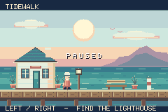

# Pausing a game

System pause is **disabled by default**. The programmer enables it during
actual gameplay and disables it on title, file-select, inventory or other menus:

```lua
pause(true)  -- Gameplay: Start pauses/resumes.
pause(false) -- Menus: Start belongs to the game.
```

`pause(enabled)` accepts one boolean and returns no values. Other types
leave the setting unchanged. The setting applies at the next engine input
poll. Enabling does not immediately pause. A Start press held across enabling
must be released and pressed again before it can pause, so using Start to
begin a game does not instantly freeze the new game.

When enabled, press **Start** to freeze the game and display **P A U S E D**
in the center; press Start again to resume. When disabled, `btn(6)` and
`btnp(6)` receive Start normally. The engine does not infer which screen is a
menu: the game chooses when pausing is available.



The enabled pause has no menu items, panel, controls footer, Save, Load or
Exit actions. Other buttons do nothing while paused. Game updates, drawing,
the game clock and button-repeat ticks stop; music continues. Buttons held
at resume must be released before they affect gameplay. Start itself is
reserved only while system pause is enabled (or its overlay is closing).

The fixed spacing, white letters and dark shadow cannot be restyled by Lua,
project fonts, camera, clipping or palette settings. The programmer controls
availability only. Disabling an active pause restores the game at the next
presentation window before gameplay runs again. Lua game updates themselves
remain frozen while paused.

The former `pause_menu` callback registration has been removed. Call the
[save API](saving.md#lua-api) from your own game menus. The
[three-file example](../examples/save-game/README.md) calls
`pause(mode == 2)` after each update: only its gameplay screen enables
pause. Start selects files and completes naming in its menus; Select opens
the game's Save/Load menu, where pause is disabled again.

The independent `save_pending()` reminder counts engine polls whether pause
is enabled, disabled or active; it never blocks Start from resuming.

## Renderer and hardware behavior

One private 64x64 4bpp hardware sprite contains only the centered message.
Pixels outside the letters and their shadow are transparent. Background
planes and framebuffers remain untouched; the relative order of game
sprites is preserved. Resuming restores borrowed tiles, OAM, palette entries
and display/blend controls exactly. About 5 KiB of fixed Context RAM holds
the overlay and backups; no Lua heap is required.

The existing system reservation remains even while pause is disabled, so
enabling it later is safe: Mode 0 allows 127 game OAM entries,
1,162 cycles on the worst scanline, and legacy `spr`/`sspr` source IDs 0..479.
Text uses physical OBJ cells 448..479, and the optional packed-sprite cache
uses 416..447. Authored text-sheet IDs remain 480..511.

Physical OBJ palette indices 241..245 and one 4bpp palette bank are reserved.
Mode 0 rejects conflicting 8bpp sprite colors, text colors or unproven sprite
mutations with `M0_PAUSE_PALETTE`; AUTO falls back to Mode 4. Background colors
are unrestricted. See the exact [renderer contract](render-modes.md).

[ARM parity and interaction checks](benchmarks/render-modes/pause-only-v2.md)
cover the message and restoration in both renderers. Physical GBA/EZ-Flash
verification remains pending; follow the [Omega procedure](saving.md#ez-flash-omega-procedure).
