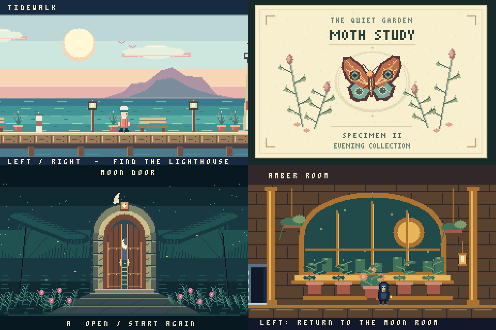

# Choose one small game

After your first edit → build → play loop, pick the feature you want next.
These four little games are independent: you do not need to finish them in
order, or read the graphics and renderer references before playing.

Every project includes ready artwork, a working `game.lua`, and complete
runnable lessons. Open its README, play first, then try one small change.
Each lesson has a visible checkpoint and a working version to return to.
Stop as soon as the idea makes sense.

| I want to learn… | Open this game | First visible checkpoint |
| --- | --- | --- |
| A map, then a following camera, then parallax | [Tidewalk](../examples/tidewalk/README.md) — a pastel coastal walk | One map displays the pier; the sailor is a separate sprite |
| A still pose, then a looping clip, then input and facing | [Moth Study](../examples/moth-study/README.md) — a botanical wing study | One saved pose appears; changing X moves the whole picture |
| An action that starts at frame zero and holds its ending | [Moon Door](../examples/moon-door/README.md) — a brass gate in a fern garden | Tap A to open; tap again to restart from the closed pose |
| Room selection, then crossing an edge and choosing a spawn | [Lantern Rooms](../examples/lantern-rooms/README.md) — an observatory and hanging garden | Switch rooms while the keeper uses the same local coordinates |

You can inspect the included art in the editor without drawing anything
first. Copy the selected lesson into `game.lua` and rebuild to run it; simply
opening a lesson file does not select the cartridge entry point. Each README
explains how to restore its shipped game and where to look up the exact API.

Need the tools first? Follow [getting started](getting-started.md).
For movement, pickups, sound, and a win condition, start with
[Coin Quest](first-game.md). The [example catalog](../examples/README.md)
also includes broader games and technical demos when you want to go further.
