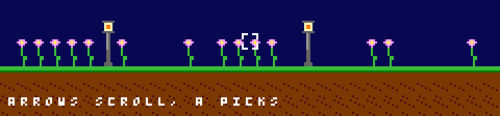
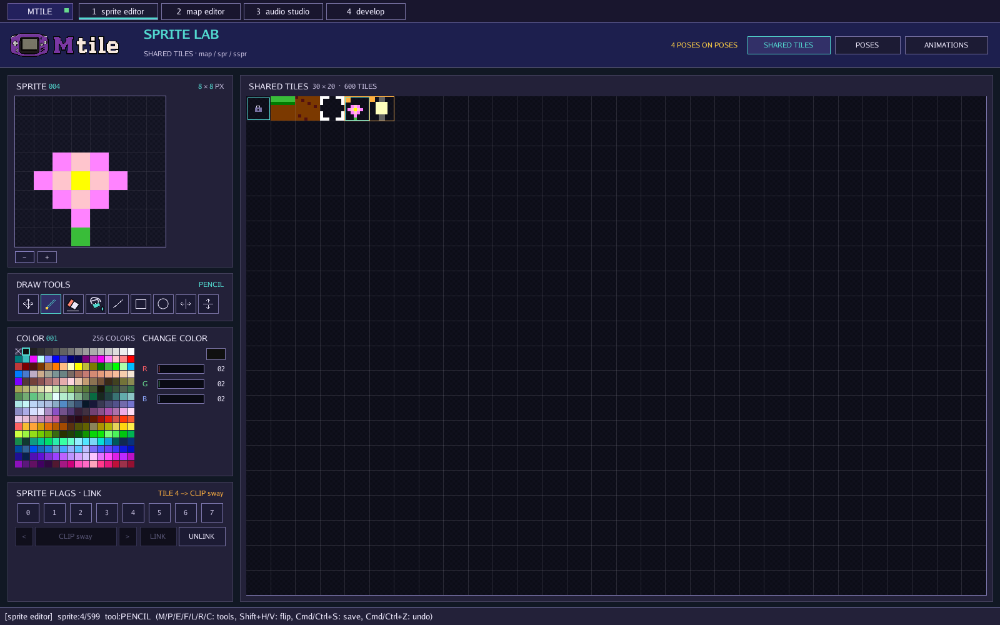
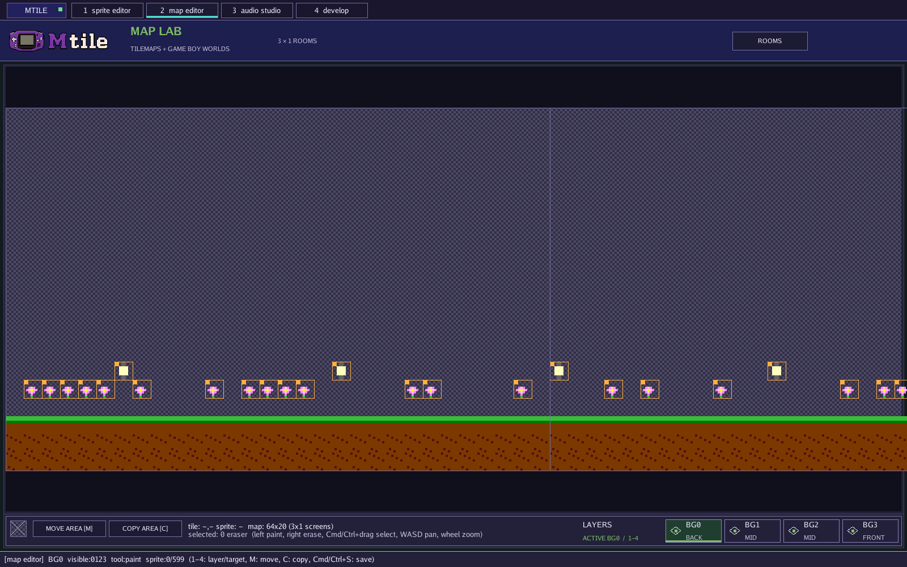

# Tile links: place poses and animations with the map editor

[Documentation index](README.md) · [Shared tiles, poses, and animations](poses-and-animations.md) · [Example: Windy Meadow](../examples/tile-links/README.md)

A **tile link** connects one shared tile to a registered pose or animation
clip. Wherever you paint that tile in Map Lab, `map()` draws the pose or plays
the clip instead of the tile. You place objects by painting them, and your Lua
code never draws them itself.

Use it for decorations and level objects that should be placed by hand and
look alive: flowers swaying in the wind, flickering torches, lamps, signs, or
coins that bob. Map cells can only hold shared tiles. Without links you would
scan the map for marker tiles at startup, store their positions in a Lua table,
and draw each one with `anim` every frame; a tile link does all of that for
you, faster, and without the 256-entry limit of a Lua table array.



The flowers keep swaying while the camera stands still and scrolls. This is
the actual Windy Meadow ROM: `map()` plays every linked clip without any
`anim` call in the game code.

## Try it

```sh
go run ./cmd/mtile edit examples/tile-links
```

1. In **Sprite Lab → Shared tiles**, select tile 4, the pink flower. The
   **SPRITE FLAGS · LINK** panel's header reads *TILE 4 -> CLIP sway*.
2. Open **Map Lab**. Every linked cell has an amber outline and corner mark.
   Hover one: the status line reads *sprite: 4 (draws clip sway)*.
3. In **Develop**, select **Build + Reload**. The flowers sway; scroll with the
   arrows and press A to pick the flower under the cursor.





## Link and unlink a tile

You need at least one registered pose or animation clip first; see
[when to use poses and animations](poses-and-animations.md).

1. In **Sprite Lab → Shared tiles**, select the tile to use as a marker. Paint
   it so it resembles the object; the art only appears in the editors.
2. In the **SPRITE FLAGS · LINK** panel, use **<** and **>** to choose a pose
   (*POSE 3 lamp*) or a clip (*CLIP sway*), then click **LINK**. The panel's
   header names the selected tile's link, or reads *NOT LINKED*.
3. Paint the tile in **Map Lab** wherever the object belongs, on any layer.
4. Save and build.

To remove a link, select the tile and click **UNLINK**; the map draws the tile
itself again. Only the action that applies is enabled: **LINK** and the
selector while the selected tile is unlinked, **UNLINK** while it is linked.
To link a tile to a different target, unlink it first. Both buttons act on
every tile in a multi-tile selection, just like the flag checkboxes, and both
can be undone. Tile 0, the map eraser, cannot be linked.

Links stay attached when you rename a clip. Deleting a clip removes its links.
Deleting a pose removes links to that pose and renumbers links to later poses,
the same way clip frames are renumbered.

## What the game does

Linked objects behave exactly as if your `_draw` called `pspr` or `anim` right
after the tiles of each `map()` call:

- **Position.** A linked object is drawn with its pose origin at its cell's
  top-left corner. Parts can extend beyond the cell, for example an 8×16 flower
  hanging into the cell below. Objects whose cell is just off screen still draw
  their visible parts.
- **Order and layers.** Each layer's objects draw after that layer's tiles, in
  row-major cell order, and before anything your code draws later. On a
  multi-layer map, objects on BG1 appear in front of BG0 and behind BG2.
- **Camera, clip, and colors.** `camera`, `clip`, `pal`, `palt`, and
  `pvariant` apply as they would to a `pspr` call at that point.
- **Flag filtering.** A `map` flag mask applies to the linked marker's current
  flags, just as it does to ordinary tiles. Omitted sizes include objects
  reaching in from any screen edge; positive sizes retain the requested
  source rectangle.
- **Animation timing.** Clips follow the default update clock, so every
  occurrence of a linked clip shows the same frame. To give some objects a
  different phase, link a second tile to a clip with a different frame order.
- **Gameplay.** The map still holds the linked tile, so `mget` and `fget` see
  it. Replacing it with `mset` removes the object, and writing another linked
  tile swaps it. Writing a linked tile with `mset` into a new cell creates an
  object there too.

From [Windy Meadow](../examples/tile-links/game.lua):

```lua
if mget(x, FLOWER_ROW) == FLOWER then
  mset(x, FLOWER_ROW, 0) -- replacing the tile removes its flower
  picked += 1
end
```

## Mode 0

Linked objects work in both renderers with identical pixels. In Mode 0 they
are hardware objects drawn through the same pose machinery as `pspr` and
`anim`, so the build must prove they fit:

- The compiler counts the most linked cells any screen-sized view of each
  `map()` call can contain, and budgets that many pose draws for the call.
  They share the 128 object entries and the per-scanline budget with your own
  sprites, poses, and text.
- Because that count comes from the map, **no `mset` may write a linked tile**
  in Mode 0. `mset` values must be literals, or finite sets the compiler can
  list, that are not linked. Removing linked objects by writing an unlinked
  tile such as 0 is fine. Expanded argument lists such as `mset(values())`
  require Mode 4 when the project has linked tiles.

When a rule fails, forced Mode 0 stops with an `M0_TILE_LINKS` diagnostic at
the offending call, and AUTO falls back to Mode 4. See the
[renderer contract](render-modes.md#linked-tiles). Windy Meadow uses forced
Mode 0: AUTO keeps its conditional `mset` on Mode 4 because only
unconditional `mset` calls have measured AUTO costs.

## Performance

The build stores every linked cell in a ROM index grouped by layer and map row
(6 bytes per linked cell, with 32-bit row offsets). Each `map()` call visits
only the rows it shows and binary-searches each row for the first visible column, so the lookup cost
follows what is on screen, not the size of the level. If `mset` places a
linked tile on a cell the index does not list, that layer switches to scanning
its visible cells, which keeps every placement exact.

Three lookups were implemented and measured on the same workloads, each with
its hot loop in IWRAM. Median cycles per 30 Hz tick, Mode 4, TinyGo 0.42.0:

| Workload | Map alone | Scan visible cells | List of all cells | Row index (chosen) |
| --- | ---: | ---: | ---: | ---: |
| One screen, 12 linked | 44,646 | 117,564 | 103,988 | 105,457 |
| One screen, 120 linked | 118,828 | 690,728 | 704,044 | 705,597 |
| 256×20 scrolling, 200 linked | 152,530 | 271,094 | 266,214 | 263,026 |
| 1024×20 streamed, 250 linked | 197,224 | 260,355 | 231,894 | 226,249 |
| 1024×20 streamed, 1,500 linked | 247,581 | 472,698 | 500,905 | 453,028 |

The row index was fastest in three of five workloads and within 2.2% of the
best in the others, and it is the only lookup whose cost does not grow with
map size or with the number of linked cells elsewhere in the level. Drawing
the objects dominates every column: about 5,000 cycles per 8×16 flower in
Mode 4, which is why 120 animated flowers on one screen exceed the budget no
matter how they are found. Mode 0 draws the same scenes much faster:

| Workload | Mode 4 median | Mode 0 median | Mode 0 objects |
| --- | ---: | ---: | ---: |
| One screen, 12 linked | 103,863 | 32,855 | 12 |
| 256×20 scrolling, 200 linked | 221,769 | 58,324 | 32 |
| 30×60 vertical scrolling, 90 linked | 244,303 | 78,710 | 37 |
| 1024×20 streamed, 250 linked | 221,412 | 30,832 | 18 |

Every workload matches a hand-written Lua version (scan, `mset`, `anim` in the
same order) frame for frame, and Mode 0 matches Mode 4 pixel for pixel. The
records and workload generator are in
[docs/benchmarks/tile-links](benchmarks/tile-links/README.md).

## Limits

- At most 255 linked tiles per project; any number of linked cells.
- Every occurrence of a clip shares one clock (see above).
- The experimental `-experimental-tilecanvas` build does not support links.

## File format

Links live in `assets/tilelinks.json`, sorted by tile. The editor writes it;
the file is absent when a project has no links.

```json
{
  "version": 1,
  "links": [
    { "tile": 4, "animation": "sway" },
    { "tile": 5, "pose": 3 }
  ]
}
```

Each link names exactly one target: a zero-based pose ID or a clip name.
Builds reject links to missing poses or clips, duplicate tiles, and tile 0.
