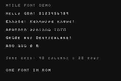

# Font demo

A native GBA text sample with English, modern Greek (including accents) and
German (including umlauts and ß). It selects `international`, so **one** font
contains all three repertoires. AUTO selects Mode 4 because the text is UTF-8.

```sh
go run ./cmd/mtile edit examples/font-demo
go run ./cmd/mtile build examples/font-demo
```

In the editor:

1. Open **FONT**, choose `greek`, `german` or `international`, and type a sample
   in Preview text. The preview identifies unsupported characters.
2. Enter `demo-font` in New font name and choose **COPY**. Select a character,
   change its pixels and watch the preview update. **BLANK** instead starts
   an empty international repertoire with a visible fallback question mark.
3. Try painting the spacing outside the 4×5 highlighted box: it is locked.
4. Choose **SAVE PROJECT**, close FONT, then Build + Reload in Develop. The
   next cartridge contains only the selected font. Existing text coordinates
   and its 6×8 grid are unchanged.

Use `international` to display the complete sample. Other selections deliberately
show fallback question marks for languages outside their repertoire. Missing
custom glyphs can be added using **SELECT / ADD**.



See the [font guide](../../docs/fonts.md) for the format, memory footprint,
control codes and limitations. Text must use precomposed Unicode (NFC).
For a renderer comparison, the [ASCII benchmark fixture](../../docs/benchmarks/fonts/ascii.lua)
uses the same selected font and remains eligible for Mode 0.
