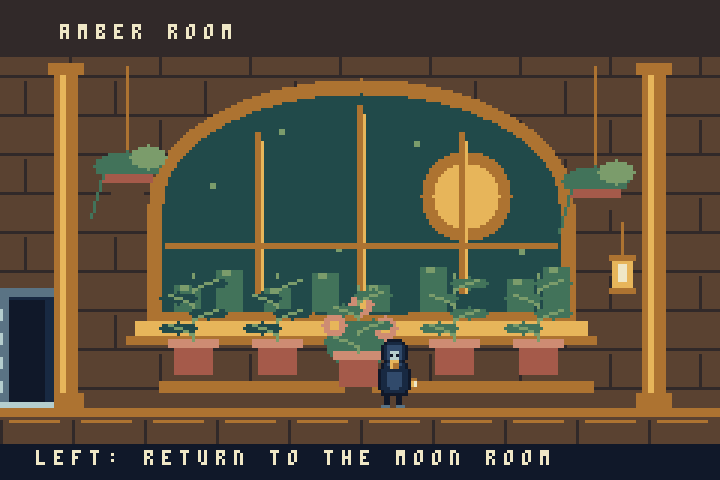

# Lantern Rooms

Carry a little lantern from a moonlit observatory into a warm hanging garden,
then find your way home. This miniature game teaches one distinction:
**Map Lab authors room artwork; Lua decides when to enter each room.**



[Watch the journey between rooms](play.gif).

## Play

From the repository root:

```sh
go run ./cmd/mtile edit examples/lantern-rooms
```

In **Develop**, choose **Build + Reload**, then click the GBA preview. Hold
**right** to walk through the amber doorway; hold **left** to come back.
Escape returns focus to the editor. The keeper uses one static registered pose;
the illustration is scenery, so walking past furniture does not imply collision.

**Checkpoint:** visit the Amber Room and return. The caption changes to
“HOME AGAIN.” The outermost edges keep you inside these two rooms.

## Learn one step at a time

Both files in `lessons/` are complete programs. Open one in **Develop** and
click **Run Lesson** beside the source tabs. The GBA preview shows the lesson
name. Choose **Back to My Game** to reopen `game.lua` and restart the game with
your current Lua edits.

### 1. Choose the room explicitly

Try `lessons/01-switch.lua`. Tap **Z** (GBA A) to switch between rooms.
The character stays still. Each switch also resets its spawn to X=24.
Holding A repeats after a delay; quick taps make each transition easier to see.

```lua
map(0, room * 30, 0, -room * 240, 0, 30, 20)
```

The map is one BG0 strip, **60×20 cells**, containing two 30×20 rooms.
`room = 0` reads the first 30 columns; `room = 1` reads the next 30. The
negative pixel offset places the selected room at screen X=0. Both rooms use
the same local player coordinates. No scrolling camera is involved.

**Checkpoint:** tap A twice. The scenery changes, then returns, while the
keeper appears at the same local position each time.

### 2. Let crossing an edge choose the room

Try `lessons/02-crossing.lua`. The map drawing stays the same. Left/right now
change `player_x`; crossing the inner edge selects the adjacent room and
places the keeper just inside its opposite edge. Crossing the outer edge
clamps the position because there is no third room.

**Checkpoint:** walk right into the garden, then left into the observatory.
Check that the keeper enters through the matching doorway each time.

## What Map Lab changes

Open **Map** → **ROOMS**. The editor labels the chambers as columns **1** and
**2**; Lua's `room` values are **0** and **1**. Adding a room in Map Lab expands
the artwork, but does not add a transition to this program. Its two-room rule
is written explicitly in `_update()`. That is the distinction this example
is designed to make visible.

The game uses one BG0 plane, one `pspr`, and text in forced Mode 0. It has no
animations, collision, gravity, entities, or audio to learn alongside room
selection. See the [Map Lab guide](../../docs/ide.md#map-rooms) for room controls.

## Assets and rebuilding

The two chambers, keeper, palette, and tile patterns are original artwork
created for this example. They use the repository's MIT license. Ready-to-edit
assets are included. Regenerate them with Python's standard library:

```sh
python3 examples/lantern-rooms/gen_assets.py
go run ./cmd/mtile build examples/lantern-rooms
```

Regeneration replaces artwork assets, so keep your edited project separately.
