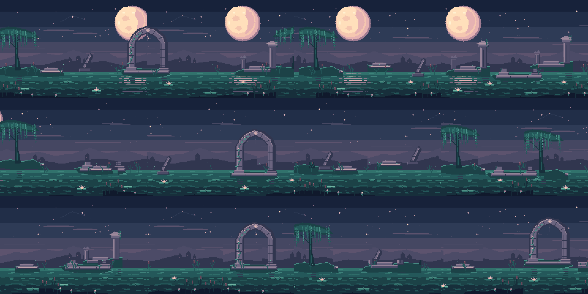
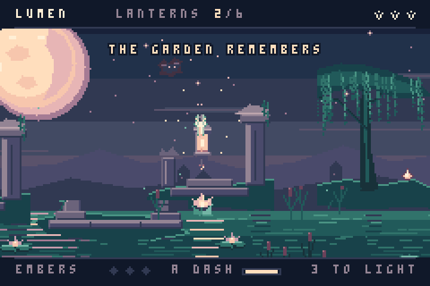
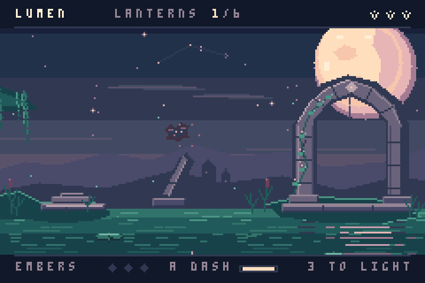

# Lumen · Keeper of the Tide

A little moth, eighteen lost embers, and twelve rooms waiting for morning.

Fly through an original moonlit garden, gather light, and kindle six
lanterns. Each restored lantern opens a flower, reflects on the water, and
becomes a safe place to return. Lighting the last one brings a rosy dawn.
There is no time limit.

The garden spans 2,880 pixels: **12 continuous screen-width rooms**, six times
the original level's length. Each pair of rooms has three embers and a lantern
checkpoint, with its own arrangement of willows, ruined columns, bridges,
islands, and moon gates. You can fly back through earlier rooms at any time.
Lanterns can be restored in any order; dawn celebrates at the last one you light.





From the repository root:

```sh
go run ./cmd/mtile edit examples/lumen
go run ./cmd/mtile build examples/lumen
```

The project explicitly selects **Mode 0**. The build must prove its hardware
budgets; it cannot silently fall back to Mode 4. To repeat that choice explicitly:

```sh
go run ./cmd/mtile build -renderer mode0 examples/lumen
```

In Develop, select **Build + Reload**, then click the preview for keyboard
focus. The build produces `examples/lumen/game.gba`, playable on a GBA
emulator or compatible cartridge.

## Controls

| GBA | Editor preview | Action |
| --- | --- | --- |
| D-pad | Arrow keys | Fly; diagonal movement has the same speed |
| A | Z | Dash in the held direction, or the direction you last faced |
| B | X | Light a nearby lantern with three embers |
| Start | Enter | Pause or resume |

Press A or Start on the title screen to begin. The bottom bar shows three
ember slots and dash recharge. Full hands leave other embers in the garden
until you have room. Approach an unlit lantern with three embers and press B
when its prompt appears.

The twelve drifting purple shadows cost one of your three wing marks when touched.
Dashing through one disperses it for five seconds. The dash recharges in
about a second and a half. Lanterns restore your wings. If all three marks
are lost, A returns to the last lantern while keeping gathered embers and
restored lanterns; the camera glides back before flight resumes. B begins a
fresh journey. After the dawn, A starts again.

## Poses and animation clips

The moth, embers, shadows, lanterns, flowers, glints, particles, and interface
are registered **poses** on the separate OBJ page. The draw code uses `pspr`
for a static recipe and `anim` for a saved clip. It contains no sprite-sheet
coordinate arithmetic or hand-selected animation frames.

| Clip | FPS | Behavior |
| --- | --- | --- |
| `moth-flight` | 10 | Four wing poses, looping |
| `moth-dash` | 18 | The same authored wing poses at a faster rate |
| `ember-glow` | 5 | Four ember poses, looping |
| `shadow-drift` | 4 | Two shadow poses, looping |
| `lantern-lit` | 6 | Three flame poses, looping |
| `bloom-opening` | 6 | Three opening poses, then hold the last |
| `dash-recharge` | 6 | Nine meter poses, then hold full |

Open **Sprite Lab → Poses** to inspect a recipe and edit its source pixels.
Open **Animations** to step through a clip or change its order, FPS, and loop
setting. The Lua calls keep using the saved name. Animation flips use the
clip's combined bounds; no per-frame position correction is needed.

Explicit elapsed seconds give the flower and recharge meter their own
playback timing. Ambient clips use the game's paused clock. The `glow` color
variant warms world objects during dawn, then resets before drawing the HUD.
The compiler can keep the immutable reachable pose bank resident in OBJ VRAM,
pack rectangular poses into larger hardware objects, and share their pixels
across palette variants. The forced build proves the actual allocation.

## Four hardware backgrounds

Each explicit `map` call observes its own camera. The layer speeds are relative
to the moth's following camera:

| Plane | Artwork | Camera rate |
| --- | --- | --- |
| BG0 | Sky bands, slow star, and seven dawn views | 1/8 |
| BG1 | Moon, stars, clouds, distant hills, water, moonlight | 1/4 |
| BG2 | Garden islands, moon gate, columns, willows | 1 |
| BG3 | Foreground reeds, lilies, dark banks | 1.125 |



The visible map is a compact **64×60-cell display cache**. The complete
12-room scenery lives in generated numeric lookup functions in ROM. As the
camera crosses a tile, `src/landscape.lua` copies the incoming column with
`mset`. Each 32-column neighborhood is duplicated side by side. A constant
64×20 map rectangle and a camera that wraps every 256 pixels keep the visible
31 columns continuous across the ring seam. Incoming cells patch the cached
hardware map without rebuilding it. A second bank prepares the opening garden
in advance, so restarting needs no full map refill. Dawn resets the sky one
update before swapping those three terrain banks, keeping their uploads in
separate VBlank windows.

BG0 contains an extended sky strip that warms from blue through rose to peach.
Dawn moves through seven views of this strip using map source/destination
offsets, without changing palette or tile pixels at runtime. All 15,360 display
map cells stay below the native streaming threshold. The four layers therefore
retain the compact map path throughout the larger journey.
This respects the current four-background-plus-native-audio renderer contract,
which rejects runtime `pal` and `sset` writes.

All four maps are unconditional direct submissions in `_draw()`. Objects are
drawn afterward with one screen-space camera: world positions subtract the
following camera, while the HUD stays fixed. This keeps the compiler's
scanline proof precise. Decorative ripples, light bursts, lettering, and panel
backgrounds are authored tile/pose pixels rather than raster primitives.

## Follow the code

- `game.lua` owns callbacks, flight, dash, collisions, inventory, checkpoints,
  the four map passes, and game-state transitions.
- `src/state.lua` loads the numeric game state first, keeping live values
  visible in Develop's debug inspector.
- `src/world.lua` stores fixed geometry, compact ember/lantern bitsets, flower
  timing, and three reusable analytical particle bursts.
- `src/landscape.lua` maintains the two map banks and incoming parallax columns.
- `src/terrain.lua` contains generated ROM lookups for the complete level;
  the generated source uses no Lua tables or heap.
- `src/draw.lua` presents the world and interface using poses and saved clips.
- `src/art.lua` contains generated pose constants, keeping numeric IDs out of
  the handwritten presentation code.
- `assets/spritesheet.json` contains only the shared background tiles.
- `assets/objsheet.json`, `poses.json`, and `animation.json` contain the
  independently authored objects, recipes, color variant, and clips.
- `assets/audio/` contains an original 48-second, four-channel PSG score and
  five effects. Music and gameplay share the hardware channels.

## Rebuild the artwork and music

The authored JSON is included, so Python is not needed to play or build.
The generators use only the Python standard library and are deterministic:

```sh
python3 examples/lumen/generate_assets.py
python3 examples/lumen/generate_audio.py
```

JSON can be edited in Sprite Lab; rerunning the artwork generator restores
its original authored assets and pose constants. It also writes enlarged
previews into `/tmp`. Map Lab shows the compact display cache; the full room
compositions are authored in the artwork generator, which also rebuilds the
numeric terrain lookups. Hear the music independently with:

```sh
go run ./cmd/mtile render-audio -o /tmp/lumen.wav examples/lumen
```

## Verify a complete journey in both renderers

With the repository's native `mtile-player` built, the optional harness builds
forced Mode 0 and Mode 4 ROMs and drives them with identical ordinary button
input. It compares every pixel and game watch at matched logical frames,
checks all 12 rooms, 18 embers, six lanterns, pause, checkpoint recovery,
reverse travel, a distant checkpoint return, dawn, and restart,
and records the layer formulas, hardware proofs, timing, screenshots, and a
native parallax GIF:

```sh
go run ./examples/lumen/tests/verify.go \
  -player build/player/mtile-player -out /tmp/lumen-verification
```

It also builds a temporary clock-rollover fixture and checks that eight frames
after the wrap match a fresh cartridge at the same animation phases.

The harness requires zero pixel differences, zero missed deadlines after
startup, no Lua heap, and at least 140 KiB of free EWRAM. Every flight update
must fit the 561,792-cycle budget. The hardware proof uses four BGs,
105/128 OBJ entries, and 1,176/1,226 scanline cycles.

The native reference journey compared 7,114 frames (273,177,600 pixels) with
zero differences and zero missed deadlines. Its maximum flight update took
269,572 cycles; the release cartridge leaves 157,984 bytes of EWRAM free.

Mode 4 is a verification reference, not the project's renderer policy.
All game code, artwork, and music were created for this example and use the
repository's [license](../../LICENSE).
