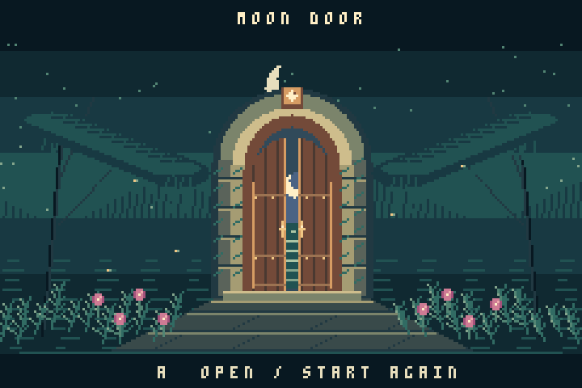

# Moon Door — start an animation at the beginning

A brass moon gate waits in a fern garden. Tap **A** to open it and reveal the
little garden beyond. Tap A again to watch the same action from its beginning.
This miniature teaches one thing: **an action needs its own elapsed time**.



## Play

From the folder containing the [downloaded examples](../README.md#run-an-example), run:

```sh
mtile edit examples/moon-door
```

In **Develop**, select **Build + Reload** and click the preview. **Z is GBA A**.
The shipped `game.lua` is the complete first lesson; its assets are ready.

**Checkpoint:** A opens the door, the last pose stays visible, and another tap
starts again at the closed pose. There is no movement, collision, or room change
to learn alongside the clock.

## 1. Give one action its own clock

Read [lessons/01-open.lua](lessons/01-open.lua). Pose **0** is the closed door.
The saved clip **open** contains poses **0–5**, runs at **8 FPS**, and has LOOP
off. Inspect it in **Sprite Lab → Animations**.

`anim` does not store a playhead for the door. Its sixth argument is elapsed
seconds. A resets `opening_ticks` to zero; each subsequent update adds one.
The usual approximately 30 updates per second make `opening_ticks / 30` the
action's elapsed time. The counter is bounded; the nonlooping clip holds its
final pose when that time exceeds its length.

Try changing `opening_ticks / 30` to `opening_ticks / 15`, save, and rebuild.
**Checkpoint:** the same saved sequence plays twice as fast. Restore `/ 30`.
You can stop here.

## 2. Optional: pause that clock

Open [lessons/02-pause.lua](lessons/02-pause.lua) in **Develop** and click
**Run Lesson** beside the source tabs. The GBA preview shows the lesson name.

Tap **Z** to open and quickly tap **Enter** (GBA Start) midway through the action.
Tap Enter again to resume.

**Checkpoint:** the door freezes on its current pose and continues from there.
Only the gameplay counter stops. The engine's shared animation clock would
continue even if `_update()` returned early, so the explicit elapsed argument
is what makes this pause work.

`btnp` repeats when a button is held; use quick taps for these experiments.
The game owns `opening` and `paused`; the clip owns its frame order, FPS, and
LOOP setting. A visual clip does not decide whether a door is passable.

Choose **Back to My Game** to reopen `game.lua` and restart the game with your
current Lua edits.

## Artwork and renderer

The forest, stonework, and distant garden are one authored BG0 map. Only the
folding brass leaves are poses. All pixels are preauthored native assets; Lua
does not paint them each frame. The project requests Mode 0.

Original artwork and generator are included under the repository's MIT license.
Regenerate the saved assets with Python's standard library:

```sh
python3 examples/moon-door/gen_assets.py
```

The screenshot is captured from the actual ROM. See [capture.json](capture.json)
for its hash and input sequence. For signatures and clock semantics, see
[poses and animations](../../docs/poses-and-animations.md#ambient-loops-and-actions-need-different-clocks).
