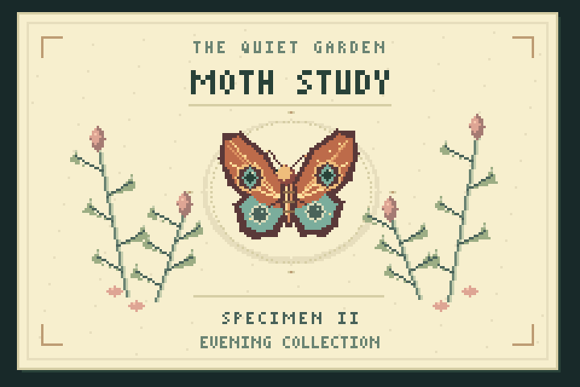

# Moth Study

A copper-and-seafoam moth rests on an original botanical plate. Hold left or
right to stir its wings and turn its head; release to let it rest. The moth
stays in place: this example teaches pictures and playback, then state and
facing. Its background is already painted in Map Lab.



*Captured from the actual ROM. [Capture details](capture.json).*

Open from the repository root:

```sh
go run ./cmd/mtile edit examples/moth-study
```

Select **Develop → Build + Reload**, click the preview, and use the arrow
keys. Escape returns keyboard focus to the editor.

## Try one lesson at a time

Each file in `lessons/` is a complete program using the included artwork.
Save your own edits separately, then copy a lesson's entire contents into
`game.lua`, save, and **Build + Reload**. Opening a lesson alone does not
select it as the entry point. To restore the final example, copy
`lessons/03-facing.lua` into `game.lua`.

### 1. One still picture

Use **`lessons/01-pose.lua`**. `pspr("rest", 88, 48)` draws the pose named
`rest` in the editor. A pose is one complete picture, even when its artwork
uses many tiles. The build resolves the name to its current index.

**One edit:** change `88` to `96` in that call and rebuild.

**Checkpoint:** the still moth moves eight pixels right. Its wings do not
animate, and arrows do nothing in this lesson. You can stop here.

### 2. Play a saved sequence

Use **`lessons/02-loop.lua`**. The pose call becomes
`anim("flutter", 88, 48)`: the saved clip chooses its frames and speed.
There is no frame-selection arithmetic in the game.

**One edit:** in **Sprite Lab → Animations**, select **flutter**, click the
FPS **−** four times to change **10 → 6**, then click **SAVE CLIP**. Return
to Develop and **Build + Reload**.

**Checkpoint:** the wings keep folding and opening, more slowly. You changed
playback without editing Lua. Restore 10 FPS if you prefer the original pace.
The clip has **LOOP** enabled, so it repeats.

### 3. Let input choose the clip and facing

Use **`lessons/03-facing.lua`**, the default game. `_update` records whether
an arrow is held and which direction was last chosen. `_draw` uses that
state: held arrows select `flutter`; releasing them selects the slower `idle`.
The fourth argument mirrors the complete picture when `facing_left` is true.
Look at the head and antennae to see it turn.

**One edit:** change only `"idle"` to `"flutter"` in the final draw branch
and rebuild.

**Checkpoint:** releasing an arrow now keeps the fast wing sequence playing,
because both branches select it. Facing still follows left/right. Restore
`"idle"` afterward. Animation does not move the moth: the draw position remains
`(88, 48)`.

## Optional: register one picture of your own

Return to lesson 1. In **Sprite Lab → Poses**, choose **Moth studies** and
paint a small flower in one empty 8×8 cell below the moth artwork. Drag a
rectangle around that cell, click **REGISTER POSE**, name it `flower`, and
press Enter. Save the project.

Replace `"rest"` in the draw call with `"flower"`, or select the flower in
**Registered Poses** and click **COPY LUA CALL**. Save and rebuild.

**Checkpoint:** your flower appears on the botanical plate. You registered
one picture and drew it; no animation clip was needed. Deleting other poses
does not change this named call. Renaming or deleting `flower` makes the build
report the missing name at the draw call.

## Included assets

- `assets/map.json` places the botanical plate's shared tiles on one BG plane.
- `assets/objsheet.json` holds the moth artwork, separate from terrain tiles.
- `assets/poses.json` registers `rest` (0), `breathe` (1), `open` (2), `half`
  (3), `folded` (4), and `half-return` (5).
- `assets/animation.json` saves **idle** (poses 0–1, 2 FPS) and **flutter**
  (poses 2–5, 10 FPS); both loop. Those names must exist before building.

All pictures are original to this example. The project requests **Mode 0**;
Lua draws the preauthored tiles and poses with `map`, `pspr`, and `anim`.
It does not paint the scene pixel by pixel at runtime.

To rebuild the ROM or regenerate the original artwork:

```sh
go run ./cmd/mtile build examples/moth-study
python3 examples/moth-study/gen_assets.py
```

Regeneration replaces edited asset files and writes an authored-art proof to
`/tmp/mtile-moth-study-art.png`; keep a copy of your asset changes first. It
needs only Python's standard library. The native ROM capture above is preserved.

For the next question, see [when to use poses and animations](../../docs/poses-and-animations.md).
