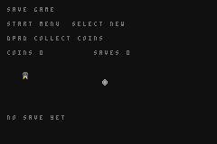

# Save Game

A dedicated cartridge-save example: walk to a coin, open the common pause
menu, save progress, and resume after switching a real GBA off and on.



*Actual ROM output. Physical power-cycle verification is pending.*

```sh
go run ./cmd/mtile build examples/save-game
```

Copy `examples/save-game/game.gba` to your compatible flash cartridge. The
project uses AUTO rendering; the shared menu and save API work in Mode 0
and Mode 4.

| Control | Action |
| --- | --- |
| D-pad in the game | Move and collect coins |
| Start | Open Load / Save / Exit |
| Up/Down, A | Choose and activate a menu item |
| B or Start | Resume once the save wait has ended |
| Select in the game | Start a new run in RAM; the old save remains until Save |

The example connects `store_game` and `restore_game` with `pause_menu`.
Save stores position, coins, coin location, and successful-save count;
Load restores them. SAVES advances only after a verified write. Holding A
does not keep saving. After a failure, progress stays in RAM and selecting
Save again retries. Failed loads leave the run untouched. Selecting Save
intentionally replaces damaged or incompatible saved data.

The menu's five-second Omega wait continues while the game clock is frozen.
Resuming becomes available when the reminder clears; another successful Save
restarts the wait. Exit ends the session and shows POWER OFF OR RESET. If a
save is still within that wait, it first shows PLEASE WAIT. This is a timed
reminder, not confirmation that the Omega's SD write has finished.

## Try it on EZ-Flash Omega

1. Back up your existing SAVER folder. Use the example's own ROM filename.
2. Launch with CLEAN BOOT. Leave SAVE TYPE on AUTO; if save detection fails,
   select SRAM. This ROM includes the standard SRAM identifier.
3. Collect a coin, press Start, select Save and press A. Record the player and
   coin positions, COINS and SAVES.
4. Wait for the five-second reminder to clear before resuming or powering off.
5. Fully power off/on and launch the same ROM. Expect LOADED with the same
   positions and counts.
6. Move without saving, then choose Load in the Start menu. Resume and check
   that the saved position returned.
7. Save a different position and count; repeat the power-cycle test.

The original Omega's [official manual](https://www.ezflash.cn/omega.html)
requires a delay after saving and recommends counting to five. Mtile checks
cartridge-visible bytes but cannot confirm the microSD flush has completed.
Do not deliberately interrupt SD writes to test recovery: that can damage
the save file or filesystem.

**Physical verification is pending.** Record the real-device run in the
[hardware result form](hardware-results.md). The [shared menu guide](../../docs/pause-menu.md)
covers every game; the [saving guide](../../docs/saving.md) documents the API,
record format, failure handling and software verification.
