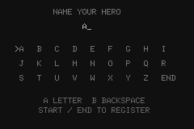
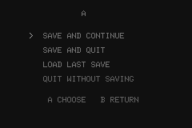

# Save Game: three named files

A dedicated cartridge-save example with a player-file menu inspired by the
original Game Boy Link's Awakening. Choose one of three independent files,
enter a name, play, and save back to that file. All menus are ordinary Lua
code in [game.lua](game.lua). The fixed Start pause is enabled only in gameplay.


## Reference and scope

Nintendo's original instruction booklet describes three player files,
registration of a name up to five letters, and returning to the file picker
before starting the adventure. Its saving screen offers Save and Continue,
Save and Quit, and Continue Without Saving. It also describes file copy and
erase. See the [original manual transcription, pages 6–8 and 25–26](https://zelda.pocitac.com/zgbmanual.shtml.htm).

This example implements the three named files, registration flow, per-file
progress, Save and Continue, Save and Quit, Load Last Save, Quit Without
Saving, and confirmed erase. It uses original Mtile assets and does not
reproduce Zelda's game, artwork, file-copy screen or checkpoint rules.
A or Start selects a player file. **Start**, or choosing **END** with A,
finishes naming. Menus keep Start because system pause is disabled there.
Load restores the saved position in this small coin game.

## Build and play

```sh
go run ./cmd/mtile build examples/save-game
```

The example uses AUTO, which selects **Mode 4** because its names are dynamic
strings. Forced Mode 0 rejects them with `M0_PRINT_SHAPE`, preserving exact
text semantics. Numeric saving and the fixed pause message support both
renderers; their separate ARM parity workloads cover Mode 0 as well.

| Screen | Controls |
| --- | --- |
| Gameplay only | Start pauses/resumes, showing only P A U S E D |
| Player files | Up/Down selects; A or Start opens an existing file or creates an empty one |
| Name entry | D-pad selects letters; A adds one; B backspaces (or cancels when empty); Start or END + A registers |
| In the game | D-pad moves and collects coins; Select opens the game's own menu |
| Game menu | Up/Down selects; A activates; B or Start returns to play |
| File picker, occupied/unreadable file | Select requests erase; A confirms, B cancels |



In the editor preview, **Enter/Return = Start**, **Backspace (Mac Delete) =
Select**, **Z = A**, and **X = B**. Click the running game to focus it.

`pause(mode == 2)` runs after updates: file selection, naming, the
game's own menu, saving and erase confirmation all keep system pause disabled.
Start used to enter gameplay must be released before a new press can pause.

Names contain 1..5 uppercase letters. Registration immediately commits the
new file, waits for the Omega reminder and returns to the file picker.
Select the named file again to begin playing. Occupied files are loaded
rather than overwritten; unreadable files remain untouched until confirmed
erase. The active file number and hero name stay visible during play.



- **Save and Continue** commits to the active file, waits, then returns to play.
- **Save and Quit** commits to that file, waits, then returns to the file picker.
- **Load Last Save** validates and restores that file's saved progress.
- **Quit Without Saving** returns to the picker without writing.

“Quit” here returns to the example's file screen. There is no system Exit
operation or flashcart-launcher return. The saving screen's **PLEASE WAIT**
clears after the 150-poll reminder; it is not a hardware completion signal.

## Storage and failures

The example uses slots **0, 1, 2** with the common key `mtile-three-files-v1`.
Every write passes `active_slot` explicitly. Fields are:

| Field | Value |
| --- | --- |
| 0 | 1 for a player file, 0 for a committed empty file |
| 1 | Name length |
| 2..6 | ASCII letters encoded with `ord`, reconstructed with `chr` |
| 7..8 | Player x/y |
| 9 | Collected coins |
| 10 | Coin x position |
| 11 | Successful saves (including registration) |
| 12..63 | Zero / reserved by this layout |

Each slot has two recovery records. They protect one logical player file;
no other slot is modified by Save or Erase. Erase writes a valid empty
payload, so an old backup does not reappear on the next load.

A failed write keeps the run and name in RAM, leaves the save count unchanged,
and displays failure for another explicit attempt. A failed/invalid load does
not replace the running hero or position. The game checks every field before
applying it. Runtime errors retain their negative status; `-6` is this
example's own invalid-payload result. Holding A cannot repeat saves.

This payload uses a new key. Saves from the earlier single-file example are
reported as unreadable, not silently reinterpreted. Back up that save if
needed; deliberately erase the selected file to replace it.

## Test on the original EZ-Flash Omega

1. Back up your SD card's `SAVER` folder. Copy this ROM under its own filename.
2. Launch with **CLEAN BOOT**, SAVE TYPE **AUTO** (or SRAM if necessary).
3. Create file 1 named ALPHA. Wait for the file picker, open it and collect coins.
4. Use Select → Save and Quit. Wait for the file picker before power-off/reset.
5. Create file 2 named BETA and file 3 named GAMMA, each with different progress.
6. Fully power off/on, launch the same ROM, and open each file. Check its name,
   position, coins and save count independently.
7. Change one file and save again. Confirm the other two did not change.
8. Test Load after unsaved movement, erase cancellation, and confirmed erase.
   Recreating an erased file must leave the other two intact.

The [official Omega manual](https://www.ezflash.cn/omega.html) recommends
counting to five after saving. Wait for this example's reminder before
power-off/reset. It verifies cartridge-visible bytes but cannot confirm
microSD completion; do not deliberately cut power during an SD flush.

**Physical verification is pending.** Record a real-device run in the
[hardware result form](hardware-results.md). The [saving guide](../../docs/saving.md)
documents the API and recovery protocol; the [pause guide](../../docs/pause-menu.md)
documents the fixed Start behavior.
