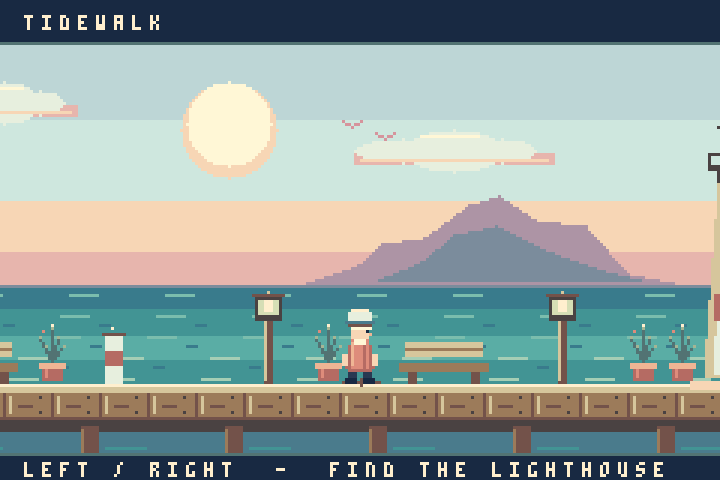
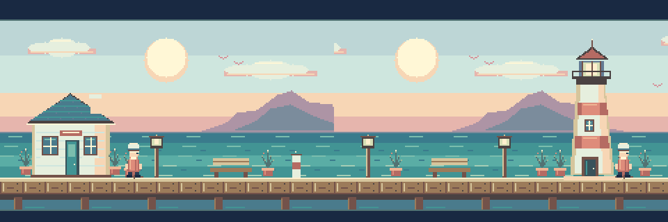

# Tidewalk — one map, then a camera, then parallax

A quiet morning walk from a seaside cottage to a lighthouse. The painted
clouds, glazed windows, flowerpots, timber pier, and striped tower are ready
assets. Your only control is **left/right**. Reach the lighthouse, then walk
home; there is no score or failure state.



The image above is a capture of the running cartridge.

Three small lessons share the same artwork. Start with one map; add the camera
only after that makes sense; add the distant shore last. `game.lua` initially
contains the final lesson so you can play the finished walk immediately.

## Play first

Run these commands from the mTile repository root:

```sh
go run ./cmd/mtile edit examples/tidewalk
```

In **Develop**, click **Build + Reload**, then click the preview so it receives
the arrow keys. Hold right to reach the lighthouse; hold left to return. The
world ends at both edges. The camera stops there too.

## 1. One map

Close the editor before copying a lesson, then reopen it:

```sh
cp examples/tidewalk/lessons/01-map.lua examples/tidewalk/game.lua
go run ./cmd/mtile edit examples/tidewalk
```

Build + Reload. Walk to the striped harbour marker on this first screen.

The important line is `map(1)`. It draws the already authored **BG1** map.
Each map cell refers to an 8×8 tile in the spritesheet; the scenery is stored
in `assets/map.json`, not drawn with rectangles in Lua. The sailor uses
`spr(1, x, 98, 2, 4, left)`: a ready 2×4-tile image, with an optional flip.
Movement is already supplied so you can concentrate on the map.

**Try one change:** replace `map(1)` with `map(1, 0, 0, 8, 0)` and rebuild.
The whole map shifts eight pixels right, while the sailor stays in place.
Restore `map(1)` afterward.

**Checkpoint:** you can point to the line that displays the landscape and the
separate line that displays the sailor. You can stop here.

## 2. Follow the sailor with a camera

Close the editor, select the next lesson, and reopen:

```sh
cp examples/tidewalk/lessons/02-camera.lua examples/tidewalk/game.lua
go run ./cmd/mtile edit examples/tidewalk
```

Build + Reload, then walk right past the harbour marker. The map was already
60 tiles wide: **480 pixels**, or two GBA screens. This lesson widens the
sailor's allowed X range and adds these lines around the same map/sprite draws:

```lua
local scroll = mid(0, x - 112, 240)
camera(scroll, 0)
-- The existing map and sailor draws go here.
camera(0, 0)
```

`camera` subtracts its position from world coordinates. The `mid` clamp keeps
the view inside the 480-pixel landscape. Resetting it before `print` keeps the
title and instructions attached to the screen.

**Try one change:** change `112` to `80`. The camera now follows with the
sailor closer to the left side, leaving more coast visible ahead. Restore
`112` before the next lesson.

**Checkpoint:** the coast scrolls, the title stays still, and neither edge
reveals space beyond the map. You can stop here.

## 3. Give the distant shore a slower camera

Close the editor, restore the final lesson, and reopen:

```sh
cp examples/tidewalk/lessons/03-parallax.lua examples/tidewalk/game.lua
go run ./cmd/mtile edit examples/tidewalk
```

Build + Reload and make the same walk. This lesson adds only two lines before
the existing `camera(scroll, 0)`:

```lua
camera(flr(scroll / 4), 0)
map(0)
```

**BG0** holds the sky, sun, clouds, and distant headlands. **BG1** holds the
cottage, sea, pier, and lighthouse, with transparent space above the sea.
Both maps are 60×20 tiles. BG0 is drawn first, then BG1; the slower shore is
visible through BG1's transparent cells. The sailor uses the foreground
camera, and the text still uses the reset camera.

**Try one change:** replace `/ 4` with `/ 2`. The headlands move faster and
feel closer. Use `/ 1` to compare equal speeds, then restore `/ 4`.

**Checkpoint:** while the camera follows, compare a pier lamp with a distant
headland. Both move left as you walk right, but the headland moves less. That
difference is parallax. Nothing in the movement code changed.

## Files and artwork

The lessons contain **17, 20, and 22 lines**, including comments and spacing.
There are no action timers, animation clips, collisions, pickups, audio, or
room transitions to read past. Those belong to other lessons.

`project.json` requests **Mode 0**. All visible scenery comes from prepared
tilemaps; the sailor comes from the prepared spritesheet; the HUD uses text.
[`lessons/01-map.lua`](lessons/01-map.lua) uses only BG1;
[`lessons/02-camera.lua`](lessons/02-camera.lua) scrolls that same plane;
[`lessons/03-parallax.lua`](lessons/03-parallax.lua) adds BG0. The project
contains no runtime tile editing.

The authored overview below shows the landscape at the start and end, without
the HUD. It is generated from the artwork, rather than captured from the ROM.



Regenerate the ready assets and authored overview with:

```sh
python3 examples/tidewalk/gen_assets.py
```

Regeneration preserves the native `preview.png`; a separate enlarged artwork
proof is written to `/tmp/tidewalk-art.png`.

The generator uses only Python's standard library. All pixel artwork was
created for this example, without imported image assets. Artwork, generator,
and Lua lessons follow the repository's [MIT license](../../LICENSE).
