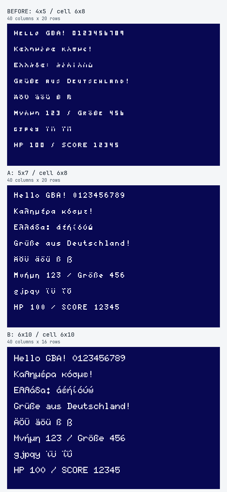

# Font typography: size and cost study

**Historical pre-selection study at commit `a1e0fad`. B has since been approved
and implemented; current results are in [production-b.md](production-b.md).**
The user requested visual and performance evidence before choosing a new size.
All candidate runtime edits are generated in an artifact directory, outside the
working runtime. The normal font editor still enforces 4×5 / 6×8.



The three screenshots use identical text, pixel coordinates and 240×160
framebuffers. They are captures from actual TinyGo cartridges running in mGBA,
not host-font mockups. Only nearest-neighbor zoom is applied to this figure.
Open the [native before](results/preview-0.png), [A](results/preview-1.png), or
[B](results/preview-2.png) image to judge the original pixel size.

## Choices

| | Current | A: same grid | B: taller text |
| --- | ---: | ---: | ---: |
| Bitmap bounding box | 4×5 | 5×7 | 6×10 |
| Advance/cell | 6×8 | 6×8 | 6×10 |
| Full-screen grid | 40×20 | 40×20 | 40×16 |
| Full cells | 800 | 800 | 640 |
| Bottom remainder | 0 pixels | 0 pixels | 0 pixels |
| Nominal cap height | 5 | 6 | 7 |
| Nominal lowercase x-height | about 4 | 4 | 5 |

The bitmap box is the allowed extent, not a claim that every character fills it.
A improves ordinary lowercase and Greek/German accents/descenders while keeping
all current cell metrics. B keeps 40 columns but cuts rows from 20 to 16
(20% fewer cells). It requires a vertical layout migration. Neither is installed as a supported
preset by this experiment.

The current Greek accent generator shifts the base down and masks to five
rows, dropping the original last row. In particular `ά` loses the closing
bottom stroke of `α`, and `ή` loses the descender of `η`. This explains part of
the current visual problem. The larger source fonts contain distinct complete
precomposed glyphs instead of generating accents by cropping the base.

## Measured before/after

Environment and source fingerprints: [metadata.json](results/metadata.json).
Measurements: **ARM7TDMI cycles in mGBA**, TinyGo 0.42.0, Go 1.27.1. These are
not physical-GBA measurements. Each run discards 20 runtime frames and captures
120 distinct profile frames. Mode 0 comparisons match exact runtime-frame IDs.
The common scene has eight identical static UTF-8 lines, at identical positions,
with a full `cls(24)` every frame. These are whole-frame median cycles.

| Implementation | Cycles/frame | vs current | vs optimized 4×5 control | Whole ROM | Font ROM data | EWRAM used | IWRAM used |
| --- | ---: | ---: | ---: | ---: | ---: | ---: | ---: |
| Current 4×5, value lookup | 186,767 | — | — | 28,140 B | 1,024 B | 7,520 B | 11,392 B |
| Control: 4×5, ROM pointer lookup | 154,121 | −17.5% | — | 28,168 B | 1,024 B | 7,520 B | 11,508 B |
| A: 5×7, ROM pointer lookup | 165,499 | −11.4% | +7.4% | 30,432 B | 1,436 B | 7,520 B | 11,632 B |
| B: 6×10, ROM pointer lookup | 189,804 | +1.6% | +23.2% | 39,112 B | 2,416 B | 7,520 B | 11,236 B |

**Larger glyphs do not inherently make rendering faster.** A's net improvement
over today's code combines improved artwork with a separate lookup change.
The control isolates that change: returning a pointer to ROM glyph columns
avoids per-character aggregate copies. With the same optimized lookup, the
candidate artwork and larger bitmap representation cost 7.4% for A and
23.2% for B in this scene. Results depend on text, clipping and renderer; they are not universal speed ratios.

The unoptimized larger-array probes are retained in the raw results: A takes
205,870 cycles; the roomier B probe takes 235,617. This is why the experiment
did not mistake an avoidable ABI copy cost for an unavoidable typography cost.

A's whole ROM grows **2,292 bytes**, including font data and generated/runtime
code. Its font bank itself grows **412 bytes**; IWRAM grows **240 bytes** and
EWRAM stays unchanged. B grows **10,972 ROM bytes**, with **1,392 bytes** of
extra font data. Reporting just the bitmap bytes would understate the cost.
Every ELF is checked for one selected font bank in cartridge address space;
no default font bank is retained. Bitmap data is never copied into EWRAM.
The string-rendering host probe reports zero allocations for all candidates.

The font-bank layout uses the existing struct representation: ASCII columns
plus a slice descriptor and sorted Unicode entries. Five-column entries incur
alignment padding, while ten-row columns need `uint16`. This is one measured
implementation, not a lower bound on a future packed format.

## HUD and Mode 0

The ASCII HUD has a changing decimal score and a full 40-character line. The
same amount of text is printed by all variants, including the same 40-column row.

| | Current | Optimized 4×5 control | A | B |
| --- | ---: | ---: | ---: | ---: |
| Mode 4 median cycles | 75,255 | 69,911 | 73,569 | 83,308 |
| Mode 0 median cycles | 33,068 | 33,068 | 33,068 | Unimplemented |

For A, the existing 8×8 OBJ tile holds all 5×7 pixels. It still uses one OAM
entry and one 64-byte tile per glyph/color pair, with the same 32-tile bank.
Across empty, HUD and edge fixtures, A's Mode 0 and Mode 4 captures have **zero
differing pixels in 360 paired frames**. There is no measured steady-state
HUD CPU increase in Mode 0. Startup validation cost is not characterized by
these warm steady-state samples.

B cannot use the current one-8×8-tile text implementation. An 8×16 OBJ would
require two tiles per pair (16 pairs in the existing bank) and a new scanline
budget proof; two 8×8 OBJs would instead increase OAM use. No Mode 0 eligibility
claim is made for B. Unicode text still requires Mode 4 in every candidate.

## Capacity stress

The dense scene fills every complete row with the same 26-character Greek/
German line. This is a **capacity test**, not an equal-text benchmark: current/A
print 520 glyphs in 20 rows; compact B prints 416 in 16 rows.

| | Current | Optimized 4×5 control | A | B |
| --- | ---: | ---: | ---: | ---: |
| Frame cycles | 725,125 | 561,965 | 608,445 | 569,613 |
| Missed target frames during 120 samples | 120 | 120 | 120 | 120 |

The 30 Hz budget is 561,792 cycles. Full-page text redraws are already too
expensive in the current engine. A retains 40×20 capacity but does not make
redrawing 520 glyphs every frame free. Dialogue/static text should be drawn
when it changes rather than rewritten with `cls` every frame. That application
optimization is not implemented here. See the [current](results/before-dense-mode4.png),
[A](results/same-grid-pointer-dense-mode4.png) and
[B](results/compact-grid-pointer-dense-mode4.png) dense captures for leading.

## Bounds, API and pause checks

The temporary runtime host tests check ink pixel-for-pixel against an
independent row-major oracle at the bottom/right edges, negative origins,
three camera offsets and four clip rectangles. They include all ASCII plus
Greek/German accents and descenders. Partial glyphs are clipped without writing
outside the 240×160 framebuffer. Controls, background cells, tab stops, wrap,
return coordinates, implicit cursor position and UTF-8 fallback are checked.
Invalid high bitmap rows are rejected.

A retains six-pixel horizontal advance, eight-pixel line advance and the exact
current text metrics. The final full cell starts at (234,152); its five ink
columns and seven rows fit. This does not mean arbitrary off-screen coordinates
are moved back on-screen: clipping remains clipping, and logical `print()`
return coordinates remain logical coordinates. In particular, arbitrary old
pixel anchors still need review: a 4×5 glyph at y=155 used to fit, while a
seven-row glyph there is safely clipped. A full 5×7 bounding box needs x≤235
and y≤153, while the preserved full-cell grid remains x≤234/y≤152. Keeping
cell metrics does not guarantee every hand-positioned old label remains uncut.

B retains pixel coordinates, call signatures, six-pixel horizontal advance
and tab stops. It changes line/wrap vertical advance and cursor y movement
from eight to ten pixels. Existing y coordinates need review; old y=152 text
can be clipped because ten ink rows no longer fit. The last full row begins
at y=150, and all 16 rows fill the screen exactly.

The mandatory pause overlay also uses the selected font. Its current renderer
reads five rows. The A prototype reads seven while retaining its compact
five-pixel pause advance: all existing English pause glyphs fit in four ink
columns. Every fixed label is checked against the full bitmap and all ink
fits 64×64. Captures include [paused](results/same-grid-pointer-pause-paused.png),
[save failure/wait](results/same-grid-pointer-pause-save-failed.png) and
[session ended](results/same-grid-pointer-pause-ended.png). These are direct
captures of the runtime's packed pause raster, rather than a live button-input
hardware smoke test. B's pause-layout check is explicitly **skipped** because
it needs redesign: natural six-pixel spacing makes an eleven-character label
65 pixels wide, and its current bottom message can reach row 66.

Logs: [current](results/before-host-tests.txt),
[A](results/same-grid-pointer-host-tests.txt),
[B](results/compact-grid-pointer-host-tests.txt).

These are prototype proofs at the stated scope, not a compatibility signoff for
every game. Generated text atlas pixels are substituted in the probe toolchain;
the production font schema/compiler/editor are untouched. A production change
must still migrate the full font pipeline, test reserved-sheet glyph aliases,
update the renderer contract and run its complete merge gates. B additionally
needs a Mode 0 fallback/new resource proof and a working pause layout.

## Roomier arrangement also measured

The same 6×10 font was additionally tested in an **8×12 cell**. It has 30×13
full cells (390, 51.25% fewer than today) and four unused bottom pixels. Its
[preview](results/roomier-8x12.png) has looser horizontal tracking. It takes
191,164 cycles / 39,192 ROM bytes in the common scene. Dense-page cost is
470,714 cycles, but only 338 glyphs are drawn, so that result does not establish
an equal-text speed advantage. The raw results keep both layouts. The main
comparison favors the natural 6×10 cell so the larger font preserves 40 columns.

## Source and licensing

Candidates subset the exact same **174 codepoints** as the current
`international` preset from public-domain Misc Fixed sources:

- [5×7 BDF](https://raw.githubusercontent.com/olikraus/u8g2/master/tools/font/bdf/5x7.bdf):
  SHA-256 `6cdcaa87c2b22517a8265e3f5ea103a36d64642a9a727a7aeb6e1e9bc3961bdf`.
- [6×10 BDF](https://raw.githubusercontent.com/olikraus/u8g2/master/tools/font/bdf/6x10.bdf):
  SHA-256 `d61fc0a144077b59599d128f31de5c01a7a8a426cf2456d581ba4421af092e19`.

Both BDF headers declare public-domain status. Both lack capital `ẞ` (U+1E9E),
so the subsets contain an explicit original mTile research glyph for it, under
the [repository license](../../LICENSE). It is not silently aliased to `ß` or
replaced by `?`. No game font assets were copied. The original PICO-8-derived
bitmap remains under its existing CC0 notice.

## Reproduce

For these historical experiments, first check out `a1e0fad` in a separate
directory. The patch scripts deliberately target that older 4×5 runtime.
For current production use `go run ./research/font-typography -production
-out /tmp/mtile-font-b-production`.

From the historical repository root, with TinyGo, the built headless player, Python 3 and
Pillow available:

```sh
go run ./research/font-typography -out /tmp/mtile-font-geometry
python3 research/font-typography/render.py /tmp/mtile-font-geometry
go test ./research/font-typography
python3 research/font-typography/probe_test.py
```

`-variants same-grid-pointer` reruns just A; `-variants compact-grid-pointer`
reruns just B. The default also runs value-copy candidates and the optimized 4×5 control. Use a fresh output directory for a complete
comparison after production source changes; partial reruns retain other records.
Source subsets are committed, so no
font download is needed. `probe.py extract` optionally rebuilds those subsets
from checksum-verified `/tmp/mtile-font-5x7.bdf` and `-6x10.bdf` plus the exported
baseline JSON. `main.go -export` exports that baseline only.

The runner copies the runtime into each output variant, strips unrelated tests,
patches only those copies, runs geometry/pause host probes, builds real ELF/ROM
pairs through a research TinyGo wrapper, validates each ROM, and captures paired
profile frames. The production renderer/font validators deliberately reject the
research-size font documents. The generated artifacts are not a supported new
font API or editor import format.

Local preview ROMs are written by `render.py` as `results/preview-before.gba`,
`preview-a.gba` and `preview-b.gba` (ignored build artifacts). They show the
candidate pixels; B's unfinished pause/Mode 0 support is not production ready.

Production regression gates also passed on 2026-10-29, with no production
source diff:

```sh
go test ./internal/transpiler ./internal/build ./cmd/mtile
(cd runtime && go test ./...)
```
