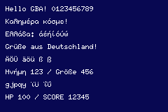

# Approved B: production verification (2026-10-29)

B is now the production geometry: **6×10 bitmap and advance, 40×16 cells**.
Tests were committed first in `cbf9427` and observed failing against the
previous implementation. This report measures the actual production runtime,
without the temporary runtime/source patches used in the original study.



## Before/after: identical Unicode workload

Both runs use TinyGo 0.42.0, Go 1.27.1 and the same local headless mGBA helper.
The eight lines, coordinates, colors and per-frame clear are identical.
Discard 20 runtime frames, then capture 120 distinct profile frames. These are
emulated ARM7TDMI cycle measurements, not physical hardware measurements.

| | Before 4×5 | Production B 6×10 | Change |
| --- | ---: | ---: | ---: |
| Median frame cycles | 186,767 | 189,804 | +1.6% |
| Whole ROM | 28,140 B | 39,516 B | +11,376 B |
| Selected font in ROM | 1,024 B | 2,416 B | +1,392 B |
| EWRAM used | 7,520 B | 7,520 B | 0 B |
| IWRAM used | 11,392 B | 11,236 B | −156 B |
| Runtime print allocations | 0 | 0 | 0 |

B's cycle measurement matches the approved prototype. Its final ROM includes
404 more bytes than the prototype, including the completed system menu.
The net +1.6% includes the ROM pointer lookup optimization; against the same
optimized 4×5 control (154,121 cycles), B costs **23.2%** more. Larger glyphs
require more rendering work; the pointer change avoids aggregate copies.

The [original measurements](results/measurements.json) and
[production measurements](../../docs/benchmarks/fonts/b/measurements.json)
([environment](../../docs/benchmarks/fonts/b/metadata.json)) include ROM SHA-256, p95, draw/commit cycles, memory and missed frames.
These workload-specific results do not promise the same ratio for every game.

## Completed Mode 0 support

Each glyph retains its 6×10 bitmap and cell. If bitmap rows 8/9 are blank,
Mode 0 uses one **8×8 OBJ** and one 64-byte tile; otherwise it uses one vertical
**8×16 OBJ** containing two consecutive tiles. No ink is cropped. Physical OBJ
reservation stays 448–479: up to 32 compact pairs, 16 tall pairs, or a mixture
within 32 physical tiles. Sorted glyph/color pairs pack consecutively; authored
aliases 480–511 expose the same tile sequence, with unused cells cleared.
OAM use stays one entry per occurrence. The resource proof counts actual 8/16-row
spans, including overlap between adjacent ten-pixel lines. A build fails or
falls back with `M0_OBJ_BUDGET` when capacity is exceeded; Unicode remains
`M0_PRINT_SHAPE`.

The complete regression suite caught existing tutorials falling back with the
initial two-tiles-for-every-glyph design. A new failing capacity test was added
before implementing this lossless packing. Coin Quest and Celeste retain Mode 0
eligibility without reducing the reserved sprite area. The Save Game sample's
instruction is now “MOVE TO COLLECT”, removing one unused capital-letter pair
so its decimal dot's lower pixel also fits the 32-tile bank. Gameplay and input
remain unchanged. Font selection is explicitly installed before atlas startup
validation; a generated-code regression checks that order.

| Production scene | Mode 4 cycles | Mode 0 cycles | Paired frames | Differing pixels |
| --- | ---: | ---: | ---: | ---: |
| Empty | 24,058 | 599 | 120 | 0 |
| ASCII HUD and changing score | 78,013 | 33,711 | 120 | 0 |
| Screen edges, wrap, negative origins, descenders | 40,932 | 10,843 | 120 | 0 |

Frames are paired by exact runtime frame ID. The new HUD uses `HP` plus the
same decimal number path and a complete 40-character `HP12` row; its 14 pairs
fit the 32-tile bank. It differs from the old study's `SCORE`/`ABCD` workload,
so the old HUD numbers are not a valid before/after comparison.
[Mode 0](../../docs/benchmarks/fonts/b/hud-mode0.png) and
[Mode 4](../../docs/benchmarks/fonts/b/hud-mode4.png) captures match.
No steady-state glyph upload is needed. One selected 1bpp font also serves the
system overlay; the atlas is a derived renderer cache.

The dense capacity test redraws 416 glyphs in 16 rows and takes **569,613
cycles**, exceeding the 561,792-cycle 30 Hz budget (120 misses in 120 samples).
The old 520-glyph, 20-row test was also over budget. Full-page redraw cost
remains a limitation; applications should redraw static dialogue when it changes.
No application-level text cache or runtime font switching is introduced.

## Regression coverage and reproduction

Coverage includes strict dimensions and ten-bit columns, approved glyph pixels,
legacy padding/metadata/edit migration, runtime clipping against an independent
full-frame oracle, UTF-8 and controls, all ASCII glyphs in all presets versus
the full 8×16 atlas, tile reservations, 32 compact and 16/17 tall-pair boundaries, scanline overlap,
one-font ELF linking, editor painting/persistence/undo, and all pause states.
The system menu stays inside its existing 64×64 OBJ and keeps its input rules.

```sh
go run ./research/font-typography -production -out /tmp/mtile-font-b-production
go test ./internal/transpiler ./internal/build ./cmd/mtile
(cd runtime && go test ./...)
(cd runtime && go test -tags 'mtile_mode0,mtile_mode0_layers0,mtile_mode0_obj,mtile_mode0_text' ./...)
go test ./internal/luaparser ./internal/assetsync ./internal/editor ./research/font-typography ./cmd/renderbench
MTILE_FONT_SCREENSHOTS=/tmp/font-editor go test -tags mtile_editor_bench ./cmd/editor -run TestFont -count=1
MTILE_FONT_DEMO_CAPTURE=/tmp/font-demo go test ./research/font-typography -run TestFontBDemoCapture -count=1
```

Run historical before/control probes at commit `a1e0fad` in a separate checkout;
the old patch-based harness refuses to mislabel the new default as “before”.
See the [migration guide](../../docs/fonts.md#existing-projects-and-version-1-fonts)
for explicit behavior changes and compatibility limits.
